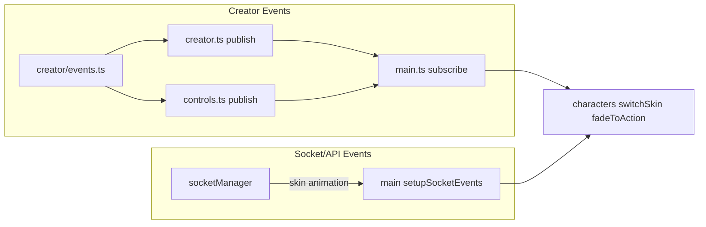
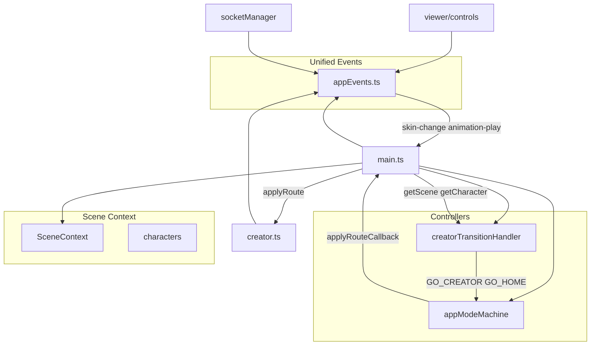

# Phased Main-Creator Refactoring Plan

This plan targets [src/main.ts](src/main.ts) and [src/creator.ts](src/creator.ts) based on the relationship analysis. Each phase is self-contained, ends with a build checkpoint, and produces agent-facing documentation.

## Current State / Progress


| File           | Size         | Notes                                                          |
| -------------- | ------------ | -------------------------------------------------------------- |
| **main.ts**    | ~1,744 lines | Many responsibilities; orchestration + domain in a single file |
| **creator.ts** | ~1,299 lines | Many responsibilities; orchestration + domain in a single file |


**Partially completed:** Some extractions have been started but not finished. Existing modules include: `creator/modePanels.ts`, `creator/layerVisibility.ts`, `creator/canvasCoords.ts`, `controllers/previewRoute.ts`, `controllers/characterTypes.ts`, `controllers/transitions/creatorTransitionHandler.ts`, `domain/characters.ts`, `events/appEvents.ts`, `config/scene.config.ts`, `creator/shortcuts.ts`. The focus is to complete the refactor so that creator.ts becomes a lean facade and main.ts becomes a bootstrap/wiring entry point.

---

## Build Checkpoint (Every Phase)

After each phase, run:

```bash
npm run build
```

If the build fails, fix before proceeding. Optionally run `npm run dev` and smoke-test: viewer, creator (wardrobe/2d/3d), preview, skin change, animation play, Design/Home buttons.

---

## Phase 1: Unified Event System

**Goal:** Single event bus with a clear naming convention, replacing the split between creator events (document CustomEvents) and socket/API handlers.

**Current state:**




**Deliverables:**

1. **Create [src/events/appEvents.ts](src/events/appEvents.ts)** (new module)
  - Export event name constants: `app:<domain>:<action>` (e.g. `app:creator:canvas-change`, `app:character:skin-change`, `app:character:animation-play`)
  - Export typed `publish(event, detail)` and `subscribe(event, handler)` that use `document` (or a minimal in-memory bus)
  - Export TypeScript types for each event's `detail`
  - Add JSDoc with discoverability note: "All app-level events flow through this module. See docs/concepts/EVENT-SYSTEM.md"
2. **Create [docs/concepts/EVENT-SYSTEM.md](docs/concepts/EVENT-SYSTEM.md)** (agent-facing)
  - Table of event names, domains, publishers, subscribers, and payload shapes
  - Convention: `app:<domain>:<action>`; detail objects include `characterId?` for future multi-character
  - Diagram of event flow
3. **Migrate creator events**
  - In [src/creator/events.ts](src/creator/events.ts): re-export from `appEvents` or deprecate in favor of `appEvents`
  - Replace all `publish(CREATOR_EVENTS.X, ...)` with `publish(APP_EVENTS.X, ...)` in [src/creator.ts](src/creator.ts), [src/viewer/controls.ts](src/viewer/controls.ts), [src/creator/blockyEditor.ts](src/creator/blockyEditor.ts)
  - Replace all `subscribe(CREATOR_EVENTS.X, ...)` in [src/main.ts](src/main.ts) with `subscribe(APP_EVENTS.X, ...)`
4. **Unify skin/animation handlers**
  - Add `app:character:skin-change` and `app:character:animation-play` with `{ characterId?, path?, name? }`
  - In [src/main.ts](src/main.ts): socket handler and UI skin/animation clicks both call `publish(app:character:skin-change, ...)` or `publish(app:character:animation-play, ...)`
  - Single subscriber in main handles both UI and socket sources: `switchSkin`, `fadeToAction`
5. **Event handling simplification (flexibility patterns)**
  Replace switch/case and ad hoc logic with data-driven patterns so new handlers can be added without editing branches.

  | Current pattern                                                    | Replacement                                                                                                                           | Location                                                                                                                                                                                         |
  | ------------------------------------------------------------------ | ------------------------------------------------------------------------------------------------------------------------------------- | ------------------------------------------------------------------------------------------------------------------------------------------------------------------------------------------------ |
  | `switch (e.key)` for shortcuts                                     | `KEY_BINDINGS: Record<string, () => void>` map; lookup and run                                                                        | [src/creator.ts](src/creator.ts) ~1295 (bindEditorToolShortcuts)                                                                                                                                 |
  | Multiple `subscribe()` calls                                       | `EVENT_HANDLERS` array with `{ event, handler, guard? }`; iterate to register                                                         | [src/main.ts](src/main.ts) setupCreatorPreviewDirtySubscription                                                                                                                                  |
  | `if (data.name === 'back-to-idle')` in socket handler              | `ANIMATION_COMMANDS: Record<string, (char) => void>`; special cases in map, default lookup for animation names                        | [src/main.ts](src/main.ts) setupSocketEvents                                                                                                                                                     |
  | `switch (tool)` for display labels                                 | `TOOL_LABELS: Record<DrawingTool, string>` constant                                                                                   | [src/creator/texturePositionPanel.ts](src/creator/texturePositionPanel.ts), [src/creator/api.ts](src/creator/api.ts)                                                                             |
  | Per-component `subscribe()` calls                                  | `ComponentEventBinding` type; components declare bindings; central bootstrap wires them with optional `scope` (creator/viewer/global) | [src/creator/skinLayersPanel.ts](src/creator/skinLayersPanel.ts), [src/creator/texturePositionPanel.ts](src/creator/texturePositionPanel.ts), [src/creator/swatches.ts](src/creator/swatches.ts) |
  | `if (e.type === 'mousedown') ... else if (e.type === 'mousemove')` | `POINTER_STRATEGIES: Record<string, (e, ctx) => void>` map                                                                            | [src/creator/blockyEditor.ts](src/creator/blockyEditor.ts) handleBlockyPointer                                                                                                                   |

   Deliverables:
  - Create `KEY_BINDINGS` in creator (or `src/creator/shortcuts.ts`); refactor bindEditorToolShortcuts to use it
  - Create `EVENT_HANDLERS` array in main; refactor setupCreatorPreviewDirtySubscription to register from it
  - Create `ANIMATION_COMMANDS` map; refactor setupSocketEvents animation handler to use it (with default for getAction + fadeToAction)
  - Add `TOOL_LABELS` to [src/creator/api.ts](src/creator/api.ts) or domain; replace formatToolName switch in texturePositionPanel
  - Define `ComponentEventBinding` type and bootstrap helper; migrate skinLayersPanel, texturePositionPanel, swatches to declare bindings; initCreator (or equivalent) registers them
  - Optionally: refactor blockyEditor pointer handler to `POINTER_STRATEGIES` map if it simplifies the logic
   Document these patterns in [docs/concepts/EVENT-SYSTEM.md](docs/concepts/EVENT-SYSTEM.md) under "Event handling conventions" so future agents add handlers via maps/registries instead of case statements.

**Build checkpoint:** `npm run build`

---

## Phase 2: Scene Object

**Goal:** Bundle scene-related state into a `SceneContext` object passed through initialization and route logic, reducing scattered module-level variables in main.

**Current state (scattered in main.ts):**

- `scene`, `camera`, `renderer`, `controls`, `clock`, `characters`, `container`

**Deliverables:**

1. **Define `SceneContext` type** (in [src/viewer/scene.ts](src/viewer/scene.ts) or new [src/domain/scene.ts](src/domain/scene.ts))

```ts
   type SceneContext = {
     scene: THREE.Scene;
     camera: THREE.PerspectiveCamera;
     renderer: THREE.WebGLRenderer;
     controls: OrbitControls;
     clock: THREE.Clock;
     characters: Record<string, CharacterState>;
     container: HTMLElement;
   };


```

1. **Create scene in main and pass it**
  - Extend `initViewerScene` return (or post-init) to include `clock`, `characters`, `container`
  - Introduce `let sceneContext: SceneContext` in main; populate after init
  - Refactor `applyRoute`, `loadCharacter`, `setupCreator3DPaint`, capture functions, `animate` to accept `sceneContext` (or `getScene()`) instead of individual vars
  - Keep `characters` inside `sceneContext`; `getCharacter(id) => sceneContext.characters[id]`
2. **Create [docs/concepts/SCENE-CONTEXT.md](docs/concepts/SCENE-CONTEXT.md)** (agent-facing)
  - Diagram: scene owns camera, renderer, controls, characters
  - Where scene is created, who receives it, how to add a character
  - Reference TAXONOMY: scene lives in controllers/viewer boundary

**Build checkpoint:** `npm run build`

---

## Phase 3: Transition Handler

**Goal:** Extract viewer↔creator transition logic into a dedicated handler that works with the mode machine; make `creatorTransitionInFlight` internal or derived from machine state.

**Current state:**

- `transitionViewerToCreator` and `transitionCreatorToViewer` are ad hoc in main
- They set hash directly; mode machine reacts to hashchange
- `creatorTransitionInFlight` is a separate guard

**Deliverables:**

1. **Create [src/controllers/transitions/creatorTransitionHandler.ts](src/controllers/transitions/creatorTransitionHandler.ts)**
  - `createCreatorTransitionHandler(deps)` where deps include: `getScene`, `getRoute`, `getEditMode`, `applyCreatorCharacterPose`, `normalizeLayerStateForNonEditMode`, `setActiveTool`, `sendToModeMachine` (or equivalent)
  - `enterCreator(): Promise<void>` — wait for clip, stop animation manager, apply pose, animate camera, send `GO_CREATOR` to machine
  - `exitCreator(): Promise<void>` — normalize layers, set tool, delay, send `GO_HOME` to machine
  - Encapsulate `creatorTransitionInFlight` or derive from machine "transitioning" state if extended
2. **Integrate with mode machine**
  - Button handlers call `transitionHandler.enterCreator()` / `transitionHandler.exitCreator()` instead of inline logic
  - Machine continues to receive events; `applyRoute` remains the callback for applying UI/behavior
  - Optionally: add `transitioningToCreator` / `transitioningToHome` states in [src/controllers/modes/appModeMachine.ts](src/controllers/modes/appModeMachine.ts) if desired (can defer)
3. **Update [docs/concepts/MODES.md](docs/concepts/MODES.md)**
  - Add "Transition flow" section: Design click → transition handler → machine event → applyRoute
  - Diagram linking transitions to mode machine

**Build checkpoint:** `npm run build`

---

## Phase 4: External Skin/Animation Events in Home

**Goal:** Ensure external API/socket skin and animation commands work reliably in home mode; align behavior with original design (character in home receives those events).

**Current state:**

- Animation socket handler returns early when `getRoute() === 'creator' || creatorTransitionInFlight`
- Skin handler has no route guard
- UI and external use different code paths (UI via emitSkin/emitAnimation; external via POST → broadcast → socket)

**Deliverables:**

1. **Clarify intended behavior**
  - Document: "External skin and animation commands apply to the primary character in home; in creator, animation commands are ignored (skin commands could optionally update creator canvas in future)"
  - Remove or narrow the animation route guard so external commands work in home; keep creator guard if needed
  - Use unified events: both UI and socket publish `app:character:skin-change` / `app:character:animation-play`; subscriber checks route and acts accordingly
2. **Optional: API parity**
  - If UI skin click should also notify server (e.g. for multi-client sync), add `apiPost('/api/skin', ...)` when socket is connected, or document that UI is local-only by design
3. **Update [docs/AGENT-README.md](docs/AGENT-README.md)**
  - Add bullet: "External skin/animation control: POST /api/skin and /api/animation (or socket) drive character in home mode. Events flow through app events; see docs/concepts/EVENT-SYSTEM.md"

**Build checkpoint:** `npm run build`

---

## Phase 5: Multi-Character Foundation

**Goal:** Generalize from hard-coded `'runningboy'` to support multiple characters. Does not require full multi-character UI; establishes the data model and event payloads.

**Deliverables:**

1. **Character ID in config and events**
  - `buildCharacterConfig` accepts `id`; load from config or default to `'runningboy'`
  - Event details include `characterId?: string`; default to primary when absent
  - `getCharacter(id)` and `switchSkin(charId, path)` already accept id; ensure all call sites pass it
  - Add `getPrimaryCharacterId(): string` or `sceneContext.primaryCharacterId` for default
2. **Centralize character ID**
  - Create `DEFAULT_CHARACTER_ID = 'runningboy'` in [src/domain](src/domain) or [src/config](src/config)
  - Replace string literals in [src/main.ts](src/main.ts), [src/animation/manager.ts](src/animation/manager.ts), [src/services/characterAI.ts](src/services/characterAI.ts) with the constant or config
3. **Create [docs/concepts/CHARACTERS.md](docs/concepts/CHARACTERS.md)** (agent-facing)
  - Data model: CharacterState, CharacterConfig
  - How to add a character: config, loadCharacter, sceneContext.characters
  - Event payloads: characterId in skin-change, animation-play
  - Diagram: scene → characters → per-character model, mixer, actions

**Build checkpoint:** `npm run build`

---

## Phase 6: Optional Configuration

**Goal:** Describe more scene and character state in configuration without forcing it. Config is optional; code defaults remain.

**Deliverables:**

1. **Config shape**
  - Add optional [src/config/scene.config.ts](src/config/scene.config.ts) or JSON: `{ characters?: Array<{ id, label, model, skin, animations, idlePreferences? }>, scene?: { fov?, cameraDefaults? } }`
  - Load at startup; merge with fallbacks (FALLBACK_SKINS, FALLBACK_ANIMATIONS, buildCharacterConfig defaults)
  - Idle key order from `idlePreferences` or shared `PREFERRED_IDLE_KEYS` constant
2. **Refactor hard-coded lists**
  - Replace `['bored','shrugging','crying','laughing']` in main and `getAction` fallback with config or `PREFERRED_IDLE_KEYS`
  - Replace `PREVIEW_BASE_SKIN_CANDIDATES` with config if present
3. **Document in [docs/concepts/CONFIGURATION.md](docs/concepts/CONFIGURATION.md)** (agent-facing)
  - What can be configured vs code defaults
  - File locations and merge order
  - Reference from AGENT-README

**Build checkpoint:** `npm run build`

---

## Phase 7: creator.ts Extraction

**Goal:** Split creator.ts into focused modules. creator.ts becomes a lean facade: imports, wires modules, and exposes `initCreator`, `setEditMode`, `loadSkinFromPath`, and other public APIs.

**creator.ts – suggested splits:**


| Concept          | New location                   | Contents                                                                                                                                                                                                                                                                                                                           |
| ---------------- | ------------------------------ | ---------------------------------------------------------------------------------------------------------------------------------------------------------------------------------------------------------------------------------------------------------------------------------------------------------------------------------- |
| Wardrobe         | `creator/wardrobe.ts`          | wardrobeSelections, wardrobeLibraries, resolveWardrobeComposite, captureWardrobeBaseFromCurrentCanvas, applyWardrobePartSelection, selectWardrobeOutfit, loadWardrobeImage, clearPartBoundsToTransparent, captureWardrobeOriginalPreviews, ensureWardrobeLibrariesLoaded, renderWardrobeLibraries, syncWardrobeLibraryActiveStates |
| Mode panels      | `creator/modePanels.ts`        | MODE_PANEL_CONFIGS, transitionModePanels, applyModePanelsImmediate, bindModePanelTransitions, animateModePanelIn/Out, showWardrobeLibraryPanel, hideAllWardrobeLibraryPanels, mountPreviewSlotForMode                                                                                                                              |
| Layer visibility | `creator/layerVisibility.ts`   | setLayer3DVisible, setLayerPartVisible, setLayer3DLocked, getLayer3DVisible, getLayer3DPartVisible, setLayer3DVisibleAll, setLayer3DLockedAll, setupDragToToggle, handleVisibilityAltClick, handleLockAltClick, solo modes                                                                                                         |
| Canvas & coords  | `creator/canvasCoords.ts`      | getSkinCanvas, captureCanvasImageData, cloneImageData, applyProgrammaticCanvasImage, getLayerAtCoords, getLayerAndPartAtCoords, getPartDisplayNameAtCoords, pointInBounds                                                                                                                                                          |
| Color & swatches | `creator/swatches.ts` (extend) | addToSwatch, applyColorToUI, setSwatchAt, colorDistanceSq, extractColorsFromSkin (shared by toolbar/swatches)                                                                                                                                                                                                                      |
| Skin gallery     | `creator/skinGallery.ts`       | loadSkinFromPath, setupCreatorSkinGallery, renderOutfitsPanel, saveCurrentSkinToOutfits, downloadCurrentSkin, bindOutfitsKeyboardNav                                                                                                                                                                                               |


**Execution order (creator.ts):**

1. Extract wardrobe logic → `creator/wardrobe.ts`
2. Extract mode panels → `creator/modePanels.ts`
3. Extract layer visibility → `creator/layerVisibility.ts`
4. Extract canvas/coords → `creator/canvasCoords.ts`
5. Extract skin gallery → `creator/skinGallery.ts`
6. Slim down creator.ts to orchestration and public API

**Build checkpoint:** `npm run build`

---

## Phase 8: main.ts Extraction

**Goal:** Split main.ts into focused modules. main.ts becomes an entry point and bootstrap: load config, call main(), wire modules, and register route/callback setup.

**main.ts – suggested splits:**


| Concept             | New location                                                         | Contents                                                                                                                                                                 |
| ------------------- | -------------------------------------------------------------------- | ------------------------------------------------------------------------------------------------------------------------------------------------------------------------ |
| Character           | `controllers/character.ts`                                           | CharacterState, CharacterConfig, buildCharacterConfig, loadCharacter, getCharacter, fadeToAction, getAction, switchSkin, resolveAnimationByName, resolveSkinByName       |
| Preview route       | `controllers/previewRoute.ts`                                        | PreviewRouteInfo, buildPreviewRouteInfo, getPreviewRouteInfo, setPreviewRouteOverride, URL/param parsing                                                                 |
| Preview sync        | `controllers/previewSync.ts`                                         | syncPreviewRouteState, buildLayerVisibleState, loadPreviewImage, composePreviewSkinCanvas, applyPreviewTextureFromCanvas, buildLayerMaskedCanvas, buildVisibilityTexture |
| Preview camera      | `controllers/previewCamera.ts`                                       | applyPreviewCameraPreset, updatePreviewCameraDebugPanel, ensurePreviewCameraDebugPanel, restoreDefaultCameraFov, getPreferredPreviewBaseSkinPath                         |
| Viewer UI           | `controllers/viewerUI.ts`                                            | setupSkinPreviews, setupAnimationButtons, setupSequenceButtons, highlightActiveSkin, highlightActiveButton                                                               |
| Character events    | `controllers/characterEvents.ts`                                     | handleCharacterSkinChange, handleCharacterAnimationPlay, setupCharacterEventSubscribers, setupSocketEvents, ANIMATION_COMMANDS                                           |
| Creator integration | `controllers/creatorIntegration.ts`                                  | updateCreator3DViewPlacement, updateCreatorPreviewTexture, setupCreatorPreviewDirtySubscription                                                                          |
| Capture             | `viewer/captureHelpers.ts` or keep in `viewer/capture3DThumbnail.ts` | captureCreator3DThumbnail, captureCreator3DPartThumbnail, linearToSrgb                                                                                                   |
| Camera/pose         | `controllers/cameraPose.ts`                                          | getCreatorCameraPose, snapCameraToCreatorView, animateCameraToCreatorView, applyCreatorCharacterPose, lockCharacterToCreatorIdle, etc.                                   |
| Animation loop      | `controllers/animationLoop.ts`                                       | animate, step-one-frame logic, paused state                                                                                                                              |


**Execution order (main.ts):**

1. Extract character loading/actions → `controllers/character.ts`
2. Extract preview route → `controllers/previewRoute.ts`
3. Extract preview sync + camera → `controllers/previewSync.ts`, `controllers/previewCamera.ts`
4. Extract viewer UI + character events → `controllers/viewerUI.ts`, `controllers/characterEvents.ts`
5. Extract creator integration → `controllers/creatorIntegration.ts`
6. Extract camera/pose helpers → `controllers/cameraPose.ts`
7. Extract animation loop → `controllers/animationLoop.ts`
8. Slim down main.ts to bootstrap and wiring

**Build checkpoint:** `npm run build`

---

## Design Choices (creator.ts and main.ts extraction)

- **Shared state:** Shared mutable state should live in a single module or be passed via dependency injection so modules don't re-export large internals.
- **Circular imports:** Avoid A→B→A; prefer interfaces/callbacks or small shared modules (e.g. domain, state) that others depend on.
- **Taxonomy:** Align with [TAXONOMY.md](docs/concepts/TAXONOMY.md): keep domain/config in domain/ and config/, orchestration in controllers/, feature logic in creator/ and viewer/.
- **Tests:** Smaller modules make unit tests easier; keep pure logic free of DOM/globals where possible.

---

## Agent-Facing Concepts Summary

Concepts to capture across the new docs for future agents:


| Concept                     | Where                                    | Purpose                                                         |
| --------------------------- | ---------------------------------------- | --------------------------------------------------------------- |
| **Event system**            | EVENT-SYSTEM.md                          | Single bus, naming, publishers, subscribers                     |
| **Event handling patterns** | EVENT-SYSTEM.md                          | Handler maps, registries, component bindings; avoid switch/case |
| **Scene context**           | SCENE-CONTEXT.md                         | What the scene owns; how to add characters                      |
| **Mode machine**            | MODES.md                                 | Routes, transitions, applyRoute                                 |
| **Character model**         | CHARACTERS.md                            | CharacterState, config, event payloads                          |
| **main ↔ creator**          | AGENT-README, MAIN-CREATOR-RELATIONSHIPS | One-way: main orchestrates, creator publishes events            |
| **Taxonomy**                | TAXONOMY.md                              | Layer roles; where new code belongs                             |


---

## Dependency Diagram (Target State)




---

## File Operations

When performing file copies or deletes as part of this refactor, use system-level file operations:

- **Copy:** Use `cp` (terminal) or Node.js `fs.copyFileSync` / `fs.promises.copyFile` — not manual read/write or editor-based duplication
- **Delete:** Use `rm` (terminal) or Node.js `fs.unlinkSync` / `fs.promises.unlink` — not editor delete or truncate
- **Move/rename:** Use `mv` (terminal) or Node.js `fs.renameSync` / `fs.promises.rename`

This ensures atomic behavior, proper permissions, and cross-platform reliability. Scripts in `scripts/` that perform file ops should follow the same convention.

---

## Suggested Execution Order

Execute phases in order (1 → 8). After each phase:

1. Complete all deliverables
2. Run `npm run build`
3. Fix any failures before continuing
4. Commit (recommended) so rollback is easy

Out of scope for this plan: migration to Babylon, major creator panel restructuring, or changes to skin/UV logic.