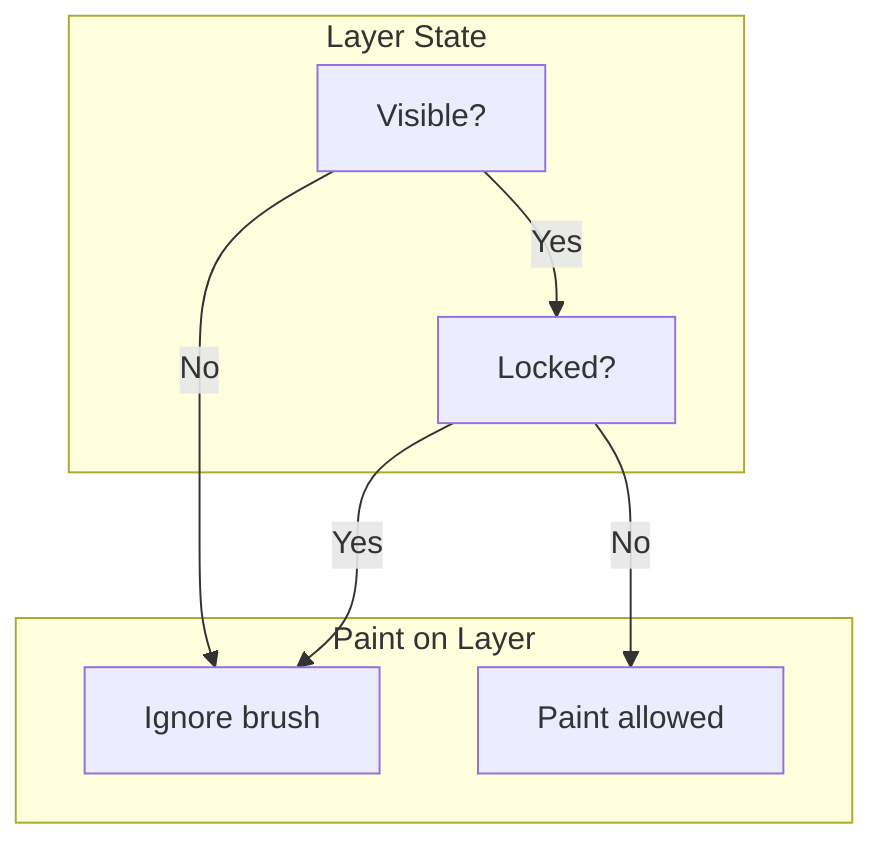

# Character Creation Screen Specification — Addendum

An additional specification extending the main [Character Creation Screen Specification](./CHARACTER-CREATION-SCREEN-SPEC.md). This addendum defines the color swatch management system, 3D-mode floating UI panels (layers and tools), solo-layer visibility with Alt/Option, and 3D viewport cursor behavior.

---

## Implementation Status

| Status | Meaning |
|--------|---------|
| ⬜ | Not started |
| 🚧 | In progress |
| ✅ | Done |
| 📋 | Future / planned |

| Feature | Status |
|---------|--------|
| Color swatch manager (centralized, 12–24 colors, merge/dedupe) | ⬜ |
| Select more colors (Add color button → picker) | ⬜ |
| Auto-load from skin (extract colors on load) | ⬜ |
| Layers panel (3D) — floating lower-right, lock + visibility | ✅ |
| Hidden layer behavior (3D part hidden, brush ignored) | ✅ |
| Solo-layer (Alt+click eye → show only that layer) | ⬜ |
| Tools panel (3D) — floating upper-left | ✅ |
| Navigate tool (disables paint, full orbit) | ✅ |
| Brush, Eraser, Fill tools (3D mode) | ✅ |
| Brush size slider (1, 2, 4, 8) in 3D tools | ✅ |
| Grid mode toggle (1px black pixel overlay) | ⬜ |
| Cursor (3D) — block outline for Brush/Eraser | ⬜ |
| Visual body-diagram layer toggles (future) | 📋 |

*Update both this table and the status indicator in each section heading when implementation changes.*

---

## Table of Contents

1. [Color Swatch Management System](#color-swatch-management-system)
2. [Layers Panel — 3D Mode (Floating, Lower Right)](#layers-panel--3d-mode-floating-lower-right)
3. [Solo-Layer Visibility (Alt/Option + Eye Click)](#solo-layer-visibility-altoption--eye-click)
4. [Tools Panel — 3D Mode (Floating, Upper Left)](#tools-panel--3d-mode-floating-upper-left)
5. [Cursor Behavior in 3D Viewport](#cursor-behavior-in-3d-viewport)
6. [Summary](#summary)

---

## ⬜ Color Swatch Management System

### Scope

A system to manage color swatches, allow users to select and add more colors, and auto-load colors from the existing skin texture.

### Swatch Manager

- **Centralized state** — Single source of truth for the current swatch (e.g., array of hex strings).
- **Capacity** — Max 12–24 colors (configurable; 12 recommended for compact UI).
- **Merge strategy** — When adding colors, merge with existing swatch; new colors prepend or append; deduplicate by hex value.
### Select More Colors

- **"Add color" flow** — Explicit button or control that opens a color picker.
- **Color picker options:**
  - Native `<input type="color">` — Lightweight; limited styling.
  - External library (e.g., Coloris, Vanilla Color Picker) — Full HSL/hex picker; better UX.
- **Behavior** — User selects a color; it is added to the swatch and set as the current drawing color. Deduplicate against existing swatch before adding.

### Auto-Load from Skin

When a skin is loaded (from gallery, file, or preset), extract unique colors from the image and add them to the swatch.

| Load type | Extraction scope |
|-----------|------------------|
| Full skin load | Scan entire 64×64 (or working canvas) |
| Partial load / preset into selected layer | Scan only pixels within `SKIN_LAYER_BOUNDS` for the affected layer(s) |

**Deduplication:** Merge with existing swatch; avoid duplicates (hex match, case-insensitive).

**Sort options (optional):**
- **By frequency** — Most-used colors first (from pixel count during scan).
- **By hue** — Sort by HSL hue for a more visually organized palette.

**Implementation notes:**
- Use `ctx.getImageData()` to read pixel data.
- Scan pixels in bounds; build `Map<string, number>` (hex → count) for dedup and frequency sort.
- Convert RGBA to hex; ignore fully transparent pixels (`a < 128`).
- Add extracted colors to swatch; optionally prepend (new colors first) or append. Cap at swatch max size.

### References

- [CHARACTER-CREATION-SCREEN-SPEC.md](./CHARACTER-CREATION-SCREEN-SPEC.md) — Section 5 (Color Palette), Section 13 (Swatch palette extractor).
- [src/skinLayout.ts](../src/skinLayout.ts) — `SKIN_LAYER_BOUNDS` for region bounds.

---

## ✅ Layers Panel — 3D Mode (Floating, Lower Right)

### Scope

When in Edit 3D mode, a floating panel in the lower-right corner of the 3D viewport lists all skin layers (head, hat, body, jacket, arms, sleeves, legs, pants). Each layer has lock and visibility toggles. Hidden layers are not rendered and do not accept brush input, enabling the user to reach underlying parts (e.g., hide jacket to paint on body).

### Layout

- **Position** — Lower-right corner of the 3D viewport (or `#creator-view-wrapper` when it contains the 3D canvas).
- **Style** — Floating panel; semi-transparent background; border; z-index above the WebGL canvas. Non-intrusive; does not block critical view.
- **Contents** — One row per layer, ordered: Head, Hat, Body, Jacket, Arms, Sleeves, Legs, Pants.

### Minimize / Expand Button

- **Header** — The panel has a header row with the title "Layers" and a collapse button.
- **When expanded** — The button shows a minimize icon (e.g., chevron-down or window-minimize). Clicking shrinks the panel to a compact overlay showing only "Layers" and the button.
- **When minimized** — The panel shows only the title and button. The button shows an expand icon (e.g., chevron-up). Clicking restores the full panel with all layer rows.
- **State** — Collapsed state is session-only (resets when leaving/re-entering the page or creator).

### Per-Layer Controls

| Control | Behavior |
|---------|----------|
| **Lock toggle** | When locked, brush, eraser, and fill actions on that layer are ignored. Useful to prevent accidental edits while navigating. |
| **Visibility (eye) toggle** | When hidden: (1) the layer is treated as locked (brush motions ignored); (2) the corresponding part of the 3D model is hidden or replaced with transparent/magenta placeholder. This allows the user to reach underlying parts (e.g., hide jacket → draw on body). |

**Independence:** Lock and visibility are independent. A layer can be visible but locked, or hidden (which implies effectively locked). If a layer is not visible, it is effectively locked regardless of the lock toggle state.

### Paint Eligibility

### Model Rendering for Hidden Layers

- **Hidden layer** — Hide the corresponding mesh parts or apply fully transparent material for those UV regions.
- **Technical options:**
  - **Per-part meshes** — Toggle `mesh.visible = false` for that part.
  - **Single merged mesh** — Use material or texture override to make the layer's UV regions transparent (e.g., alpha = 0 or magenta placeholder).
- **Placeholder (optional)** — Use a distinct color (e.g., magenta) or wireframe to indicate where the hidden layer would be; helps orientation. Alternatively, fully transparent is acceptable.

### Texture-Region Transparency (Single Merged Overlay Mesh)

Some models (e.g., RunningboyRig) use a **single mesh** for jacket, sleeves, and pants (`2nd_Layer`). You cannot hide jacket without sleeves and pants via `mesh.visible` alone. Use texture-region transparency instead:

- **Principle** — Assign a **separate texture** to the overlay mesh. Copy the main skin into it, then set alpha = 0 for the UV regions corresponding to hidden parts (jacket, sleeves, pants). The main texture stays unchanged for other meshes.
- **Implementation:**
  1. Main skin texture — Used for head, body, arms, legs, hat (unchanged).
  2. Overlay texture — Copy of the skin, used only by the overlay mesh (jacket/sleeves/pants).
  3. When a part is hidden — Copy the skin into the overlay texture, then zero alpha for that part's pixels (use `SKIN_LAYER_BOUNDS`, scaled to working resolution).
  4. When all overlay parts visible — Use main texture for overlay mesh, or use the copy with no alpha changes.
  5. On paint — Rebuild the overlay texture each frame (or on visibility change) so it stays in sync with the main skin.
- **Result** — Per-part visibility for jacket, sleeves, and pants while preserving the original texture (no permanent modification). When shown again, regions are restored from the main texture.

### First Version: Checkboxes

For the initial implementation, use checkboxes for lock and visibility per layer (as described above). The visual body-diagram approach below is a future enhancement.

### 📋 Future Enhancement: Visual Body-Diagram Layer Toggles

A later version may replace or supplement checkboxes with a 2D body diagram where parts are spatially arranged and clickable.

**Layout:**
- **Base parts** — Head (near top), body (center), arms (to the sides), legs (bottom). Arranged in a T-pose or similar flattened view.
- **Overlay parts** — Hat, jacket, sleeves, pants cover the same UV regions as head, body, arms, legs respectively.

**Approach A: Side-by-side (or stacked) bodies**

Two body diagrams placed side-by-side or above-and-below:
- One diagram for base layers: Head, Body, Arms, Legs
- One diagram for overlay layers: Hat, Jacket, Sleeves, Pants

Each part is clickable within its own diagram.

**Approach B: Overlay boxes**

Single body diagram with base parts. Overlay parts appear as boxes slightly larger than their corresponding base part:
- Hat = box around Head
- Jacket = box around Body
- Sleeves = boxes around Arms
- Pants = boxes around Legs

The overlay boxes are drawn larger (e.g., 1–2px outset) so both base and overlay parts are visually distinct and independently clickable.

**Interaction model (both approaches):**

| Action | Result |
|--------|--------|
| **Click** on a visible part | Toggle that part off (make invisible) |
| **Click** on an invisible part | Toggle that part on (make visible) |
| **Alt/Option + Click** on a part | Toggle between two states: (1) this part visible, rest invisible; (2) this part invisible, rest visible |

Alt+click thus alternates between "solo this part" and "solo the rest" (inverse).

### References

- [src/skinLayout.ts](../src/skinLayout.ts) — `SKIN_LAYER_BOUNDS` for layer regions.
- Main spec [Layer System](./CHARACTER-CREATION-SCREEN-SPEC.md#layer-system).

---

## ⬜ Solo-Layer Visibility (Alt/Option + Eye Click)

### Scope

Hold Alt (Windows/Linux) or Option (macOS) and click the visibility (eye) toggle of a layer to show only that layer. Click again (with Alt/Option held) to restore the previous visibility state.

### Behavior

| Action | Result |
|--------|--------|
| **First click (Alt/Option held)** | Enter "solo mode." Hide all other layers; show only the clicked layer. Store the previous visibility state for all layers. |
| **Second click (Alt/Option held)** | Exit solo mode. Restore all layers to their stored visibility. |

### Edge Cases

- **Alt released before second click** — Solo mode persists until the next Alt+click on any eye. The user can exit solo mode by Alt+clicking the same eye again (or another eye to solo that one instead).
- **Click without Alt** — Normal visibility toggle; does not enter or exit solo mode.

### UI Feedback

- **Optional indicator** — When in solo mode, show a label such as "Solo: Jacket" near the layers panel or in the toolbar.
- **Visual hint** — Consider highlighting the soloed layer's row (e.g., border or background) to make it obvious.

---

## ✅ Tools Panel — 3D Mode (Floating, Upper Left)

### Scope

When in Edit 3D mode, show a floating tools panel in the upper-left corner of the 3D viewport. It contains the drawing tools (Navigate, Brush, Eraser, Fill), a brush size slider for the Brush tool, and a Grid mode toggle.

### Contents

| Tool | Purpose |
|------|---------|
| **Navigate** | Disables paint, eraser, and fill. Restores full orbit/camera control (both left-drag and right-drag orbit). Use when the user wants to rotate/zoom without painting. |
| **Brush** | Paint on the 3D model at the raycast hit. |
| **Eraser** | Erase (set pixels to transparent) at the raycast hit. |
| **Fill** | Flood fill from the raycast hit pixel. |

### Grid Mode (Toggle)

A toggle in the tools panel that overlays a 1px black pixel grid on the skin. When enabled:

- **Visual** — Each skin pixel is delineated by a 1px black border (or grid lines drawn over the skin).
- **Effect** — Similar to other editors that appear to split the model slightly; creates a clear boundary between pixels so users can see exactly which pixel they are drawing on.
- **Scope** — Applies in both 2D canvas and 3D viewport; the grid overlays the skin texture wherever it is displayed.
- **Implementation notes:**
  - Overlay or post-process: draw grid lines on top of the rendered skin (2D: canvas overlay layer; 3D: overlay material or second pass).
  - Lines at pixel boundaries: every 1 pixel; color black (#000); 1px width.

### Brush Size

- **Control** — Slider with four discrete positions: 1, 2, 4, 8.
- **Visual** — Horizontal slider with four stops; labels: 1 | 2 | 4 | 8.
- **Default** — 2.
- **Visibility** — Brush size control is shown only when Brush tool is selected.

### Layout

- **Position** — Upper-left corner of the 3D viewport.
- **Style** — Compact vertical or horizontal list; icon or label per tool. Floating panel; semi-transparent background; z-index above canvas.
- **Behavior** — Single selection; one active tool at a time.

---

## ⬜ Cursor Behavior in 3D Viewport

### Scope

The cursor changes based on the active tool and brush size when hovering over the 3D viewport in Edit 3D mode.

### Per-Tool Cursors

| Tool | Cursor |
|------|--------|
| **Brush** | Block/square outline matching the brush size (1×1, 2×2, 4×4, 8×8 in skin pixel terms). Hotspot at center. |
| **Eraser** | Same as Brush: box outline matching brush size. |
| **Fill** | Default cursor (e.g., pointer or default). |
| **Navigate** | Default cursor (e.g., grab or default). |

### Brush and Eraser Cursor Details

- **Shape** — Square outline (stroke only; fill transparent) that matches the painted/erased area size.
- **Scale** — Must account for viewport size, zoom, and `devicePixelRatio` so the cursor visually matches the painted area on the 3D model. In practice, a fixed screen-space size derived from brush size (e.g., 8×8 px at 1, 16×16 at 2, etc.) may be acceptable for consistency.
- **Implementation** — Custom SVG cursor via `cursor: url("data:image/svg+xml,...") x y, crosshair` or similar. Hotspot at center.

### Implementation Notes

- **Reuse logic** — The 2D canvas already has `getBrushCursorStyle(brushSize)` in [src/creator.ts](../src/creator.ts). Apply equivalent logic to the Three.js canvas element when in 3D paint mode with Brush or Eraser selected.
- **Target element** — Set `canvas.style.cursor` on the WebGL canvas (e.g., `#three-canvas-container` canvas or the renderer's `domElement`).
- **Update on change** — Refresh cursor when tool or brush size changes; ensure it applies when hovering over the 3D view.

---

## Summary

| Feature | Description |
|---------|-------------|
| Color swatch manager | Centralized swatch state; max 12–24 colors; merge/deduplicate |
| Select more colors | "Add color" button opens picker; chosen color added to swatch |
| Auto-load from skin | Extract unique colors on skin/preset load; full or partial region scan; dedup; optional sort by frequency/hue |
| Layers panel (3D) | Floating panel lower-right; lock + visibility per layer |
| Hidden layer behavior | Layer locked; 3D part hidden/transparent; enables painting underlying parts |
| Solo-layer | Alt/Option + click eye → show only that layer; Alt+click again → restore |
| Layers panel (future) | Visual body-diagram: 2D clickable parts (approach A: side-by-side bodies; approach B: overlay boxes). Click = toggle visibility; Alt+click = solo this part ↔ solo rest |
| Tools panel (3D) | Floating panel upper-left; Navigate, Brush, Eraser, Fill; brush size slider (1, 2, 4, 8); Grid mode toggle (1px black pixel grid overlay) |
| Navigate tool | Disables paint; full orbit control (left + right drag) |
| Cursor (3D) | Brush/eraser: block outline matching size; Fill/Navigate: default cursor |

**Related documents:**
- [CHARACTER-CREATION-SCREEN-SPEC.md](./CHARACTER-CREATION-SCREEN-SPEC.md) — Main spec.
- [CHARACTER-CREATOR-DELIVERABLE-STEPS.md](./CHARACTER-CREATOR-DELIVERABLE-STEPS.md) — Implementation steps (addendum can inform Steps 15–19).
