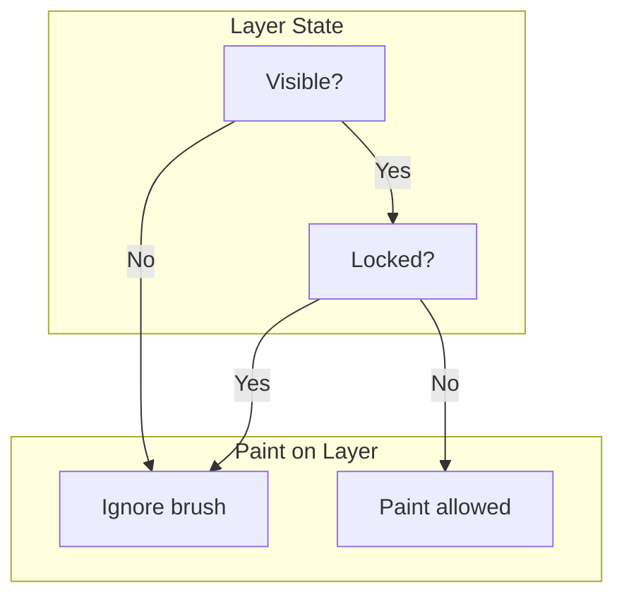

# Character Creation Screen Specification

A specification for building a character creation screen that lets users draw on a Minecraft-style character, choose partial layers (arms, legs, jacket, pants, hats, heads, etc.), randomize combinations, and save/download skins — with integration into the local webapp instead of relying on right-click-to-save. This document reflects the current implementation: blocky 2D editor as sole 2D view, floating tools/layers panels over both 2D and 3D, simplified left sidebar, and related UI changes.

---

## Table of Contents

1. [Implementation Status](#implementation-status)
2. [Context and Goals](#context-and-goals)
3. [Existing Skin Editor Assumptions](#existing-skin-editor-assumptions)
4. [Character Creation Features](#character-creation-features)
5. [Blocky 2D Editor and Tools Panel Consolidation](#blocky-2d-editor-and-tools-panel-consolidation)
6. [Paint on 3D Model](#paint-on-3d-model)
7. [Layer System](#layer-system)
8. [Layers Panel — Floating Over 2D and 3D](#layers-panel--floating-over-2d-and-3d)
9. [Solo-Layer Visibility and Lock (Alt/Option + Click)](#solo-layer-visibility-and-lock-altoption--click)
10. [Tools Panel — Floating Over 2D and 3D](#tools-panel--floating-over-2d-and-3d)
11. [Color Swatch Management System](#color-swatch-management-system)
12. [Cursor Behavior (2D and 3D)](#cursor-behavior-2d-and-3d)
13. [Hover Info Panel (2D and 3D)](#hover-info-panel-2d-and-3d)
14. [Randomization](#randomization)
15. [Save and Download Integration](#save-and-download-integration)
16. [Rulers and Grid](#rulers-and-grid)
17. [Technical Architecture](#technical-architecture)
18. [Implementation Phases](#implementation-phases)
19. [Integration with 3D Model Viewer](#integration-with-3d-model-viewer)
20. [Toggleable Template Layer (Model-to-2D Translation)](#toggleable-template-layer-model-to-2d-translation)
21. [Tools: Undo, Paint, Fill, Select, Delete, Color Picker](#tools-undo-paint-fill-select-delete-color-picker)
22. [Existing Libraries and Tools](#existing-libraries-and-tools)
23. [Summary](#summary)

---

## Implementation Status

| Status | Meaning |
|--------|---------|
| ⬜ | Not started |
| 🚧 | In progress |
| ✅ | Done |
| 📋 | Future / planned |

| Feature | Status |
|---------|--------|
| Color swatch manager (multi-palette: History + Skin, tab UI) | ✅ |
| Color picker panel (SV + hue, 5-swatch bar, minimize, floating lower-right) | ✅ |
| Swatch grid display (colorful squares, capacity limit) — History & Skin palettes | ✅ |
| Select more colors (Add color button → picker) | ⬜ |
| Eyedropper tool (2D/3D pixel sampling, prepend to swatch, tool exclusivity) | ✅ |
| Auto-load from skin (Skin palette extracts colors on load, dedupe + diversity) | ✅ |
| Blocky 2D editor as sole 2D view (Canvas 2D drawing removed) | ✅ |
| Rulers (HTML/CSS, crisp text, 0–64 labels) | ✅ |
| Tools panel — floating over both 2D and 3D views | ✅ |
| Layers panel — floating over both 2D and 3D views | ✅ |
| 2D/3D edit mode toggle in tools panel | ✅ |
| Default tool: Navigate (not Brush) on load | ✅ |
| Layers panel (3D) — floating lower-right, lock + visibility | ✅ |
| Hidden layer behavior (3D part hidden, brush ignored) | ✅ |
| Solo-layer visibility (Alt+click eye) | ✅ |
| Solo-layer lock (Alt+click lock) | ✅ |
| Brush size fixed at 1 cell (2D and 3D) | ✅ |
| 2D view tools: Navigate, Brush, Eraser, Fill, Rulers, Grid, Template | ✅ |
| Left sidebar: Edit (Undo/Redo), Skin gallery; Swatches in right-side panel (Download hidden) | ✅ |
| Grid mode toggle (1px black pixel overlay) | ⬜ |
| Cursor (2D and 3D) — block outline for Brush/Eraser | ✅ |
| Visual body-diagram layer toggles | 📋 |
| Hover info panel — specific part (Right leg, Left sleeve, etc.) + skin coords | ✅ |
| Lock respected in 2D view (no draw on locked layers) | ✅ |
| Drag-to-toggle: click and drag over layers to apply visibility/lock | ✅ |
| Layer row highlight when hovering over skin part | ✅ |
| Dead zones excluded from template overlay and hover info | ✅ |
| Undo/Redo buttons split width in tools panel | ✅ |
| Keyboard shortcuts (Tab, H, B, E, G, Ctrl/Cmd+Z, Ctrl/Cmd+Shift+Z) | ✅ |
| Tool icons for Navigate, Brush, Eraser, Fill, Eyedropper (no text labels) | ✅ |
| Color picker minimize (collapses to 5 swatches) | ✅ |
| Swatches panel minimize (collapses to "Swatches (N)") | ✅ |
| Multi-palette swatches (History + Skin tabs) | ✅ |
| Skin palette color extraction (dedupe + diversity) | ✅ |
| Left sidebar size (220–380px) | ✅ |

*Update this table and the status indicator in each section heading when implementation changes.*

---

## Context and Goals

### Current State (Typical Skin Editors)

- Standalone HTML page with canvas for drawing on a 64×64 skin texture.
- User must **right-click → Save Image** to export.
- No integration with the viewer; saved file must be manually placed and selected.

### Desired State

- **Character creation screen** — Game-like creator with:
  - Drawing/painting on the character
  - **Partial layer selection** — Toggle or choose layers (arms, legs, jacket, pants, hat, head)
  - **Randomization** — One-click random combination of layers/colors
  - **Download** — Explicit "Download" button
  - **Save to webapp** — Save directly into the running viewer (e.g., add to skin list, apply immediately)

### Reference

- [minecraft-skin-layout-specification.md](./minecraft-skin-layout-specification.md) — 64×64 layout, region bounds for head, hat, body, jacket, arms, legs, pants, sleeves.

---

## Existing Skin Editor Assumptions

If a skin editor exists on main (or another branch):

- Likely provides: canvas, color picker, brush, eraser, layer visibility.
- Output: 64×64 PNG.
- Limitation: right-click save only.

**What to preserve:** Canvas drawing logic, skin layout constants, color handling.

**What to add:** Layer selection UI, randomization, download button, webapp integration.

If no skin editor exists, the spec below describes building one from scratch with these features.

---

## Character Creation Features

### 1. Drawing / Painting

- **Canvas** — 64×64 pixel grid (or zoomed view for usability). Higher-resolution working canvas (e.g., 128×128) with downscale export for pixel-perfect 64×64 output.
- **Display quality** — Use `image-rendering: pixelated` and `imageSmoothingEnabled = false` for blocky, non-blurry pixel art. Account for device pixel ratio where needed.
- **Rulers** — Toggleable rulers in **separate strips** above and to the left of the canvas (not overlaying the image). Coordinate system: (0, 0) at upper-left, (64, 64) at lower-right.
- **Grid lines** — Toggleable grid overlay. Default: every 4 pixels (vertical and horizontal). Extensible settings (spacing, color, line width).
- **Tools:** Brush, eraser, fill, color picker.
- **Brush** — Square block brush (not round). Sizes: 1, 2, 4, 8 pixels. A click fills the entire square. **Current implementation:** Brush size fixed at 1 cell (2×2 working pixels).
- **Brush cursor** — Custom box-outline cursor that matches the brush size. Sizes correctly with canvas scale and `devicePixelRatio` so the cursor visually matches the drawn area.
- **Layer awareness:** Drawing affects only the selected layer(s). Locked layers do not accept brush, eraser, or fill (2D and 3D). See [Layer System](#layer-system).

### 2. Layer Selection (Partial Layers)

Users can **focus on** or **toggle visibility** of body parts. This supports:

- **Edit one part at a time** — Select "arms" to only draw on arm regions; other regions dimmed or locked.
- **Choose which parts to customize** — E.g., "I want to change only the jacket"; hide others for clarity.
- **Template / preset layers** — Start from a base skin and replace specific layers with templates.

### Layer Categories (Minecraft 64×64)

| Layer | Region (from spec) | Purpose |
|-------|--------------------|---------|
| **Head** | X:0–32, Y:0–16 | Face, hair base |
| **Hat** | X:32–64, Y:0–16 | Helmet, hair overlay, accessories |
| **Body** | X:16–32, Y:16–32 | Torso |
| **Jacket** | X:16–32, Y:32–48 | Jacket + sleeves overlay |
| **Arms** | X:40–56, Y:16–32 (right), X:32–48, Y:48–64 (left) | Arms primary |
| **Sleeves** | X:40–56, Y:32–48 (right), X:48–64, Y:48–64 (left) | Sleeve overlays |
| **Legs** | X:0–16, Y:16–32 (right), X:16–32, Y:48–64 (left) | Legs primary |
| **Pants** | X:0–16, Y:32–48 (right), X:0–16, Y:48–64 (left) | Pants overlays |

**UI for layers:**

- **Checkboxes or tabs** — "Head", "Hat", "Body", "Jacket", "Arms", "Sleeves", "Legs", "Pants".
- **Multi-select** — Allow editing multiple layers at once (e.g., arms + sleeves).
- **Dim/lock** — When a layer is not selected, show it dimmed or read-only in the canvas.

### 3. Skin Gallery

- **Gallery in creator** — Fetches `/skins/index.json` and displays skin thumbnails. Clicking a thumbnail loads that skin into the 2D editor.
- **Load as undoable** — Loading a skin pushes a `load` command onto the undo stack (before/after `ImageData`). Undo/redo works for skin loads (Ctrl+Z / Ctrl+Shift+Z).
- **64×64 and 64×32** — Handles both formats: 64×64 draws full image; 64×32 draws upper half, leaves jacket/sleeves/pants regions transparent.

### 4. Presets / Templates

- **Pre-made layer graphics** — E.g., "Jacket 1", "Jacket 2", "Pants A", "Hat styles".
- User selects a preset for a layer; it replaces that layer's pixels.
- Presets stored as 64×64 PNGs with only the relevant region filled (rest transparent).

### 5. Color Palette

- **Recent colors** — Last N used colors.
- **Preset palettes** — Skin tones, common Minecraft colors, custom.
- **Hex input** — For exact colors.
- **Swatch palette extractor** — When a skin (or selected layer regions) is loaded, extract all unique colors from that image and add them to the swatch. Supports:
  - **Full skin load** — Loading a skin image (e.g., from file or preset) adds all colors used in the 64×64 texture to the swatch.
  - **Partial extraction** — When loading a preset into a layer, or when a subset of layers is selected, extract colors only from the relevant region(s) and add to the swatch.
  - **Deduplication** — Merge with existing swatch; avoid duplicates. Optionally sort by frequency (most-used colors first) or by hue.

---

## Blocky 2D Editor and Tools Panel Consolidation

### Scope

The character creator uses a blocky 64×64 grid as the sole 2D editor. The Canvas 2D drawing method has been removed. Tools, brushes, layers, and view overlays are consolidated into floating panels that hover over both 2D and 3D views. The left sidebar is simplified to Edit (Undo/Redo), Color, and Swatch only.

### Blocky 2D Editor

- **Single 2D mode** — The blocky grid is the only 2D drawing surface. Each cell maps to a 2×2 block of the 128×128 working skin.
- **No Canvas 2D drawing** — The previous canvas-based 2D editor (with `fillText`, `getImageData`, pixel-level drawing) has been removed. All 2D editing is via the blocky grid.
- **Template support** — The Template overlay (region outlines for skin layout) is drawn on the overlay canvas above the blocky grid and is toggled via the tools panel.
- **Borders toggle removed** — Cell borders are no longer toggleable; the grid uses the default styling.

### Rulers (HTML/CSS)

- **Implementation** — Rulers use HTML + CSS instead of canvas for crisp, non-blocky text rendering.
- **Labels** — Major ticks at 0, 8, 16, … 64. Numbers are positioned correctly (0 at left/top, 64 at right/bottom) with alignment so they are not cut off.
- **Font** — `system-ui, -apple-system, sans-serif` for legibility.
- **Visibility** — Rulers toggle via the tools panel when in 2D mode.

### Left Sidebar (Simplified)

- **Edit** — Undo, Redo.
- **Skin gallery** — Load skin selector. Color swatch and hex input removed (color selection via color picker and swatches panels).
- **Download** — Hidden (present in DOM but not visible).
- **Removed** — Tools (Brush, Eraser, Fill), Brush sizes, 2D/3D toggle, Layers, Rulers, Grid, Template. These now live in the floating tools panel.

### Default Tool

- **On load** — The active tool defaults to **Navigate** (not Brush), so the user starts in navigation mode and must explicitly select Brush, Eraser, or Fill to paint.

### References

- [src/creator.ts](../src/creator.ts) — `buildToolsPanel3D`, `buildBlockyGrid`, `buildRulers`, `renderToDisplay`.
- [src/style.css](../src/style.css) — `.creator-tools-panel`, `.creator-blocky-grid`, `.creator-ruler-*`.

---

## Paint on 3D Model

In addition to the 2D canvas, users can **paint directly on the 3D character model**. This provides spatial context: users see exactly where strokes land on the body (face, arms, legs, etc.) and can rotate the model to reach occluded areas.

### Behavior

- **3D preview** — A live 3D view of the character using the same model as the viewer. Texture updates in real time as the user edits.
- **Paint mode** — When painting on 3D, mouse click/drag performs raycasting: screen position → 3D ray → mesh intersection → UV coordinates → 64×64 pixel position. The same brush, eraser, and color picker apply; edits write to the shared skin texture.
- **Layer awareness** — Layer selection (head, arms, jacket, etc.) restricts which regions accept paint. Clicks on non-selected regions are ignored or trigger "select this layer" feedback.
- **Orbit/rotate** — Camera controls (orbit, zoom) let the user rotate the character to paint all sides. Pan/zoom should not conflict with paint gestures (e.g., distinguish click-drag for paint vs. orbit).

### Technical Approach

- **Raycasting** — Use Three.js `Raycaster` with `Mesh.raycast()` to find the intersected face. Read face UVs from geometry to map hit point → (u, v) → pixel (x, y) on the 64×64 texture. Flip V if the texture uses top-left origin.
- **UV → pixel** — `pixelX = Math.floor(u * 64)`, `pixelY = Math.floor((1 - v) * 64)` (adjust for coordinate system).
- **Shared texture** — The 3D model's texture is the same `CanvasTexture` or `DataTexture` as the 2D editor. Editing in either view updates the other.
- **Fill on 3D** — Flood fill from the clicked UV/pixel; same algorithm as 2D but seed from raycast result.
- **Eyedropper on 3D** — Sample the pixel at the raycast hit; add to color swatch.

### UI

- **Edit mode toggle** — "2D" vs. "3D" buttons in the tools panel (floating upper-left). Default: **3D mode** (paint on 3D model).
- **Layout by mode:**
  - **Edit 3D:** Large 3D view fills the right panel; 2D canvas is hidden. Left-drag paints; right-drag orbits.
  - **Edit 2D:** Large 2D canvas fills the right panel; 3D preview moves to creator panel (after toolbar, 256px height). 2D canvas scales to fill available space.
- **Undo/redo** — Same command stack; 3D paint strokes are recorded the same way as 2D (pixel coordinates + color).
- **Sync** — 2D canvas and 3D texture always reflect the same skin state. No separate "apply" step.

### Implementation Notes

- **Mesh structure** — The model may use merged geometry (e.g., single Character mesh) or per-part meshes (head, body, arm, etc.). UV mapping must be known and consistent with `minecraft-skin-layout-specification`. If the FBX supplies UVs, use them; otherwise the UV table from `main.ts` applies.
- **Performance** — Real-time texture updates (e.g., `texture.needsUpdate = true` on each stroke) are typically fine for 64×64. Coalesce rapid brush moves if needed.
- **Depth buffer** — Ensure the 3D character is rendered and raycastable; avoid UI or overlay elements blocking rays.
- **Mouse buttons in Edit 3D** — Disable OrbitControls LEFT for rotate; use LEFT for paint, RIGHT for orbit. In Edit 2D, LEFT restores orbit for the small preview.
- **OrbitControls and DOM movement** — When the 3D view is moved in the DOM (e.g., between main area and preview slot on mode switch), OrbitControls event handling can break. **Recreate OrbitControls** (dispose + new instance) when switching back to 3D mode.
- **Camera reset for 2D preview** — When switching to Edit 2D, re-center and zoom out the camera (e.g., position `(0, 1.5, 4)`, target `(0, 1, 0)`) so the full character fits in the small preview.

---

## Layer System

See [Layers Panel — Floating Over 2D and 3D](#layers-panel--floating-over-2d-and-3d) for the current floating panel implementation.

---

## Layers Panel — Floating Over 2D and 3D

### Scope

A floating panel in the lower-right corner of the view area lists all skin layers (head, hat, body, jacket, arms, sleeves, legs, pants). It appears over both 2D blocky view and 3D model view. Each layer has lock and visibility toggles. Hidden layers are not rendered in 3D and do not accept brush input, enabling the user to reach underlying parts (e.g., hide jacket to paint on body).

### Layout

- **Position** — Lower-right corner of the view area (2D blocky view or 3D viewport).
- **Style** — Floating panel; semi-transparent background; border; z-index above the WebGL canvas. Non-intrusive; does not block critical view.
- **Contents** — One row per layer, ordered: Hat, Head | Jacket, Body | Sleeves, Arms | Pants, Legs (separators between groups).

### Minimize / Expand Button

- **Header** — The panel has a header row with the title "Layers" and a collapse button.
- **When expanded** — The button shows a minimize icon. Clicking shrinks the panel to a compact overlay.
- **When minimized** — Clicking restores the full panel. Collapsed state is session-only.

### Per-Layer Controls

| Control | Behavior |
|---------|----------|
| **Lock toggle** | When locked, brush, eraser, and fill actions on that layer are ignored (2D and 3D). |
| **Visibility (eye) toggle** | When hidden: (1) the layer is treated as locked; (2) the corresponding part of the 3D model is hidden or transparent. This allows reaching underlying parts. |

**Independence:** Lock and visibility are independent. A layer can be visible but locked, or hidden (which implies effectively locked).

### Drag-to-Toggle

- **Visibility and lock** — Click and hold on a visibility or lock toggle, then drag over other layer rows. Each row crossed adopts the same toggle value (e.g., drag to hide multiple layers at once). Simple click still toggles a single layer normally.
- **Implementation** — Uses a drag threshold (4px); movement beyond threshold starts drag mode. Alt+click on visibility or lock bypasses drag and triggers solo mode.

### Paint Eligibility



### Texture-Region Transparency (Single Merged Overlay Mesh)

Some models (e.g., RunningboyRig) use a **single mesh** for jacket, sleeves, and pants (`2nd_Layer`). You cannot hide jacket without sleeves and pants via `mesh.visible` alone. Use texture-region transparency instead:

- **Principle** — Assign a **separate texture** to the overlay mesh. Copy the main skin into it, then set alpha = 0 for the UV regions corresponding to hidden parts.
- **Implementation:** Main skin texture for head, body, arms, legs, hat. Overlay texture (copy of skin) for the overlay mesh; zero alpha for hidden part regions using `SKIN_LAYER_BOUNDS`. Rebuild on visibility change.

### Future: Visual Body-Diagram Layer Toggles

A later version may replace or supplement checkboxes with a 2D body diagram where parts are spatially arranged and clickable. See the main spec's layer categories for region layout.

---

## Solo-Layer Visibility and Lock (Alt/Option + Click)

### Scope

Hold Alt (Windows/Linux) or Option (macOS) and click a layer control to enter "solo" mode for that control. Both the visibility (eye) toggle and the lock toggle support this behavior.

### Solo Visibility (Alt + Eye Click)

| Action | Result |
|--------|--------|
| **First click (Alt/Option held)** | Enter solo visibility. Hide all other layers; show only the clicked layer. Store the previous visibility state. |
| **Second click (Alt/Option held)** | Exit solo visibility. Restore all layers to their stored visibility. |

### Solo Lock (Alt + Lock Click)

| Action | Result |
|--------|--------|
| **First click (Alt/Option held)** | Enter solo lock. Lock all other layers; unlock only the clicked layer. Store the previous lock state. This focuses editing on a single layer. |
| **Second click (Alt/Option held)** | Exit solo lock. Restore all layers to their stored lock state. |

### Edge Cases

- **Alt released before second click** — Solo mode persists until the next Alt+click on the same control type (eye or lock).
- **Click without Alt** — Normal toggle; does not enter or exit solo mode.
- **Alt+click on lock** — Bypasses drag-to-toggle (same as visibility).

---

## Tools Panel — Floating Over 2D and 3D

### Scope

A floating tools panel appears in the upper-left corner of the view area for both 2D and 3D edit modes. It contains the 2D/3D mode toggle, drawing tools (Navigate, Brush, Eraser, Fill), and in 2D mode the view overlays (Rulers, Grid, Template).

### Contents

| Tool | Purpose |
|------|---------|
| **2D / 3D** | Edit mode toggle. Switch between blocky 2D canvas and 3D model view. |
| **Navigate** | Disables paint, eraser, and fill. Restores full orbit/camera control. Default tool on page load. |
| **Brush** | Paint on the skin (2D blocky grid or 3D raycast hit). Mutually exclusive with Eyedropper. |
| **Eraser** | Erase (set pixels to transparent). Mutually exclusive with Eyedropper. |
| **Fill** | Flood fill from clicked pixel. Mutually exclusive with Eyedropper. |
| **Eyedropper** | Sample pixel color on 2D or 3D; add to swatches (prepended). See [Color Swatch Management System](#color-swatch-management-system). Mutually exclusive with Brush, Eraser, and Fill. |
| **Rulers** | (2D only) Toggle rulers above and left of the blocky grid. |
| **Grid** | (2D only) Toggle grid overlay. |
| **Template** | (2D only) Toggle skin region outlines for layout reference. |

### Layout

- **Position** — Upper-left corner of the view area.
- **Style** — Vertical list; floating panel; semi-transparent background.
- **Dividers** — Between 2D/3D toggle and tools; between Navigate and Brush; (2D only) between Fill and Rulers.
- **Undo/Redo** — Undo and Redo buttons split the full width of the tools panel (50% each).
- **Tool icons** — Navigate, Brush, Eraser, Fill, and Eyedropper are shown as icons (not text labels). Use recognizable paint-tool iconography (e.g., hand for Navigate, brush tip for Brush, eraser for Eraser, paint bucket for Fill, eyedropper for Eyedropper). Optional: show the shortcut key in a tooltip on hover.

### Keyboard Shortcuts

Shortcuts follow conventions familiar to users of Adobe Photoshop and similar paint tools. Use Ctrl on Windows/Linux; Command (⌘) on macOS.

| Action | Shortcut (Win/Linux) | Shortcut (Mac) |
|--------|----------------------|----------------|
| 2D / 3D toggle | `Tab` | `Tab` |
| Navigate mode | `H` | `H` |
| Brush | `B` | `B` |
| Eraser | `E` | `E` |
| Fill | `G` | `G` |
| Undo | `Ctrl+Z` | `Cmd+Z` |
| Redo | `Ctrl+Shift+Z` | `Cmd+Shift+Z` |

**Notes:** The 2D/3D toggle uses Tab (common for switching edit modes). Navigate, Brush, Eraser, and Fill use the same single-letter shortcuts as Photoshop (H = Hand, B = Brush, E = Eraser, G = Paint Bucket). Undo/Redo use the standard system shortcuts.

### Brush Size

- **Fixed at 1 cell** — Brush and eraser paint one grid cell (2×2 working pixels) per dab.

---

## Color Swatch Management System

### Scope

A system to manage color swatches with multiple palettes, allow users to select and add more colors, and auto-load colors from the loaded skin texture.

### Multi-Palette Swatches Panel

- **Palettes** — Two palettes in tab UI:
  - **History** — Most recently used colors (newest first). Editable; drag-drop to set swatch color.
  - **Skin** — Colors extracted from the currently loaded skin. Read-only; click to apply color.
- **Tab UI** — Horizontal tabs at top (History | Skin). Active tab highlighted (bold, blue bottom border).
- **Minimize** — Panel can minimize to "Swatches (N)" with expand button.
- **Capacity** — Max 25 colors (5×5 grid) per palette.
- **Display** — Swatches presented as a grid of colorful squares. Active palette's grid is visible; inactive hidden.

### Color Picker Panel

- **Design** — Saturation/brightness square (SV) + hue bar. Below: **5-swatch bar** showing color variations (±20, ±40 brightness from active). Active swatch has white border.
- **5-swatch behavior** — Middle swatch active by default. When user picks from SV/hue, active swatch updates. Other swatches show deltas from active. User can click any swatch to make it active.
- **Position** — Floating panel, bottom-right corner.
- **Minimize** — Panel can minimize to show only the 5 swatches.
- **Sync** — When a swatch or picker color is selected, color picker updates.

### Select More Colors

- **"Add color" flow** — Button opens the color picker panel.
- **Behavior** — Selected color is added to the swatch and set as current. Deduplicate before adding.

### Eyedropper Tool

- **Access** — The eyedropper appears in the tools panel, in the same group as Brush, Eraser, and Fill (not in the color picker panel).
- **Behavior** — When the eyedropper tool is active and the user left-clicks on the 2D blocky grid or 3D model, the system determines the pixel and color at that point. This works in both 2D and 3D.
- **Tool exclusivity** — When the eyedropper tool is enabled, the Brush, Eraser, and Fill tools are not enabled. Likewise, when Brush, Eraser, or Fill is enabled, the eyedropper is not enabled.
- **Color addition** — A color selected via eyedropper is prepended to the swatch list (pushing other swatches over). If the color already exists in the swatch list, it is removed from its previous position and prepended. The capacity limit applies; the oldest swatch may be dropped when at capacity.

### Auto-Load from Skin (Skin Palette)

When a skin is loaded via "Load skin", the **Skin palette** is updated:

| Load type | Extraction scope |
|-----------|------------------|
| Full skin load | Entire working canvas (128×128) |
| Partial load / preset | Only `SKIN_LAYER_BOUNDS` for affected layer(s) — future |

**Deduplication:** Unique hex colors only (transparent pixels skipped).

**Variety:** When unique colors exceed palette capacity (25), **farthest-point sampling** selects a diverse subset: repeatedly pick the color farthest from all already-selected colors (Euclidean distance in RGB). This avoids clumping similar shades.

### References

- [src/creator/swatches.ts](../src/creator/swatches.ts) — Multi-palette UI; subscribes to `SKIN_LOAD_CHANGE`.
- [src/creator.ts](../src/creator.ts) — `extractColorsFromSkin`, farthest-point diversity; `loadSkinFromPath` publishes `SKIN_LOAD_CHANGE`.
- [src/skinLayout.ts](../src/skinLayout.ts) — `SKIN_LAYER_BOUNDS` for region bounds.

---

## Cursor Behavior (2D and 3D)

### Scope

The cursor changes based on the active tool when hovering over the 2D blocky grid or the 3D viewport.

### Per-Tool Cursors

| Tool | Cursor |
|------|--------|
| **Brush** | Block outline, 1 cell. Hotspot at center. |
| **Eraser** | Same as Brush: box outline, 1 cell. |
| **Fill** | Default cursor. |
| **Eyedropper** | Eyedropper/crosshair cursor. |
| **Navigate** | Default cursor. |

### Implementation

- **2D cursor** — `getBrushCursorStyle()` in [src/creator.ts](../src/creator.ts); size = 1 cell; divided by `devicePixelRatio` for Retina.
- **3D cursor** — `getBrushCursorStyleFor3D()`; fixed 8px per brush unit.
- **3D brush painting** — Paints 2×2 working pixels (one full cell) per dab.

### Known Issue: Cursor ghosting on Mac

On Mac with Retina (Safari and Chrome), the brush/eraser cursor may show faint ghosting. See [TROUBLESHOOTING.md](./TROUBLESHOOTING.md#character-creator-cursor-ghosting-on-mac-safari-and-chrome).

---

## Hover Info Panel (2D and 3D)

### Scope

A compact overlay in the lower-right of the view area shows, for both 2D and 3D:

1. **Current skin part** — Granular per [minecraft-skin-layout-specification.md](./minecraft-skin-layout-specification.md): Head, Hat, Body, Jacket, Right leg, Left leg, Right pants, Left pants, Right arm, Left arm, Right sleeve, Left sleeve. When an overlay is **hidden** in 3D, show the underlying base part.
2. **Current skin coordinates** — (x, y) in the 64×64 texture.
3. **Layer row highlight** — When hovering over a skin part, the corresponding layer row in the layers panel is highlighted (e.g., hovering over "Right sleeve" highlights the Sleeves row).

### Display Format

- **Part visible:** `PartName (skinX, skinY)` — e.g. `Right sleeve (44, 36)`
- **Overlay hidden (3D):** `BasePart (skinX, skinY)` — e.g. `Right arm (44, 20)` when Sleeves hidden
- **Not over skin:** `—` (including dead zones — see [minecraft-skin-layout-specification.md](./minecraft-skin-layout-specification.md#dead-zones--non-skin-zones-reference-diagrams))

### References

- [src/creator.ts](../src/creator.ts) — `updateHoverInfo`, `getPartDisplayNameAtCoords`
- [src/skinLayout.ts](../src/skinLayout.ts) — `SKIN_PART_BOUNDS`, `SKIN_DEAD_ZONES`, `isInDeadZone`

---

## Randomization

### "Randomize" Button

- **Full random** — Pick random preset for each layer and combine.
- **Partial random** — Randomize only selected layers (e.g., only hat and jacket).
- **Color shift** — Optionally randomize hue/saturation.

### Randomization Sources

- **Preset pool** — Each layer has a list of presets.
- **Procedural** — Random colors/patterns per region.
- **Weighted** — Some presets more common than others.

---

## Save and Download Integration

### Download Button

- **Explicit "Download" button** — No right-click required.
- **Filename** — Auto-generated or user-provided.
- **Format** — PNG, 64×64.
- **Implementation:** `canvas.toDataURL('image/png')` → create `<a download="...">` and click.

### Save to Webapp (Local)

**Options:** LocalStorage/IndexedDB; File System Access API; local backend (`POST /api/skin/save`); same-origin shared state. Recommended: local API that saves to `public/skins/custom/` and updates `skins/index.json`.

---

## Rulers and Grid

### Rulers

- **Toggle** — Via tools panel in 2D mode.
- **Implementation** — HTML + CSS; labels 0, 8, 16, … 64; strips above and left of canvas.
- **Coordinate system** — (0, 0) upper-left, (64, 64) lower-right.

### Grid Lines

- **Toggle** — Via tools panel in 2D mode.
- **Default spacing** — Every 4 pixels. Extensible settings.
- **Future** — 1px black pixel overlay toggle (Grid mode).

### Hover Info Panel

See [Hover Info Panel (2D and 3D)](#hover-info-panel-2d-and-3d) for the floating panel showing part name and (x, y) coords.

---

## Technical Architecture

### Component Structure

```
/creator (route or page)
├── Creator panel (left sidebar, min 220px, max 380px)
│   ├── Edit (Undo, Redo)
│   ├── Skin gallery (Load skin)
│   ├── 3D preview slot (Edit 2D only; 256px)
│   └── Actions (Download hidden)
├── Creator view wrapper (right; main area)
│   ├── Tools panel (floating, upper-left) — 2D/3D, Navigate, Brush, Eraser, Fill, Eyedropper (icons), Rulers, Template
│   ├── Layers panel (floating, lower-right)
│   ├── Color picker panel (floating, lower-right) — SV + hue, 5-swatch bar; minimize
│   ├── Swatches panel (floating, lower-right) — History & Skin palettes (tabs); minimize
│   ├── Hover info panel (lower-right)
│   ├── Blocky 2D canvas (Edit 2D) or 3D view (Edit 3D)
│   └── Rulers (2D only; when toggled)
├── Preset panel (per layer)
├── Randomize button
└── Save to webapp button
```

### Data Flow

- **Skin state** — Single `ImageData` or offscreen canvas (64×64). All edits write here.
- **Layer mask** — Only pixels in selected, unlocked layer regions are writable.
- **Presets** — Loaded as images; drawn into the appropriate region.
- **Export** — `canvas.toDataURL('image/png')` or `toBlob()`.

---

## Implementation Phases

### Phase 1: Basic Creator

- Canvas (blocky grid), brush, eraser, color picker.
- Full skin editing (all layers at once).
- Download button.

### Phase 2: Layer Selection

- Layer checkboxes in floating panel.
- Lock and visibility per layer.
- Dim/hide non-selected regions.

### Phase 3: Presets and Randomization

- Preset images per layer.
- "Apply preset" per layer.
- "Randomize" button.

### Phase 4: Save to Webapp

- Backend `POST /api/skin/save`.
- Save to `public/skins/custom/`.
- Update `skins/index.json`.

### Phase 5: Paint on 3D Model

- Edit 2D / Edit 3D toggle.
- Raycasting: screen → UV → pixel.
- Brush, eraser, fill, eyedropper on 3D.
- Shared texture.

### Phase 6: Polish

- Undo/redo.
- Export to legacy 64×32 if needed.

---

## Integration with 3D Model Viewer

The character creator merges with the app that displays the 3D viewer. Same app, `/creator` route; shared skin layout; "Edit" / "Home" navigation. See [Creator–Viewer State Management](./CREATOR-VIEWER-STATE-MANAGEMENT.md) for state and transitions.

---

## Toggleable Template Layer (Model-to-2D Translation)

- **Toggle** — "Template" in tools panel (2D mode). Shows region outlines on the blocky grid.
- **Implementation** — Draw from `SKIN_LAYER_BOUNDS`; dead zones (top-left, top-middle, right-side legend) are excluded per [minecraft-skin-layout-specification.md](./minecraft-skin-layout-specification.md#dead-zones--non-skin-zones-reference-diagrams). Body and jacket are drawn as single 24×16 boxes.
- **Non-destructive** — Visual only.

---

## Tools: Undo, Paint, Fill, Select, Delete, Color Picker

### Undo

- Command pattern; point-based for brush; snapshot for fill; load command for skin loads. History limit 50–100.

### Paint Brush

- Size 1 cell (2×2 px). Square block. Layer mask applies. Locked layers are excluded (2D and 3D).

### Fill

- Flood fill; optional tolerance; layer-aware.

### Select / Delete / Color Picker

- Marquee select; delete selection; eyedropper (2D/3D pixel sampling, prepends to swatch, mutually exclusive with Brush/Eraser/Fill); swatch grid; hex input. See [Color Swatch Management System](#color-swatch-management-system).

---

## Existing Libraries and Tools

- **Canvas:** Raw `CanvasRenderingContext2D` + `ImageData`.
- **Undo:** Custom command stack or Reddo.js.
- **Color:** Custom eyedropper + swatch; optionally Coloris.
- **Fill:** Custom flood fill (stack-based).

---

## Summary

| Feature | Description |
|---------|-------------|
| Blocky 2D editor | Sole 2D drawing method; 64×64 grid; no Canvas 2D drawing |
| Tools panel | Floating upper-left; 2D/3D toggle; Navigate, Brush, Eraser, Fill, Eyedropper (icon-only); Rulers, Template (2D); Undo/Redo; shortcuts (Tab, H, B, E, G, Ctrl/Cmd+Z) |
| Layers panel | Floating lower-right; lock + visibility per layer; solo visibility (Alt+click eye) and solo lock (Alt+click lock); drag-to-toggle; row highlight on hover |
| Left sidebar | Edit (Undo/Redo), Skin gallery; Download hidden (220–380px width) |
| Right panels (top→bottom) | Color picker (minimize), Swatches (History/Skin tabs, minimize), Layers, Hover info |
| Default tool | Navigate on load |
| Brush size | Fixed at 1 cell (2×2 px) |
| Rulers | HTML/CSS; labels 0–64; toggled from tools panel |
| Cursor | Brush/Eraser: block outline; Fill/Navigate: default. Ghosting issue on Mac. |
| Hover info panel | Lower-right; specific part + skin (x,y); respects hidden overlays; highlights layer row |
| Paint on 3D | Raycast → UV → pixel; shared texture; left-drag paint, right-drag orbit |
| Color swatches | Multi-palette: History (editable) + Skin (from loaded skin, read-only); tab UI; eyedropper prepends to History; diversity sampling for Skin palette |
| Color picker panel | Floating lower-right; SV + hue; 5-swatch bar (±20/±40 brightness); minimize |
| Presets | Per-layer templates |
| Randomize | One-click random presets |
| Download / Save | PNG download; POST to API → `public/skins/custom/` |
| Template overlay | Toggle in tools; region outlines; body/jacket 24x16; dead zones excluded |

**Related documents:**
- [Creator–Viewer State Management](./CREATOR-VIEWER-STATE-MANAGEMENT.md) — State and transitions.
- [CHARACTER-CREATOR-DELIVERABLE-STEPS.md](./CHARACTER-CREATOR-DELIVERABLE-STEPS.md) — Implementation steps.
