# Creator.Wardrobe: No Part, Original, and Part Preview Capture

## Summary

- **Overlay layers** (hat, jacket, sleeves, pants): Add "No [PART]" (transparent) and "Original" (revert to base) buttons. No PART clears the overlay region; Original uses the base skin.
- **Base layers** (head, body, arms, legs): Add "Original" button only. No "none" option.
- **Original preview**: Capture 3D thumbnail of current part when wardrobe mode enters; cache until base changes; never update when user selects a new part.

---

## 1. Selection State Model

**Current**: `wardrobeSelections[part]` = `string | null` where `null` = "use base" for all parts.

**New**:

- **Overlay parts** (hat, jacket, sleeves, pants): `null` | `'__original__'` | `string`
  - `null` = transparent (no part)
  - `'__original__'` = use base skin for that region
  - `string` = library path
- **Base parts** (head, body, arms, legs): `null` | `string`
  - `null` = use base (equivalent to "Original")
  - `string` = library path

**Constants** (in [src/creator.ts](src/creator.ts)):

```ts
const WARDROBE_ORIGINAL = '__original__' as const;
const WARDROBE_OVERLAY_KEYS = ['hat', 'jacket', 'sleeves', 'pants'] as const;
```

**Initial state on wardrobe entry**: Set overlay parts to `WARDROBE_ORIGINAL`, base parts to `null`, so the model starts showing the base skin.

---

## 2. resolveWardrobeComposite Changes

**File**: [src/creator.ts](src/creator.ts), `resolveWardrobeComposite` (lines 463–506)

**Logic**:

- Start from `wardrobeBaseSkinData` (unchanged).
- For each part:
  - **Overlay + `null`**: Clear part bounds to fully transparent (alpha = 0) instead of `continue`-ing.
  - **Overlay + `WARDROBE_ORIGINAL`**: Copy part region from `wardrobeBaseSkinData` into result (already there; no change).
  - **Overlay + path**: Load library image, copy part bounds into result.
  - **Base + `null`**: Use base (already in result; no change).
  - **Base + path**: Load library image, copy part bounds into result.

**Helper for transparent clear**:

```ts
function clearPartBoundsToTransparent(destCtx: CanvasRenderingContext2D, part: WardrobePartKey): void {
  const bounds = SKIN_LAYER_BOUNDS[part] ?? [];
  const scale = RESOLUTION_MULTIPLIER;
  bounds.forEach((rect) => {
    const x = rect.x * scale;
    const y = rect.y * scale;
    const w = rect.w * scale;
    const h = rect.h * scale;
    const imgData = destCtx.getImageData(x, y, w, h);
    imgData.data.fill(0, 0, imgData.data.length); // RGBA all 0
    destCtx.putImageData(imgData, x, y);
  });
}
```

---

## 3. Per-Part 3D Preview Capture

**File**: [src/main.ts](src/main.ts)

**New function** (parameterize `captureCreator3DThumbnail`):

```ts
export async function captureCreator3DPartThumbnail(
  part: PreviewPresetKey,
  size?: number
): Promise<string | null>
```

- Use `getPreviewPreset(part)` for camera position, target, FOV, and `visibleLayers`.
- Use `buildLayerVisibleState(preset.visibleLayers)` to build layer visibility.
- Use `buildLayerMaskedCanvas(creatorCanvas, layerVisible, workSize)` so only the relevant layers are visible in the texture.
- Apply that masked texture to the character before render.
- Call `applyCreatorLayerVisibility` with `layerVisible` (mesh visibility; currently all visible; texture masking handles it).
- Render to `WebGLRenderTarget`, read pixels, convert to PNG data URL (same pipeline as `captureCreator3DThumbnail`).
- Restore original texture after capture.

**Note**: The model is textured from the creator canvas; `buildLayerMaskedCanvas` already supports hiding layers via alpha. We render with that masked texture and the part-specific camera.

---

## 4. Original Preview Cache

**File**: [src/creator.ts](src/creator.ts)

**State**:

```ts
const wardrobeOriginalPreviews: Record<WardrobePartKey, string | null> = {
  hat: null, head: null, jacket: null, body: null,
  arms: null, sleeves: null, pants: null, legs: null,
};
let wardrobeOriginalPreviewSignature: string = '';
```

**Invalidation**: When `wardrobeBaseSkinData` or `wardrobeBaseSkinPath` changes (outfit switch, wardrobe entry), set `wardrobeOriginalPreviewSignature = ''` or a new hash so cache is invalid.

**Capture trigger**: When `renderWardrobeLibraries` runs and cache is invalid, kick off async capture for all 8 parts. Use sequential or batched capture to avoid blocking (e.g. one per frame or small batch).

**Signature**: e.g. `JSON.stringify({ path: wardrobeBaseSkinPath, dataHash: quickHash(wardrobeBaseSkinData) })` or a simpler `wardrobeBaseSkinPath + '_' + Date.now()` at capture time.

---

## 5. UI: renderWardrobeLibraryPanel

**File**: [src/creator/wardrobeLibraryPanels.ts](src/creator/wardrobeLibraryPanels.ts)

**Render options** (extend `RenderWardrobeLibraryPanelOptions`):

- `includeNone: boolean` — "No [PART]" for overlays.
- `includeOriginal: boolean` — "Original" for all parts.
- `originalPreview: string | null` — data URL for Original button.
- `activeValue: string | null` — `null`, `WARDROBE_ORIGINAL`, or library path.

**Button order** (overlay: hat, jacket, sleeves, pants):

1. No [PART] (if `includeNone`)
2. Original (if `includeOriginal`), with `originalPreview` as `img` src or placeholder while loading
3. Library items

**Button order** (base: head, body, arms, legs):

1. Original (if `includeOriginal`)
2. Library items

**Active state**:

- Overlay: active when `activeValue === null` (No), `activeValue === WARDROBE_ORIGINAL` (Original), or `activeValue === item.path` (library).
- Base: active when `activeValue === null` (Original) or `activeValue === item.path` (library).

**File**: [src/creator.ts](src/creator.ts), `renderWardrobeLibraries`

- Pass `includeNone: true` only for overlay parts.
- Pass `includeOriginal: true` for all parts.
- Pass `originalPreview: wardrobeOriginalPreviews[config.key]`.
- Pass `activeValue: wardrobeSelections[config.key]`.
- Update `onSelect` to handle `null`, `WARDROBE_ORIGINAL`, and `path`.

---

## 6. applyWardrobePartSelection and resetWardrobeSelections

**File**: [src/creator.ts](src/creator.ts)

`**applyWardrobePartSelection(part, value)`**:

- `value`: `null` | `'__original__'` | `string`
- Set `wardrobeSelections[part] = value`.
- Only `null` and `path` for base parts.

`**resetWardrobeSelections`**:

- Overlay parts: `WARDROBE_ORIGINAL`.
- Base parts: `null`.

`**selectWardrobeOutfit**`:

- After `captureWardrobeBaseFromCurrentCanvas`, invalidate `wardrobeOriginalPreviews` and call `renderWardrobeLibraries` so Original captures run with the new base.

---

## 7. syncWardrobeLibraryActiveStates

**File**: [src/creator.ts](src/creator.ts)

- Extend active-state logic for the new "Original" button and `WARDROBE_ORIGINAL`.
- Match active state using `wardrobeSelections[config.key]` vs. `null`, `WARDROBE_ORIGINAL`, or `item.path`.

---

## 8. Data Flow

```mermaid
flowchart TD
    subgraph entry [Wardrobe Entry]
        A[setEditMode wardrobe] --> B[resetWardrobeSelections]
        B --> C[captureWardrobeBaseFromCurrentCanvas]
        C --> D[renderWardrobeLibraries]
        D --> E[Invalid cache?]
        E -->|yes| F[Async capture 8 part thumbnails]
        F --> G[Store in wardrobeOriginalPreviews]
        G --> H[Re-render panels with previews]
    end

    subgraph selection [Part Selection]
        I[User clicks No/Original/Library] --> J[applyWardrobePartSelection]
        J --> K[resolveWardrobeComposite]
        K --> L[syncWardrobeLibraryActiveStates]
        L --> M[No panel re-render - Original preview stays]
    end

    subgraph outfit [Outfit Switch]
        N[selectWardrobeOutfit] --> O[captureWardrobeBaseFromCurrentCanvas]
        O --> P[Invalidate original cache]
        P --> Q[renderWardrobeLibraries]
        Q --> R[Re-capture Original previews]
    end
```




---

## 9. Implementation Order

1. **Selection model**: Add `WARDROBE_ORIGINAL`, overlay/base split, update `resetWardrobeSelections` and initial state.
2. **resolveWardrobeComposite**: Handle `null` (transparent) for overlays; `WARDROBE_ORIGINAL` and paths as above.
3. **captureCreator3DPartThumbnail**: Add to main.ts, use part preset and layer masking.
4. **Original cache**: Add cache state, invalidation, and capture-on-render in creator.ts.
5. **renderWardrobeLibraryPanel**: Add No/Original buttons, new options, active logic.
6. **renderWardrobeLibraries**: Wire options, pass Original preview and active value.
7. **selectWardrobeOutfit**: Invalidate cache and re-render.
8. **syncWardrobeLibraryActiveStates**: Support `WARDROBE_ORIGINAL` and new button types.

---

## 10. Panel Config Updates

**File**: [src/creator/wardrobeLibraryPanels.ts](src/creator/wardrobeLibraryPanels.ts)

- Add `originalLabel` (e.g. "Current" or "Original") to `WardrobePartPanelConfig`, or derive from a shared string.
- `includeNone` is true only when `WARDROBE_OVERLAY_KEYS.includes(config.key)`.

---

## 11. Edge Cases

- **Capture before scene ready**: Guard `captureCreator3DPartThumbnail` on `char`, `renderer`, `scene`; return `null` if not ready. Original button shows placeholder (e.g. generic icon) until capture completes.
- **Rapid outfit switches**: Use a capture token/cancel pattern so only the latest capture is applied.
- **Base layer "No head"**: Per spec, base layers have no "No" option; "Original" is the default.

