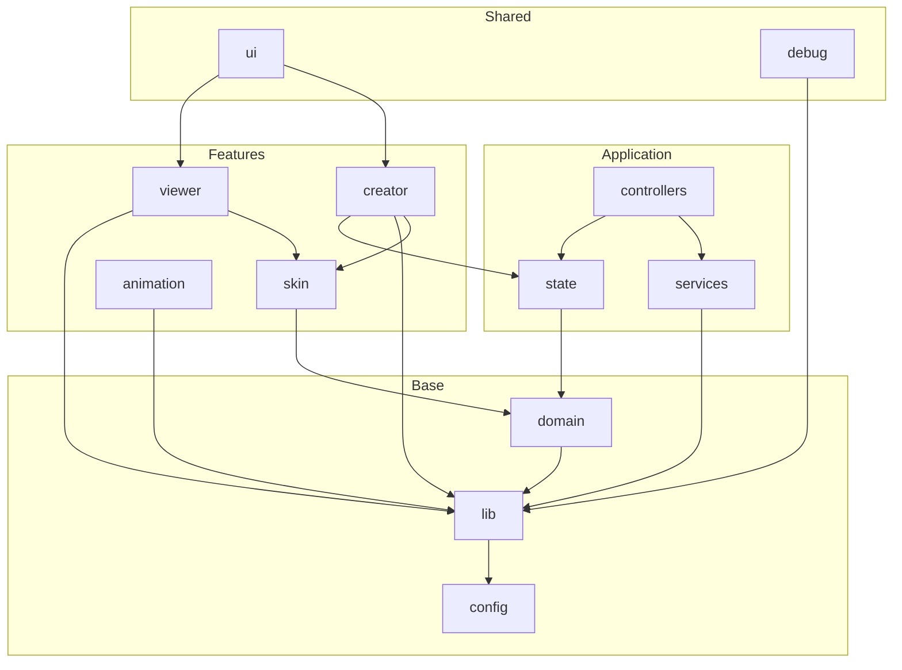

# Taxonomy Restructure Plan

## Target Structure

```
src/
├── main.ts
├── style.css
├── domain/           # types, constants, schemas
├── lib/              # logger, color, trapezoidBounds
├── config/           # existing preview/ + optional defaults
├── state/            # creatorState
├── services/         # socketManager, characterAI
├── controllers/      # modes (XState machine)
├── ui/               # previewCameraPanel, fakeChatUI, electronStatus
├── viewer/
├── creator/
├── animation/
├── skin/
└── debug/            # debugFacing, setupTestControls
```

## Phase 1: Foundation (lib, services, debug) + TAXONOMY.md

**Goal:** Create new directories, move infra modules, add barrel exports, fix imports. Build passes.

**Steps:**

1. Create directories: `domain/`, `lib/`, `state/`, `services/`, `controllers/`, `ui/`, `debug/`. Note: `config/` already exists at [src/config/preview/](src/config/preview/).
2. Write [docs/concepts/TAXONOMY.md](docs/concepts/TAXONOMY.md) with the full taxonomy table, layer definitions, directory layout, and dependency flow (as in the approved taxonomy).
3. Move files:
  - `logger.ts` → `lib/logger.ts`
  - `types/color.ts` → `lib/color.ts`
  - `socketManager.ts` → `services/socketManager.ts`
  - `characterAI.ts` → `services/characterAI.ts`
  - `debugFacing.ts` → `debug/debugFacing.ts`
  - `setupTestControls.ts` → `debug/setupTestControls.ts`
4. Create barrel files: `lib/index.ts`, `services/index.ts`, `debug/index.ts`.
5. Update imports in all consumers:
  - [main.ts](src/main.ts): `./logger` → `./lib`, `./socketManager` → `./services`, `./characterAI` → `./services`, `./electronStatus` (Phase 3), `./debugFacing` → `./debug`, `./setupTestControls` → `./debug`
  - [creator.ts](src/creator.ts): `./types/color` → `./lib/color`
  - [creator/colorPicker.ts](src/creator/colorPicker.ts): `../types/color` → `../lib/color`
  - [creator/brush.ts](src/creator/brush.ts): `../types/color` → `../lib/color`
  - [creator/blockyEditor.ts](src/creator/blockyEditor.ts): `../types/color` → `../lib/color`
  - [creator/swatches.ts](src/creator/swatches.ts): `../types/color` → `../lib/color`
  - [creator/undo.ts](src/creator/undo.ts): `../types/color` → `../lib/color`
  - [creator/wardrobeLibraryPanels.ts](src/creator/wardrobeLibraryPanels.ts): no color import
  - [viewer/skinApplication.ts](src/viewer/skinApplication.ts): `../logger` → `../lib`
  - [socketManager.ts](src/socketManager.ts): already moved, update self-import if any; consumers get it from services
  - [characterAI.ts](src/characterAI.ts): already moved; `../debugFacing` → `../debug`
  - [animation/manager.ts](src/animation/manager.ts): `../logger` → `../lib`, `../debugFacing` → `../debug`
  - [fakeChatUI.ts](src/fakeChatUI.ts): `./logger` → `./lib`
  - [debugFacing.ts](src/debugFacing.ts): `./logger` → `../lib` (after move)

**Verification:** `npm run build` succeeds.

---

## Phase 2: Domain Layer

**Goal:** Move catalog and preview types into `domain/`. Remove `types/` for catalog and previewConfig.

**Steps:**

1. Create `domain/catalog.ts` by moving content from [types/catalog.ts](src/types/catalog.ts).
2. Create `domain/preview.ts` by moving content from [types/previewConfig.ts](src/types/previewConfig.ts). Update the `LayerKey` import: `import type { LayerKey } from '../skin'`.
3. Create `domain/index.ts` re-exporting from `catalog` and `preview`.
4. Update consumers:
  - [main.ts](src/main.ts): `./types/catalog` → `./domain`
  - [creator.ts](src/creator.ts): `./types/catalog` → `./domain`
  - [creator/wardrobeLibraryPanels.ts](src/creator/wardrobeLibraryPanels.ts): `../types/catalog` → `../domain`
  - [viewer/previewPresets.ts](src/viewer/previewPresets.ts): `../types/previewConfig` → `../domain`
5. Delete [types/catalog.ts](src/types/catalog.ts) and [types/previewConfig.ts](src/types/previewConfig.ts). If `types/` is empty, remove the folder. If [types/color.ts](src/types/color.ts) was moved in Phase 1, `types/` may already be empty or only have color—verify and remove `types/` when empty.

**Verification:** `npm run build` succeeds.

---

## Phase 3: UI and Controllers

**Goal:** Create `ui/` and `controllers/`, move shared UI and mode machine.

**Steps:**

1. Move files:
  - `previewCameraPanel.ts` → `ui/previewCameraPanel.ts`
  - `fakeChatUI.ts` → `ui/fakeChatUI.ts`
  - `electronStatus.ts` → `ui/electronStatus.ts`
  - `modes/` (entire folder) → `controllers/modes/`
2. Create `ui/index.ts` and `controllers/index.ts` barrel exports.
3. Update imports:
  - [main.ts](src/main.ts): `./previewCameraPanel` → `./ui`, `./fakeChatUI` → `./ui`, `./electronStatus` → `./ui`, `./modes/appModeMachine` → `./controllers/modes/appModeMachine`
  - [ui/previewCameraPanel.ts](src/ui/previewCameraPanel.ts): `./creator/dom` stays `../creator/dom`, `./viewer` stays `../viewer`
  - [controllers/modes/appModeMachine.ts](src/controllers/modes/appModeMachine.ts): `../creator/api` → `../../creator/api`
4. Update [main.ts](src/main.ts) mode-related imports to use `./controllers/modes/appModeMachine` or a barrel from `./controllers` if preferred.

**Verification:** `npm run build` succeeds.

---

## Phase 4: State and Creator Events

**Goal:** Move creator state to `state/`, move `creatorEvents` into `creator/`.

**Steps:**

1. Move `creator/creatorState.ts` → `state/creatorState.ts`.
2. Move `creatorEvents.ts` → `creator/events.ts`.
3. Create `state/index.ts` exporting `createCreatorState` and related types.
4. Update imports:
  - [creator.ts](src/creator.ts): `./creator/creatorState` → `./state`, `./creatorEvents` → `./creator/events`
  - All creator/* files importing `./creatorState` or `../creator/creatorState` → `../state` or `../../state`
  - All files importing `creatorEvents`: `./creatorEvents` or `../creatorEvents` → `./creator/events` or `../creator/events`
  - Affected: [creator/blockyEditor.ts](src/creator/blockyEditor.ts), [creator/undo.ts](src/creator/undo.ts), [creator/brush.ts](src/creator/brush.ts), [creator/colorPicker.ts](src/creator/colorPicker.ts), [creator/editorToolsPanel.ts](src/creator/editorToolsPanel.ts), [creator/skinLayersPanel.ts](src/creator/skinLayersPanel.ts), [creator/swatches.ts](src/creator/swatches.ts), [creator/texturePositionPanel.ts](src/creator/texturePositionPanel.ts), [creator/wardrobePartsPanel.ts](src/creator/wardrobePartsPanel.ts), [creator/wardrobeLibraryPanels.ts](src/creator/wardrobeLibraryPanels.ts), [viewer/controls.ts](src/viewer/controls.ts), [main.ts](src/main.ts)

**Verification:** `npm run build` succeeds.

---

## Phase 5: Lib TrapezoidBounds

**Goal:** Move pure math from animation to lib.

**Steps:**

1. Move `animation/trapezoidBounds.ts` → `lib/trapezoidBounds.ts`.
2. Update [lib/index.ts](src/lib/index.ts) to export from `trapezoidBounds`.
3. Update [animation/manager.ts](src/animation/manager.ts): `./trapezoidBounds` → `../lib/trapezoidBounds` or `../lib`.
4. Update [animation/index.ts](src/animation/index.ts): ensure it re-exports trapezoidBounds from manager or lib as needed for external consumers. Check [setupTestControls.ts](src/debug/setupTestControls.ts) (now in debug): it imports from `./animation`—animation index should re-export `getTrapezoidBounds`, `WALK_CYCLE_DISTANCE`, `TurnStrategy` if used.

**Verification:** `npm run build` succeeds.

---

## Phase 6: Config Defaults (Optional)

**Goal:** Extract FALLBACK_SKINS, FALLBACK_ANIMATIONS, feature flags, and similar from [main.ts](src/main.ts) into `config/defaults.ts` and `config/featureFlags.ts`. Lower priority; can be deferred.

---

## External References

- [scripts/generate-wardrobe-parts.ts](scripts/generate-wardrobe-parts.ts) imports `../src/skin`—unchanged (skin path stays).
- [scripts/generate-skin-previews.js](scripts/generate-skin-previews.js) uses `src/config/preview`—unchanged.
- [vite.config.ts](vite.config.ts), [index.html](index.html)—no src path changes needed.

---

## Dependency Flow (Final)




---

## Risk Mitigation

- Run `npm run build` after each phase.
- Use `git add -p` or separate commits per phase for easy rollback.
- If a move creates circular imports, adjust barrel exports or split re-exports.

