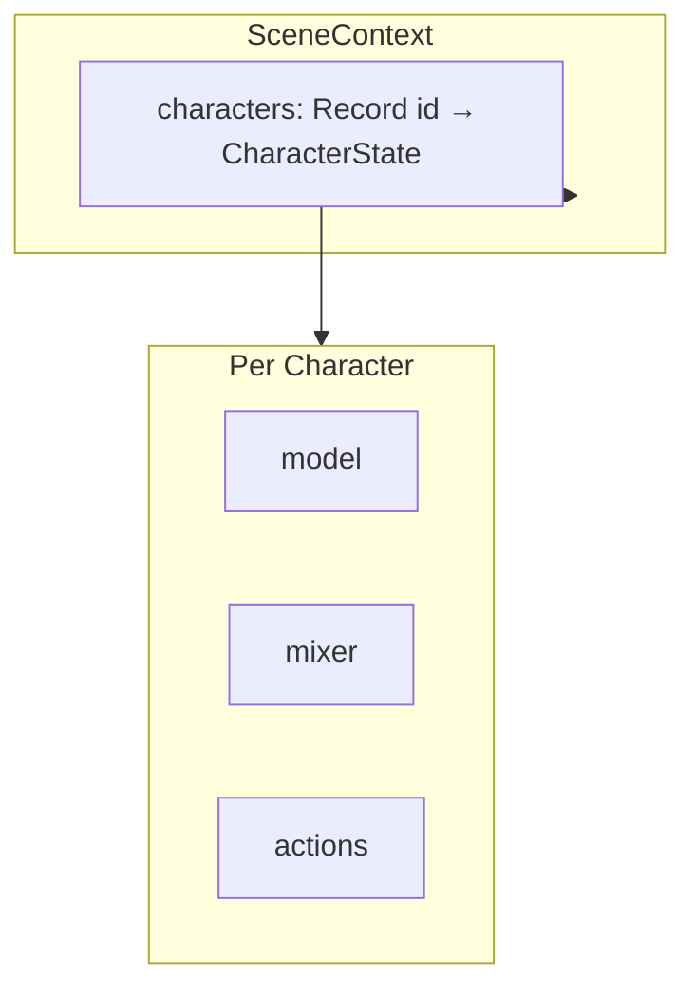

# Character Model

This document describes the character data model, configuration, and event payloads. Use it when adding characters or extending multi-character support.

**Audience:** humans and coding agents working in this repo.

---

## Overview

Characters are 3D models loaded from FBX with skin textures and animation clips. The app supports a single primary character by default; the data model and events include `characterId` for future multi-character UI.

---

## Data Model

### CharacterState

Defined in `src/controllers/characterTypes.ts`:

```ts
type CharacterState = {
  id: string;
  container: THREE.Group;   // Root we move during walkTo
  model: THREE.Group;       // FBX model
  mixer: THREE.AnimationMixer;
  actions: Record<string, THREE.AnimationAction>;
  currentAction: THREE.AnimationAction | null;
  idleAction: THREE.AnimationAction | undefined;
  texturePreset: TexturePreset;
  alphaMode: AlphaMode;
  currentSkin: string;
};
```

- **container:** Isolates root motion (model at 0,0,0).
- **mixer / actions:** Animation clips keyed by name (e.g. `walking`, `idle`, `bored`).
- **currentAction:** Currently playing animation.
- **idleAction:** Looping idle used for home mode.

### CharacterConfig

```ts
type CharacterConfig = {
  id: string;
  label: string;
  model: string;           // FBX path
  skin: string;            // Skin image path
  texturePreset: TexturePreset;
  alphaMode: AlphaMode;
  animations: Array<{ path: string; key: string }>;
  position: THREE.Vector3;
};
```

Built by `buildCharacterConfig(skinPath, animations, id?)`; `id` defaults to `DEFAULT_CHARACTER_ID`.

---

## Character ID

- **Constant:** `DEFAULT_CHARACTER_ID = 'runningboy'` in `src/domain/characters.ts`
- **Helper:** `getPrimaryCharacterId()` returns the default ID
- Use these instead of string literals when referring to the primary character

---

## Adding a Character

1. Build config: `buildCharacterConfig(skinPath, animations, id)` with a distinct `id`.
2. Call `loadCharacter(config, skins)` from `main.ts`.
3. The character is added to `sceneContext.characters[config.id]`.
4. Use `getCharacter(id)` to access by ID.

See **SCENE-CONTEXT.md** for scene ownership and `loadCharacter` flow.

---

## Event Payloads

Event details include `characterId?: string`; when absent, default to the primary character.

| Event | Payload | Default characterId |
|-------|---------|---------------------|
| `app:character:skin-change` | `{ characterId?, path }` | `getPrimaryCharacterId()` |
| `app:character:animation-play` | `{ characterId?, name }` | `getPrimaryCharacterId()` |

Subscribers resolve `characterId ?? getPrimaryCharacterId()` before calling `switchSkin`, `fadeToAction`, etc.

---

## Diagram: Scene → Characters


