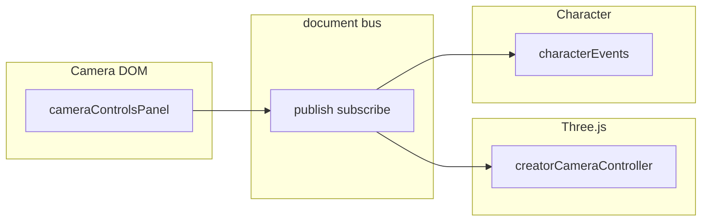

# Event System (document bus)

**Audience:** humans and coding agents working in this repo.

The **document `CustomEvent` bus** in [src/events/appEvents.ts](../../src/events/appEvents.ts) is used for **cross-boundary commands** only.

**Creator editor state** (color, layers, mode, canvas, etc.) uses **in-process slices** instead—see [MODELS-AND-SUBSCRIBERS.md](./MODELS-AND-SUBSCRIBERS.md) and [src/state/creatorSlices.ts](../../src/state/creatorSlices.ts).

---

## Convention (document bus)

- **Naming:** `app:<domain>:<action>`
- **Publish:** `publish(event, detail)` — `detail` is type-checked against `AppEventMap` (optional for events with no payload)
- **Subscribe:** `subscribe(event, handler)` — handler gets a `CustomEvent` typed for that event; returns unsubscribe function
- **Adding an event:** add it to `APP_EVENTS` *and* `AppEventMap` in `appEvents.ts`; typecheck fails if the two disagree.

---

## Event registry (remaining bus events)

| Event | Domain | Publishers | Subscribers | Payload |
|-------|--------|------------|-------------|---------|
| `app:creator:camera-yaw-left` | creator | cameraControlsPanel | creatorCameraController | `{ degrees?: number }` |
| `app:creator:camera-yaw-right` | creator | cameraControlsPanel | creatorCameraController | `{ degrees?: number }` |
| `app:creator:camera-pitch-up` | creator | cameraControlsPanel | creatorCameraController | `{ degrees?: number }` |
| `app:creator:camera-pitch-down` | creator | cameraControlsPanel | creatorCameraController | `{ degrees?: number }` |
| `app:creator:camera-zoom-in` | creator | cameraControlsPanel | creatorCameraController | (none) |
| `app:creator:camera-zoom-out` | creator | cameraControlsPanel | creatorCameraController | (none) |
| `app:creator:camera-recenter` | creator | cameraControlsPanel | creatorCameraController | (none) |
| `app:creator:camera-move-start` | creator | creatorCameraController | cameraControlsPanel | (none) |
| `app:creator:camera-move-end` | creator | creatorCameraController | cameraControlsPanel | (none) |
| `app:character:skin-change` | character | viewerUI, socket | characterEvents | `{ characterId?, path }` |
| `app:character:animation-play` | character | viewerUI, socket | characterEvents | `{ characterId?, name }` |

---

## Diagram

---

## Handler patterns

Use maps and registries instead of large switch statements where it helps. Creator UI panels that sync to shared state should use **creator slices**, not new `app:creator:*` strings.

---

## External skin and animation commands

External skin and animation commands (API/socket) publish `app:character:skin-change` and `app:character:animation-play`. The subscriber applies them in viewer context; see existing [characterEvents](../../src/controllers/characterEvents.ts) behavior.
