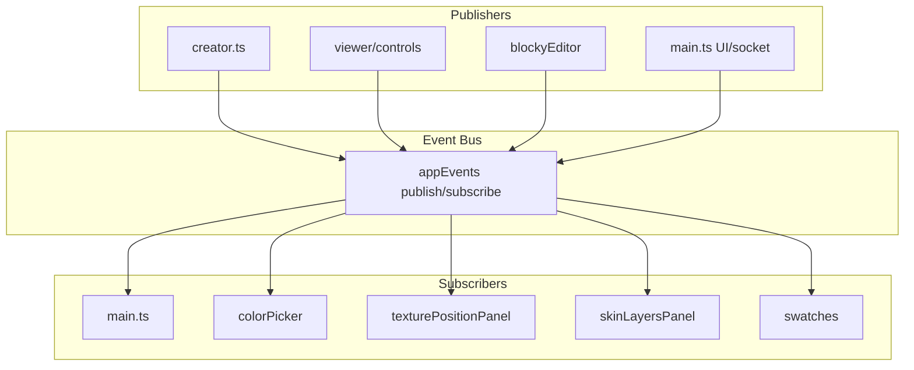

# Event System

Unified app event bus for domain state changes. All app-level events flow through [src/events/appEvents.ts](../../src/events/appEvents.ts).

**Audience:** humans and coding agents working in this repo.

---

## Convention

- **Naming:** `app:<domain>:<action>`
- **Detail objects:** Include `characterId?` for future multi-character support when relevant
- **Publish:** `publish(event, detail)` — call when state changes
- **Subscribe:** `subscribe(event, handler)` — returns unsubscribe function

---

## Event Registry

| Event | Domain | Publishers | Subscribers | Payload |
|-------|--------|------------|-------------|---------|
| `app:creator:current-color-change` | creator | creator.ts | colorPicker | `{ color: string }` |
| `app:creator:texture-position-change` | creator | creator.ts, controls | texturePositionPanel, skinLayersPanel | `{ part, layer, skinX, skinY, tool?, currentColor?, hoverColor? }` |
| `app:creator:swatch-history-change` | creator | creator.ts | swatches | (none) |
| `app:creator:skin-load-change` | creator | creator.ts | main, swatches | `{ path: string }` |
| `app:creator:swatch-palette-change` | creator | creator.ts | swatches | (none) |
| `app:creator:edit-mode-change` | creator | creator.ts | main, creator (bindModePanels), wardrobePartsPanel | `{ mode, previousMode? }` |
| `app:creator:tools-change` | creator | creator.ts | (UI sync) | (none) |
| `app:creator:layer3d-change` | creator | creator.ts, controls | main, skinLayersPanel, blockyEditor | `{ layer?, property?, ... }` |
| `app:creator:canvas-change` | creator | creator.ts, blockyEditor | main | (none) |
| `app:creator:lock-feedback` | creator | controls, blockyEditor | skinLayersPanel | `{ layer: string }` |
| `app:creator:camera-yaw-left` | creator | CameraControls | creatorCameraController | `{ degrees?: number }` |
| `app:creator:camera-yaw-right` | creator | CameraControls | creatorCameraController | `{ degrees?: number }` |
| `app:creator:camera-pitch-up` | creator | CameraControls | creatorCameraController | `{ degrees?: number }` |
| `app:creator:camera-pitch-down` | creator | CameraControls | creatorCameraController | `{ degrees?: number }` |
| `app:creator:camera-zoom-in` | creator | CameraControls | creatorCameraController | (none) |
| `app:creator:camera-zoom-out` | creator | CameraControls | creatorCameraController | (none) |
| `app:creator:camera-recenter` | creator | CameraControls | creatorCameraController | (none) |
| `app:creator:camera-move-start` | creator | creatorCameraController | CameraControls | (none) |
| `app:creator:camera-move-end` | creator | creatorCameraController | CameraControls | (none) |
| `app:character:skin-change` | character | main (UI + socket) | main | `{ characterId?, path }` |
| `app:character:animation-play` | character | main (UI + socket) | main | `{ characterId?, name }` |

---

## Event Flow Diagram

---

## Event Handling Conventions

Use data-driven patterns instead of switch/case so new handlers can be added without editing branches.

| Pattern | Use | Example |
|---------|-----|---------|
| **Handler map** | Key → handler lookup | `KEY_BINDINGS: Record<string, () => void>` for shortcuts |
| **Event registry** | Central subscribe array | `EVENT_HANDLERS: Array<{ event, handler, guard? }>` |
| **Command map** | Action name → handler | `ANIMATION_COMMANDS: Record<string, (char) => void>` |
| **Label map** | Value → display string | `TOOL_LABELS: Record<DrawingTool, string>` |
| **Component bindings** | Declare events; bootstrap wires | `ComponentEventBinding` with `scope` (creator/viewer/global) |
| **Strategy map** | Event type → handler | `POINTER_STRATEGIES: Record<string, (e, ctx) => void>` |

Add new handlers by extending the map or registry; avoid adding case branches.

---

## External skin and animation commands

**Intended behavior:** External skin and animation commands (POST `/api/skin`, `/api/animation`, or socket) apply to the primary character in **home (viewer) mode**. In **creator mode**, animation commands are ignored (character is under creator control). Skin commands from external sources apply regardless of route—the character model updates; updating the creator canvas from external skin commands could be added in future.

Both UI (skin/animation selector clicks) and external (API/socket) sources publish the same events (`app:character:skin-change`, `app:character:animation-play`). The subscriber checks route and acts accordingly; external commands work in home mode.
