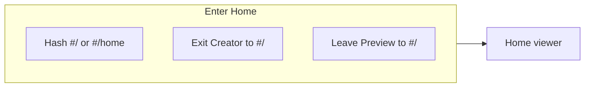
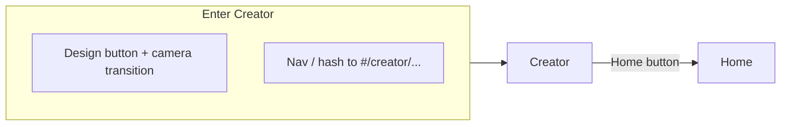
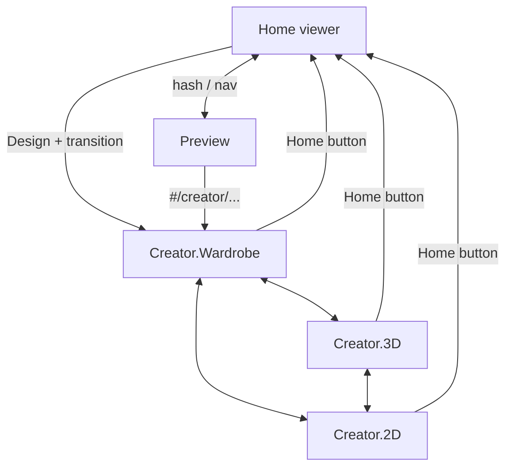

# Application modes (views, scenes, routes)

This document is the **canonical vocabulary** for how the app is partitioned into *modes*. Use it when reading user language (“home”, “world view”, “Creator.2D”) and when tracing code (`AppRoute`, `EditMode`, hash URLs).

**Audience:** humans and coding agents working in this repo.

---

## How to read user language

The same idea is often called **view**, **mode**, **scene**, or **world** (especially “world view” for the main 3D playground). Map informal speech to the names below:

| User / doc phrasing | Canonical mode | Code / URL |
|---------------------|----------------|------------|
| Home, home view, home mode, world view, main scene, “the viewer” | **Home** | `route: 'viewer'`, `#/` or `#/home` |
| Creator, creator view, character design, design mode | **Creator** | `route: 'creator'`, `#/creator` or `#/creator/<submode>` |
| Creator wardrobe, wardrobe tab | **Creator.Wardrobe** | `editMode: 'wardrobe'`, `#/creator/wardrobe` |
| Creator 3D, paint on model, 3D edit | **Creator.3D** | `editMode: '3d'`, `#/creator/3d` |
| Creator 2D, pixel editor, 2D canvas | **Creator.2D** | `editMode: '2d'`, `#/creator/2d` |
| Preview (nav label) | **Preview** | `route: 'preview'`, `#/preview` |

**Dot notation:** `Creator.Wardrobe`, `Creator.3D`, and `Creator.2D` mean “Creator route with that **edit mode**.” They are not separate top-level routes in code—only Creator has these submodes.

---

## Top-level routes (`AppRoute`)

The shell is driven by **hash routing** (`hashchange` → `applyRoute()` in `src/main.ts`). `document.body.dataset.route` mirrors the active route.

### Home (`viewer`)

| | |
|--|--|
| **Canonical name** | Home |
| **Aliases** | Viewer (nav label), home mode, home view, world view, main 3D view |
| **Hash** | `#/`, `#/home` (trailing slash normalized away) |
| **`body` attribute** | `data-route="viewer"` |
| **Primary trigger** | `location.hash` set to viewer hash; nav link “Viewer”; returning from Creator after exit animation |
| **Enters from** | Creator (Home button / `transitionCreatorToViewer`), Preview (`#/`) |
| **Exits to** | Creator (Design button → `transitionViewerToCreator` → camera move → `#/creator/...`), Preview (`#/preview`) |
| **Behavior notes** | Full-width `#app` in `creator-view-wrapper`; animation manager + character AI can run; skin/animation selectors in controls bar |
| **Core code** | `src/main.ts` (`getRouteInfo`, `applyRoute`, `resumeHomeMode`, character load, animation loop) |
| **Styles** | `src/style.css` — `body[data-route="viewer"]` (layout, floating home hidden, lower-left panels) |
| **Resources** | `/wardrobe/skins/index.json`, `/animations/index.json`, `/sequences/index.json`, `RunningboyRig.fbx`, skin PNGs |

---

### Creator (`creator`)

| | |
|--|--|
| **Canonical name** | Creator |
| **Aliases** | Creator mode, character creator, design mode, creator view |
| **Hash** | `#/creator`, `#/creator/wardrobe`, `#/creator/3d`, `#/creator/2d` |
| **`body` attributes** | `data-route="creator"`, `data-edit-mode="<wardrobe|3d|2d>"` |
| **Primary trigger** | After “Design” flow completes, `location.hash` becomes `#/creator/<currentEditMode>`; direct navigation to creator hash; `setEditMode` updates hash via `history.replaceState` while already on creator |
| **Enters from** | Home (Design), Preview (nav to creator hash) |
| **Exits to** | Home (`transitionCreatorToViewer`: optional `data-creator-exiting` on body, delay, then `#/`) |
| **Behavior notes** | `initCreator()` on first entry to route; shortcuts unregistered when leaving; leaving forces `navigate` tool and normalizes layer state for non-edit |
| **Core code** | `src/main.ts` (`applyRoute`, `transitionViewerToCreator`, `transitionCreatorToViewer`, `updateCreator3DViewPlacement`, preview texture sync); `src/creator.ts` (`setEditMode`, `getEditMode`, skin canvas, wardrobe); `src/creator/*.ts` (panels, brush, block editor) |
| **Styles** | `src/style.css` — `body[data-route="creator"]`, `[data-edit-mode="..."]` for canvas visibility/layout |
| **Resources** | Same model/skins as Home; wardrobe UI uses `public/wardrobe/skins/` and wardrobe parts indices as built by repo scripts |

---

### Preview (`preview`)

| | |
|--|--|
| **Canonical name** | Preview |
| **Aliases** | Preview route, preview mode (informal) |
| **Hash** | `#/preview` |
| **`body` attribute** | `data-route="preview"` |
| **Primary trigger** | Nav to `#/preview`; programmatic preview state for thumbnails / tooling |
| **Enters from** | Home, Creator (hash change) |
| **Exits to** | Home (`#/`), Creator (`#/creator/...`) |
| **Behavior notes** | Character locked to idle; creator shortcuts off; optional preview panels; FOV / camera preset driven by preview config |
| **Core code** | `src/main.ts` (`applyRoute` preview branch, `syncPreviewRouteState`, capture helpers in `src/viewer/capture3DThumbnail.ts` if used) |
| **Styles** | `src/style.css` — `body[data-route="preview"]` (shared with viewer for some chrome hiding) |
| **Resources** | Preview base skins, composed skin paths as configured for capture |

---

## Creator submodes (`EditMode`)

Submodes share **`route: creator`** and differ by `state.editMode` in `src/creator/creatorState.ts`, mirrored on `document.body.dataset.editMode`. Changes publish `CREATOR_EVENTS.EDIT_MODE_CHANGE` (`src/creatorEvents.ts`).

### Creator.Wardrobe (`wardrobe`)

| | |
|--|--|
| **Canonical name** | Creator.Wardrobe |
| **Aliases** | Wardrobe mode, wardrobe tab, outfit / parts picking |
| **Hash** | `#/creator/wardrobe` (default if segment missing or invalid: `#/creator` → wardrobe) |
| **`body`** | `data-route="creator"` `data-edit-mode="wardrobe"` |
| **Primary trigger** | Wardrobe mode button in editor tools; hash with `/wardrobe`; initial creator default |
| **Enters from** | Creator.3D, Creator.2D (mode buttons or URL) |
| **Exits to** | Creator.3D, Creator.2D |
| **Behavior notes** | On entry: `resetWardrobeSelections`, `captureWardrobeBaseFromCurrentCanvas`, `renderWardrobeLibraries`, default layer `fullOutfit`. Idle animation **plays** (not frozen)—see `applyCreatorCharacterPose`. 3D view lives in **main** area (`updateCreator3DViewPlacement`: `3d` or `wardrobe` → `#app` in wrapper). |
| **Core code** | `src/creator.ts` (`setEditMode` wardrobe branch); `src/creator/wardrobePartsPanel.ts`, `wardrobeLibraryPanels.ts` |
| **Styles** | Wardrobe panel classes (`creator-wardrobe-*`); canvas area rules for `data-edit-mode="wardrobe"` |
| **Resources** | `public/wardrobe/skins/index.json`, generated wardrobe parts under `public/wardrobe/` (see `scripts/generate-wardrobe-parts.ts`) |

---

### Creator.3D (`3d`)

| | |
|--|--|
| **Canonical name** | Creator.3D |
| **Aliases** | 3D edit mode, paint on model |
| **Hash** | `#/creator/3d` |
| **`body`** | `data-edit-mode="3d"` |
| **Primary trigger** | 3D mode button; hash; keyboard shortcut `3` (first mode button on mode panel) |
| **Enters from** | Creator.Wardrobe, Creator.2D |
| **Exits to** | Creator.Wardrobe, Creator.2D, Home |
| **Behavior notes** | Idle pose **frozen at frame 0** for stable painting (`lockCharacterFrozenForPainting`). Layer visibility/lock affect brush and mesh visibility. 3D view in **main** area. Orbit controls adjusted for creator (`updateOrbitControlsForEditMode`). |
| **Core code** | `src/creator.ts`, `src/creator/blockyEditor.ts`, `src/creator/brush.ts`, `src/viewer/controls.ts` (subscribes to edit mode), `src/viewer/skinApplication.ts`, `src/main.ts` (`updateCreatorPreviewTexture`, `applyCreatorLayerVisibility`) |
| **Styles** | `body[data-route="creator"][data-edit-mode="3d"] .creator-canvas-area` |
| **Resources** | Working skin texture from creator canvas; mesh part map in `src/skin/meshPartMapping.ts` |

---

### Creator.2D (`2d`)

| | |
|--|--|
| **Canonical name** | Creator.2D |
| **Aliases** | 2D mode, pixel editor, flat canvas editing |
| **Hash** | `#/creator/2d` |
| **`body`** | `data-edit-mode="2d"` |
| **Primary trigger** | 2D mode button; hash; keyboard shortcut `2` |
| **Enters from** | Creator.Wardrobe, Creator.3D |
| **Exits to** | Creator.Wardrobe, Creator.3D, Home |
| **Behavior notes** | Same frozen idle as 3D for painting reference. **`#app` (Three.js) moves into `#creator-3d-preview-slot`** — small preview; large area is 2D canvas / blocky grid. |
| **Core code** | `src/creator.ts`, `src/creator/blockyEditor.ts`, `src/main.ts` (`updateCreator3DViewPlacement`) |
| **Styles** | `body[data-route="creator"][data-edit-mode="2d"]` rules for `.creator-canvas-area`, `.creator-blocky-grid` |
| **Resources** | 64×64 layout from `src/skin/layout.ts`, `src/skin/coordinates.ts` |

---

## Combined transition diagram

---

## Implementation cheat sheet

| Concern | Where |
|--------|--------|
| Parse hash → route + creator submode | `getRouteInfo()` in `src/main.ts` |
| Apply route to DOM + scene | `applyRoute()` in `src/main.ts` |
| Set creator submode + event | `setEditMode()` in `src/creator.ts` |
| Submode constants / types | `EDIT_MODE_*`, `EditMode` in `src/creator/api.ts` |
| Creator state default (`editMode`) | `createCreatorState()` in `src/creator/creatorState.ts` |
| URL sync when submode changes | `syncCreatorModeUrl()` in `src/creator.ts` (only when `data-route="creator"`) |
| Mode change event | `CREATOR_EVENTS.EDIT_MODE_CHANGE` in `src/creatorEvents.ts` |
| Mode toggle UI | `src/creator/editorToolsPanel.ts` (Wardrobe / 3D / 2D buttons, keys 1–3) |
| Layout: where the WebGL canvas lives | `updateCreator3DViewPlacement()` in `src/main.ts` |

---

## Related documentation

- Wardrobe behavior detail: `docs/specs/CREATOR-WARDROBE-MODE-SPEC.md`
- Creator vs viewer state: `docs/specs/CREATOR-VIEWER-STATE-MANAGEMENT.md`
- Cursor rule (short alias map): `.cursor/rules/app-modes.mdc`
