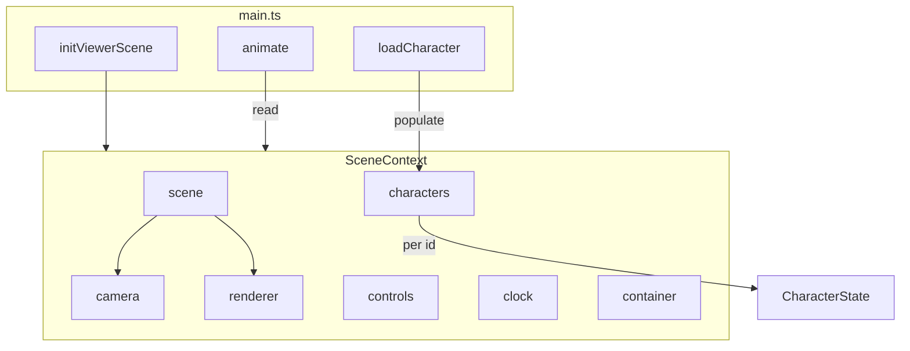

# Scene Context

This document describes the **scene context** object that bundles Three.js scene-related state. Use it when adding characters, passing scene dependencies to components, or understanding the viewer/controllers boundary.

**Audience:** humans and coding agents working in this repo.

---

## Overview

The scene context (`SceneContext`) is the single object that owns:

- The Three.js scene, camera, renderer, and orbit controls
- The animation clock
- The characters map (per-character model, mixer, actions)
- The DOM container element that hosts the canvas

All scene access flows through `sceneContext` (or `getSceneContext()`) so that initialization and route logic stay consistent. See **TAXONOMY**: scene lives at the controllers/viewer boundary—`main.ts` orchestrates, `viewer/` owns scene creation.

---

## Where the scene is created

The scene is created in `main()` via `initViewerScene()`:

```
main() → initViewerScene(container, params) → SceneContext
```

- **File:** `src/main.ts`
- **Factory:** `initViewerScene` from `src/viewer/scene.ts`
- **Container:** `#three-canvas-container` DOM element

After creation, `sceneContext` is stored at module level in `main.ts` and populated before any character load or animation loop runs.

---

## SceneContext type

Defined in `src/viewer/scene.ts`:

```ts
type SceneContext = {
  scene: THREE.Scene;
  camera: THREE.PerspectiveCamera;
  renderer: THREE.WebGLRenderer;
  controls: OrbitControls;
  clock: THREE.Clock;
  characters: Record<string, unknown>;
  container: HTMLElement;
};
```

In `main.ts`, an extended type (`AppSceneContext`) narrows `characters` to `Record<string, CharacterState>` for the running app. The base `SceneContext` uses `Record<string, unknown>` so the viewer module stays agnostic of character shape.

---

## Diagram: scene ownership



---

## How to add a character

1. Ensure `sceneContext` is initialized (after `main()` has run).
2. Build a `CharacterConfig` (model path, skin path, animations, etc.).
3. Call `loadCharacter(config, skins)` from `main.ts`. It:
   - Loads the FBX model
   - Loads the skin texture
   - Creates the character container and mixer
   - Assigns to `sceneContext.characters[config.id]`
4. For multi-character support, pass a distinct `id` in the config. See **CHARACTERS.md** (when present) for event payloads and `characterId` conventions.

---

## Access patterns

| Need | Use |
|------|-----|
| Scene, camera, renderer, controls | `getSceneContext()` (throws if not initialized) |
| Check if scene exists | `sceneContext` (may be null before `main()`) |
| Get a character by id | `getCharacter(id)` (returns `CharacterState \| undefined`) |
| Update controls (e.g. recreate OrbitControls) | `sceneContext.controls = recreateOrbitControls(...)` |

Functions that run before `main()` completes (e.g. early `applyRoute` from hash init) should guard with `if (!sceneContext) return` before accessing scene state.

---

## Reference: TAXONOMY

- **viewer:** 3D scene, skin application, orbit controls. `SceneContext` and `initScene` live here.
- **controllers / main.ts:** Orchestrates scene creation, character load, mode machine, and `applyRoute`. Owns `sceneContext` and passes it (or getters) to services and UI.
