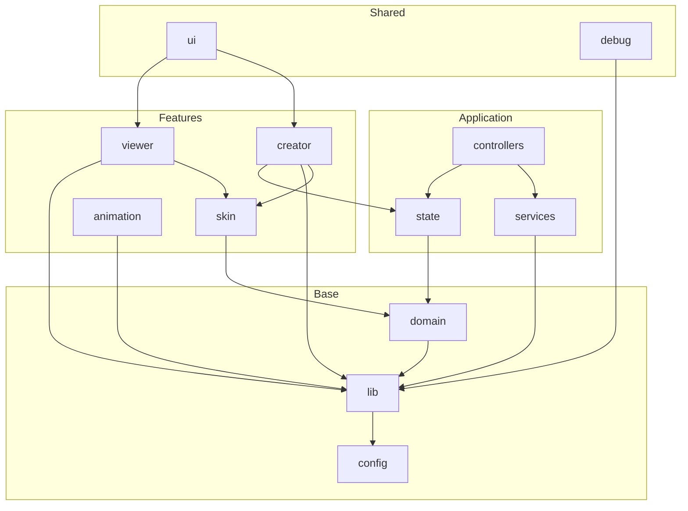

# Source Code Taxonomy

This document defines the canonical structure of the `src/` directory. Use it when adding new code or when agents need to locate logic by concern.

---

## Taxonomy Table

| Layer | Purpose | Contains |
|-------|---------|----------|
| **domain** | Types, constants, schemas | Catalog types, EditMode, skin bounds, preview types |
| **lib** | Pure functions, shared utilities | Logger, color, math, URL helpers |
| **config** | Static configuration | Defaults, feature flags, preview configs |
| **state** | Shared runtime state (optional) | Session catalogs, creator state |
| **services** | External I/O and integrations | Socket manager, character AI, API wrappers |
| **controllers** | Flow and orchestration | Mode machine, routes, bootstrap |
| **ui** | Shared visual components | Panels, overlays, chrome |
| **viewer** | 3D rendering and controls | Scene, skin application, orbit controls |
| **creator** | Creator feature (including its UI) | Panels, canvas, tools, wardrobe |
| **animation** | Animation playback | Manager, trapezoid bounds |
| **skin** | Skin domain logic | Layout, coordinates, mesh mapping |
| **debug** | Dev-only | DebugFacing, setupTestControls |

---

## Layer Definitions

| Layer | Role |
|-------|------|
| **domain** | Types, constants, schemas. Single source of truth for data shapes and domain rules. |
| **lib** | Pure helpers and shared utilities. No feature logic, minimal side effects. |
| **config** | Static configuration. Defaults, feature flags, preset options. |
| **state** | Shared runtime state used across features. |
| **services** | External I/O and integrations. Socket, AI, API. |
| **controllers** | Application flow. Bootstrap, routes, mode machine, character lifecycle. |
| **ui** | Shared visual components: panels, overlays, chrome (nav, electron status). |
| **viewer** | 3D scene, skin application, orbit controls. |
| **creator** | Creator feature and its UI: panels, canvas, tools, wardrobe. |
| **animation** | Animation manager and playback. |
| **skin** | Skin layout, coordinates, mesh mapping. |
| **debug** | Dev-only utilities. |

---

## Directory Layout

```
src/
├── main.ts
├── style.css
│
├── domain/           # types, constants, schemas
├── lib/              # logger, color, trapezoidBounds
├── config/           # defaults, feature flags, preview configs
├── state/            # shared runtime state
├── services/         # socket, AI, API
├── controllers/      # app, routes, character, modes
│
├── ui/               # shared visual components
├── viewer/           # 3D scene, controls, skin application
├── creator/          # creator feature + its panels
├── animation/        # manager, playback
├── skin/             # layout, coordinates, mesh mapping
└── debug/            # dev-only
```

---

## Dependency Flow



---

## Quick Reference for Agents

| Concern | Location |
|---------|----------|
| Skin layout, UVs | `src/skin/` |
| Domain types (catalog, preview) | `src/domain/` |
| Routing, modes | `src/controllers/` |
| Creator state | `src/state/creatorState.ts` |
| Network, AI | `src/services/` |
| Pure helpers (color, logger) | `src/lib/` |
| Shared UI (preview panel, chat) | `src/ui/` |
