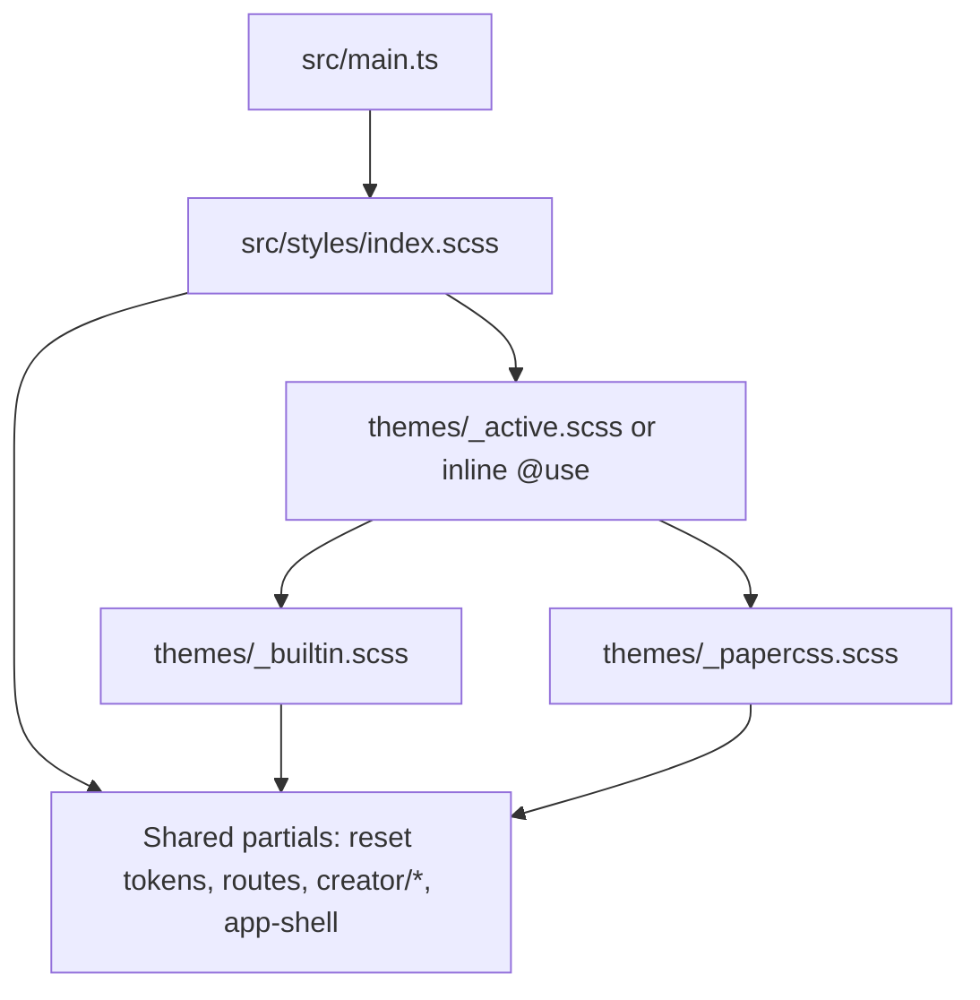

# CSS theme swap — phased implementation plan

## Goal

- **Single switch:** One import or one forwarded module in the main stylesheet chain decides which **core theme** loads (today’s custom dark look vs [PaperCSS](https://github.com/papercss/papercss) from npm).
- **Not required:** Live toggle, persisted preference, or Electron-specific APIs.
- **Constraint:** Keep `src/main.ts` importing **one** styles entry (`./styles/index.scss` or equivalent) unless a technical blocker forces a second import (prefer resolving inside SCSS).

## Starting point

| Item | Location |
|------|----------|
| Style entry | [`src/main.ts`](src/main.ts) → [`src/styles/index.scss`](src/styles/index.scss) |
| Global base | [`src/styles/_reset.scss`](src/styles/_reset.scss) (`:root`, `html`/`body` colors, fonts) |
| App chrome | [`src/styles/_app-shell.scss`](src/styles/_app-shell.scss), [`src/styles/_routes.scss`](src/styles/_routes.scss), creator partials under [`src/styles/creator/`](src/styles/creator/) |
| Build | Vite + Dart Sass ([`package.json`](package.json)) |

## Architecture (target)

- **Theme modules** load first (base framework + `:root` / `html` theme contract).
- **Shared partials** own layout and structure; they consume **CSS custom properties** where colors/fonts/radii repeat, so a theme can redefine tokens without rewriting every rule.

## Out of scope (unless explicitly added later)

- Runtime theme switching, settings UI, or `prefers-color-scheme` automation.
- Rewriting all creator panels to PaperCSS class names in one pass.
- Changing HTML structure app-wide solely for Paper (optional phase only where it pays off).

---

## Phase 1 — Theme shell and single switch

**Objective:** Introduce `src/styles/themes/` with a **builtin** theme that reproduces current globals, and make [`src/styles/index.scss`](src/styles/index.scss) delegate the “core” layer to one active theme (one `@use` or `@forward` to change).

**Tasks**

1. Add `src/styles/themes/_builtin.scss` (or `builtin.scss` with `@use` from index — match repo `camelCase` preference for new files per conventions).
2. Move **theme-specific** rules from [`_reset.scss`](src/styles/_reset.scss) into the builtin theme where appropriate: e.g. `body` background, text color, font stack. Keep **non-theme** basics in reset if desired (box-sizing, `overflow: hidden`, structural `--creator-right-panel-width` can stay in reset or move to a tiny `_tokens-layout.scss` — pick one place and document in the theme file header).
3. Ensure `index.scss` order stays intentional: **theme → reset (if any remains) → rest**.

**Acceptance criteria**

- [ ] Flipping only the active theme `@use` path is the documented way to swap cores (even if Paper is not wired yet, stub a second file that `@forward`s builtin).
- [ ] Default build looks **visually unchanged** from before Phase 1 (pixel-parity for main chrome and creator unless intentional).
- [ ] Short file-level comment on `index.scss` or `themes/_active.scss`: “Change active theme here.”

---

## Phase 2 — Design tokens on high-impact partials

**Objective:** Reduce hardcoded colors (and repeated fonts/radii where cheap) in shared SCSS by binding them to **`var(--…)`** on `:root`, with **builtin** theme defining the default values.

**Priority surfaces (suggested order)**

1. [`_reset.scss`](src/styles/_reset.scss) / builtin: `--app-bg`, `--app-fg`, `--app-font-family`, optional `--app-muted-fg`.
2. [`_app-shell.scss`](src/styles/_app-shell.scss): floating controls, borders, shadows (map to `--accent`, `--surface-elevated`, etc. — keep the set small and name by role, not by hex).
3. [`_routes.scss`](src/styles/_routes.scss) and one or two dominant creator files (e.g. [`creator/_panels.scss`](src/styles/creator/_panels.scss)) if they share the same tokens.

**Tasks**

1. Define a **minimal token set** in builtin theme (document the list in the theme file or a `themes/_token-names.md` comment block — avoid a new doc file unless the team wants it).
2. Replace literals with `var(--token)` only where it improves theme swap; do not boil the ocean.
3. Run dev build and spot-check **viewer**, **creator** (wardrobe + one other mode).

**Acceptance criteria**

- [ ] Builtin theme defines all tokens used by updated partials; no broken `var()` references.
- [ ] No visual regression on the areas touched (or differences are documented as intentional token cleanup).
- [ ] New partials should prefer tokens over raw hex when adding UI.

---

## Phase 3 — PaperCSS dependency and second theme module

**Objective:** Add PaperCSS as a dependency and a **`themes/_papercss.scss`** (name may vary) that imports the published CSS and aligns the app’s tokens + global contract.

**Tasks**

1. Add `papercss` to `package.json` (pin to a known version, e.g. latest stable from [releases](https://github.com/papercss/papercss/releases)).
2. In the Paper theme module, import Paper’s dist stylesheet (path as shipped by the package — typically `dist/paper.css` or minified variant). If Sass/Vite interaction is awkward, document the fallback: import Paper from `main.ts` once **after** the SCSS entry (only if necessary; prefer keeping a single SCSS-driven story).
3. Set `:root` / `html` / `body` token overrides so **layout** still works (full viewport, `overflow` behavior unchanged unless product wants scroll).
4. Apply Paper’s **dark mode** contract if using dark UI: their docs describe adding `.dark` on `html` — either set it in the static HTML shell or document that the Paper theme expects `document.documentElement.classList.add('dark')` from a one-line bootstrap (only if you want dark Paper; otherwise use light Paper tokens).
5. Switch **active theme** to Paper locally, fix **obvious** clashes (e.g. global `body` background fighting the canvas).

**Acceptance criteria**

- [ ] With active theme = Paper, app loads without console/CSS errors.
- [ ] 3D canvas and core interactions remain usable (contrast, hit targets, z-index).
- [ ] README or plan note: exact line/file to change to switch builtin ↔ Paper.

---

## Phase 4 (optional) — Markup and component alignment

**Objective:** Where Paper’s look depends on **classes** (buttons, cards, alerts), selectively add classes or wrappers in HTML builders / templates for high-value UI (e.g. primary actions, modals), without rewriting the entire creator.

**Tasks**

1. Inventory 3–5 UI elements that would benefit most from Paper classes (e.g. main nav buttons, dialogs).
2. Patch DOM builders only where needed; keep creator internals on tokens from Phase 2 where possible.
3. Add any Paper-specific overrides in `themes/_papercss.scss` (scoped to `#app` or `body[data-route=…]` to avoid leaking).

**Acceptance criteria**

- [ ] Paper theme feels intentional on chosen surfaces, not half-default/half-Paper.
- [ ] Builtin theme unchanged when those classes are inert or harmless.

---

## Verification checklist (any phase)

- `npm run dev` — smoke: `#/`, `#/creator/wardrobe`, `#/creator/3d`.
- `npm run build` — no Sass resolution errors.
- Electron packaging path unchanged if styles stay under Vite bundle.

## Risks and mitigations

| Risk | Mitigation |
|------|------------|
| Paper global styles override Three/canvas or break layout | Load order + scoped overrides in Paper theme; token-based `body`/`#app` rules after Paper import if needed |
| Sass `@use` vs plain CSS from `node_modules` | Use Vite’s CSS handling; test early in Phase 3 |
| Token sprawl | Cap token count; add new tokens only when a second theme needs them |

## Summary: phase order

| Phase | Deliverable |
|-------|-------------|
| **1** | `themes/` + builtin extraction + single switch; visual parity |
| **2** | Shared partials use CSS variables; builtin defines defaults |
| **3** | `papercss` package + Paper theme module + documented switch |
| **4** (opt) | Targeted Paper classes + overrides |

---

*Last updated: aligned with repo layout as of `src/styles/index.scss` + Vite/Sass stack.*
