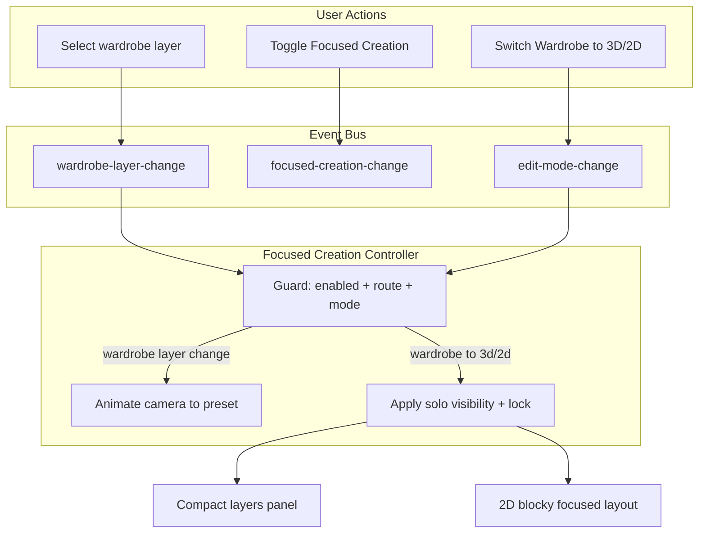

# Focused Creation Mode — Implementation Plan

## Summary

Focused Creation is a toggleable feature that guides the user by:

- **Initial wardrobe entry:** When first entering Creator.Wardrobe, the camera uses the full outfit preview preset (same as Preview when viewing the full skin) instead of the current creator default.
- **Wardrobe mode:** When the user selects a layer (hat, head, jacket, etc.), the camera animates to that part's preset view.
- **Mode transition (wardrobe to 3D/2D):** The camera stays put; focused visibility/lock is applied from the wardrobe selection (see [Outline: Wardrobe, 3D, and 2D behavior](#outline-wardrobe-3d-and-2d-behavior) below).
- **Layers panel (3D/2D):** In focused mode, the panel opens in a **partially collapsed** state: only layers that are **currently visible** are listed. The user can **expand** to see every layer row; expanded UI shows **true** visibility/lock/part state for all layers.
- **Blocky editor (2D):** In focused mode, the editor **restructures** so only the skin regions for the focused wardrobe selection occupy the layout (bounding boxes from [SKIN_LAYER_BOUNDS](src/skin/)); the rest of the 64×64 map is not merely dimmed—it is **out of the structured view** until the user expands layers in 2D or changes wardrobe selection and re-enters 2D (see [Blocky editor: focused layout](#blocky-editor-focused-layout)).

Default: **ON**. Toggle OFF for experienced users who want full manual control.

**Unresolved product choices** are captured in **Open decisions** tables throughout this document (see [Open decisions index](#open-decisions-index)). Each table has an **Answer** column to fill in as decisions are made.

---

## Starting point: branch `creative-wardrobe-focused-camera`

There is a **WIP implementation** on git branch **`creative-wardrobe-focused-camera`** (e.g. commit `8929597`, message *“WIP: Focused Creation mode — camera, layers, transitions”*). It predates parts of this plan (composite wardrobe keys, compact layers panel, blocky focused layout) but is the right **spine** to rebase or cherry-pick onto current `main` and extend.

### What the branch already implements

| Area | Files (on branch) | Maps to this plan |
|------|-------------------|-------------------|
| **Focused Creation controller** | [`src/controllers/focusedCreationController.ts`](src/controllers/focusedCreationController.ts) (new) | §5 — subscribes to `WARDROBE_LAYER_CHANGE` (camera → preset in Wardrobe) and `EDIT_MODE_CHANGE` (Wardrobe → 3D/2D → solo). **Reuse** the module; extend deps when adding compact panel / blocky layout triggers. |
| **Events** | [`src/events/appEvents.ts`](src/events/appEvents.ts) | §1 — `wardrobe-layer-change`, `focused-creation-change`. **Reuse**; add more event types only if you prefer bus over direct calls for compact/blocky UI. |
| **Creator state + API** | [`src/state/creatorState.ts`](src/state/creatorState.ts), [`src/creator.ts`](src/creator.ts) | §2–3 — `focusedCreationEnabled`, localStorage, `getFocusedCreationEnabled` / `setFocusedCreationEnabled`, `getWardrobeSelectedLayer`, publish on wardrobe `setSelectedLayer`. **Reuse**; may add flags (e.g. layers panel compact) next to `focusedCreationEnabled`. |
| **Solo helper** | [`src/creator/layerVisibility.ts`](src/creator/layerVisibility.ts) | §4 — `applyFocusedSoloForLayer(layer)` clears solo modes, sets one **`LayerKey`** visible/unlocked, clears part visibility. **Replace or wrap** with `WardrobeLayerKey` → member `LayerKey` set (composites); keep `clearLayerSoloModes` + publish pattern. |
| **Initial Wardrobe camera + FOV** | [`src/main.ts`](src/main.ts) | §6 — `getCreatorEntryCameraPose()`, first-entry snap uses `fullOutfit` preset when Focused ON. **Reuse**; reconcile with any `main` changes in `applyRoute`. |
| **Enter/exit Creator camera** | [`src/controllers/transitions/creatorTransitionHandler.ts`](src/controllers/transitions/creatorTransitionHandler.ts), [`src/main.ts`](src/main.ts) | Saves Home camera on enter Creator; restores (or default) on exit; `getCreatorEntryCameraPose` / `animateCameraToPose` naming. **Reuse** if still desired alongside Preview-style wardrobe entry. |
| **Toggle UI** | [`src/viewer/CameraControls.ts`](src/viewer/CameraControls.ts), [`src/styles/creator/_camera-controls.scss`](src/styles/creator/_camera-controls.scss) | §7 — Focused / Free toggle via optional `buildCameraControls(deps)`. **Reuse** as-is. |
| **Exports** | [`src/controllers/index.ts`](src/controllers/index.ts) | §8 — export focused creation factory. **Reuse**. |
| **Docs** | [`docs/concepts/EVENT-SYSTEM.md`](docs/concepts/EVENT-SYSTEM.md) | §9 — register new events. **Update** when events or publishers/subscribers grow. |

### Gaps vs this plan (implement on top of the branch or `main`)

- **Composite `WardrobeLayerKey`:** Branch solo only treats a single `isLayerKey` layer; composites no-op. Plan §4 / edge cases require a **shared map** from wardrobe tree → `LayerKey[]` for solo, presets, and blocky bounds.
- **Layers panel:** Branch does **not** implement compact vs expanded list or **checkbox sync** on programmatic `LAYER3D_CHANGE` — that caused 3D UI drift relative to state. Plan [Layers panel: focused compact and expanded](#layers-panel-focused-compact-and-expanded).
- **Blocky editor:** No focused **layout restructure** on the branch. Plan [Blocky editor: focused layout](#blocky-editor-focused-layout).
- **`main` divergence:** Current `main` may have more `LAYER_KEYS` / wardrobe taxonomy than the branch base; resolve conflicts in `layerVisibility.ts`, `creator.ts`, and `main.ts` while keeping the branch’s **event + controller + toggle** structure.

### How to use this branch in an implementation pass

1. **Rebase or cherry-pick** `creative-wardrobe-focused-camera` onto latest `main` (expect conflicts in shared files).
2. **Land unchanged first** where possible: `focusedCreationController` shape, events, creator getters/setter, `buildCameraControls` deps, transition handler + `getCreatorEntryCameraPose` if those match product intent.
3. **Extend** `applyFocusedSolo*` with wardrobe-aware mapping; wire controller (or creator) to set **compact panel** + **blocky focused mode** on the same transitions that call solo.
4. **Implement** `skinLayersPanel` and `blockyEditor` per this plan; subscribe to `LAYER3D_CHANGE` / `EDIT_MODE_CHANGE` / `FOCUSED_CREATION_CHANGE` as needed.
5. **Drop or revise** any branch behavior that conflicts with updated `main` (e.g. duplicate camera snaps).

---

## Outline: Wardrobe, 3D, and 2D behavior

This section is the **product spec** for what the user should see when Focused Creation is **ON**. Wardrobe keys may be **leaves** (`hat`, `head`, …) or **composites** (`top`, `center`, …); implementation maps each to a set of `LayerKey` visibility/lock rules and to preview presets (see [Edge cases and guards](#edge-cases-and-guards) and taxonomy docs).

### A. User selects a row in Creator.Wardrobe

- **Camera:** Animates to the preview preset for that wardrobe selection (or full outfit for `fullOutfit`).
- **Wardrobe UI:** Unchanged from current behavior (tree, library, placeholders).
- **Layer state (behind the scenes):** Selection is stored as today (`WardrobeLayerKey`); no requirement to mutate 3D layer visibility **until** the user leaves Wardrobe for 3D/2D (optional: could pre-solo in Wardrobe for consistency—decide in implementation; this plan assumes solo applies on transition to 3D/2D).

#### Open decisions (Wardrobe layer state)

| Question | Answer |
|----------|--------|
| Should **3D visibility/lock** update **while still in Wardrobe** (pre-solo) so the character matches the focused selection before switching modes, or only **on transition** to Creator.3D / Creator.2D? | |
| Wardrobe composite key **`all`** vs **`fullOutfit`:** Same solo/camera/panel behavior, or different (e.g. `all` = every leaf visible; `fullOutfit` = preset + no solo)? | |

The 3D visibility/lock should update in all modes. So the new modes that are transitioned to are up-to-date with the state of the system. I want the layer changes to fire events. The events to be handled by controllers. The controllers modify the models. The models update their visual representation. I don't want to have to constantly manage the state of view when the model represents it. Using Model-View-Controller strategies. 

### B. User switches from Wardrobe → Creator.3D

- **Camera:** Does not snap away from the pose established in Wardrobe; same rule as existing plan (no `applyRoute` re-snap on in-creator mode change).
- **3D visibility/lock:** Apply **focused solo** for the current wardrobe selection: only the relevant layer(s) are visible and paintable (unlocked); others hidden and locked. Mapping must handle **composite** wardrobe keys (expand to member `LayerKey` set), not only single `LayerKey` rows.
- **Layers panel:** Enters **partially collapsed (focused) layout**:
  - **Shown:** Only rows for layers that are **currently visible** (the focused set).
  - **Hidden until expand:** Rows for layers that are hidden in this focused state.
  - **Expand affordance:** Clear control (e.g. chevron, “Show all layers”) to expand the full list.
- **After expand:** Every layer row is visible; **checkboxes and part toggles reflect actual state** (including layers that are off or locked). User can show/hide/lock layers manually; that updates state as today.

### C. User switches from Wardrobe → Creator.2D (or 3D → 2D)

- **Layer state:** Same focused visibility/lock as in 3D for the same wardrobe selection (stay consistent across 3D ↔ 2D while focused).
- **Layers panel:** Same **partially collapsed** behavior as Creator.3D: only visible layers listed until the user expands; expanded shows full list with correct state.
- **Blocky editor:** **Focused layout mode** (see [Blocky editor: focused layout](#blocky-editor-focused-layout)):
  - The editor **restructures** to present **only** the pixel regions that belong to the focused layer set—derived from [SKIN_LAYER_BOUNDS](src/skin/) (and part visibility where applicable).
  - This is **not** a full 64×64 grid with other cells merely hidden or disabled; the **layout is limited to those bounding regions** (e.g. repositioned/scaled strips or a composite of rects—implementation detail left to UI design).
  - Regions outside the focused set **remain absent from this structured view** until:
    - The user **expands** the Creator.2D layers panel and uses visibility (or equivalent) to **show** additional layers, at which point the blocky view **updates** to include those regions; or
    - The user returns to **Creator.Wardrobe**, selects a **different** body part/layer, and enters Creator.2D again—then focused regions **recompute** from the new selection.

### D. Order of operations summary

1. **Wardrobe:** Pick part → camera follows selection.
2. **Enter 3D:** Solo + **compact** layers panel + 3D matches.
3. **Enter 2D:** Same solo + **compact** layers panel + **restructured** blocky editor to focused bounds only.
4. **Expand layers panel (3D or 2D):** Full list, truthful state; user can reveal more layers.
5. **New wardrobe selection + re-enter 2D:** New focused bounds and compact panel baseline.

### E. Focused Creation OFF

- Existing behavior: no auto-solo, no forced compact layers panel, no blocky restructuring (full map layout as today).

#### Open decisions (toggling Focused Creation)

| Question | Answer |
|----------|--------|
| User turns **Focused OFF** while in Creator.3D or Creator.2D: restore **previous** visibility/lock (undo solo), **leave state as-is**, or **normalize** (e.g. all layers visible and unlocked)? | |
| User turns **Focused ON** while **already** in Creator.3D or Creator.2D (not coming from Wardrobe): **immediately** apply solo from current `WardrobeLayerKey`, **wait until next Wardrobe visit**, or **no auto-solo** until next Wardrobe → 3D/2D transition? | |
| On **`focused-creation-change`:** What must **subscribers** do (compact panel, blocky layout, camera, solo)? List concrete handlers after implementation. | |

---

## Layers panel: focused compact and expanded

**Goal:** Reduce noise when entering 3D/2D from a wardrobe choice, while keeping a single source of truth in `layer3DVisible` / `layer3DLocked` (and part visibility).

### Behavior

- **Partially collapsed (focused) state**
  - Trigger when: Focused Creation is ON and user has just entered Creator.3D or Creator.2D **from** a transition that applied focused solo (typically from Wardrobe, or same focused session when switching 3d ↔ 2d).
  - **List content:** Render **only** layer rows whose **current visibility is true** (the visible subset). Layers that are hidden by focused solo **do not appear** in the list until expansion.
  - **State:** Underlying state is still the full per-layer map; the panel is a **view filter**, not a second truth.

- **Expanded state**
  - User explicitly expands the panel.
  - **List content:** **All** layer rows (same grouping/separators as today).
  - **Controls:** Every row shows **correct** visibility, lock, and part (L/R) state—requires **syncing DOM from state** on `LAYER3D_CHANGE` (including programmatic solo), not only updating row chrome from stale checkboxes.

- **Returning to compact**
  - Optional product choice: collapse back to focused-only list when re-entering from Wardrobe with a new selection, or when toggling Focused ON again. Document chosen behavior in implementation.

#### Open decisions (layers panel UX)

| Question | Answer |
|----------|--------|
| **Returning to compact:** When does the panel switch back to focused-only rows—only when **re-entering from Wardrobe** with a new selection, when toggling **Focused ON**, **never** after user expanded, or another rule? | |
| User is **expanded**, then **hides** more layers so the visible set shrinks: switch back to **compact** automatically, or **stay expanded** with fewer rows? | |
| Interaction with **panel minimize** (existing collapse of the whole layers panel): does minimize **stack with** compact list mode, **override** it, or **independent** state? | |
| **Creator.3D ↔ Creator.2D** without visiting Wardrobe: preserve **expanded vs compact** across the switch, **always reset to compact**, or **reset only when** transitioning from Wardrobe? | |

### Implementation notes

- **Files:** Likely [src/creator/skinLayersPanel.ts](src/creator/skinLayersPanel.ts), creator state or panel-local flag (e.g. `layersPanelFocusedCompact: boolean`), and styles under `src/styles/creator/`.
- **Events:** `EDIT_MODE_CHANGE`, `FOCUSED_CREATION_CHANGE`, `LAYER3D_CHANGE` may all need to coordinate compact vs expanded and which rows to mount.
- **Accessibility:** Expanded/collapsed state should be exposed to assistive tech (e.g. `aria-expanded` on the toggle).

---

## Blocky editor: focused layout

**Goal:** In focused mode, the 2D editor **only occupies the layout** needed for the selected wardrobe region(s), using **skin layout bounds** as the source of geometry—not a hidden full grid.

### Behavior

- **Example:** If the user selects the **`top`** wardrobe row (head + hat composite per [WARDROBE_LAYER_TREE](src/creator/wardrobePartsPanel.ts)) in Creator.Wardrobe and opens Creator.2D, the blocky editor’s **layout** includes **only** the skin rectangles for the member layers of `top` (e.g. `head` and `hat` bounds)—not the full 64×64 cell grid with the rest hidden.

- **Entering Creator.2D** with Focused Creation ON and a wardrobe selection that maps to a non–full-outfit focused set:
  - Compute the union of relevant rectangles from `SKIN_LAYER_BOUNDS` for each **visible** `LayerKey` in the focused set (respect `layer3DPartVisible` for arms/legs where applicable).
  - **Restructure** the blocky UI (grid cells, rulers, optional overlay) so the **editable surface** corresponds to those regions only—e.g. multiple disjoint rects in one scrollable workspace, or a single bounding box when one contiguous region; exact presentation is a UX decision, but the **non-focused pixels are not part of the laid-out editor** in this mode.

- **While focused layout is active**
  - Painting, hover, and template/guides apply **only** within the structured regions (aligned with [canPaintAt](src/creator/blockyEditor.ts) / lock rules).
  - The rest of the 64×64 skin exists in data but is **not** shown as part of the default focused blocky canvas layout.

- **Exiting focused layout (show full map again)**
  - User **expands** the Creator.2D layers panel and **turns on visibility** for additional layers so the visible set is wider than the initial focused solo; the blocky editor **rebuilds** layout to include the newly visible layers’ bounds (or switches to full-map layout—specify one consistent rule).
  - **Or** user goes to **Creator.Wardrobe**, selects another part, returns to **Creator.2D** → recompute focused bounds from the new selection.

- **Focused Creation OFF or fullOutfit**
  - Use the **existing** full blocky grid behavior (no restructuring).

#### Open decisions (blocky focused layout)

| Question | Answer |
|----------|--------|
| **Layout:** Single outer bounding box vs **multiple** disjoint regions in one scroll area vs other—pick one primary UX. | |
| **Exiting focused layout** when user shows more layers: **incrementally add** regions to the focused layout, or **switch to full 64×64** grid once any “extra” layer is shown? | |
| **Arms/legs L/R:** When only one part side is visible, how does the restructured grid represent **half** a layer (one strip, two blocks, template overlay rules)? | |
| User **expands** the layers panel but does **not** show additional layers: blocky stays **focused-only** until visibility changes—confirm or override? | |
| **`selectedLayers` / restrictToLayers (2D):** Should focused mode **narrow** `selectedLayers` to match the wardrobe-focused `LayerKey` set so painting eligibility matches the overlay, or **only** use `layer3DVisible` / lock? | |

### Implementation notes

- **Files:** [src/creator/blockyEditor.ts](src/creator/blockyEditor.ts), DOM under creator 2D view, possibly [src/creator/modePanels.ts](src/creator/modePanels.ts) or equivalent for layout containers.
- **Dependency:** Focused `LayerKey` set must match wardrobe mapping used by `applyFocusedSoloForLayer` (single module or shared helper for “wardrobe key → visible layer keys”).
- **Performance:** Rebuilding grid DOM on expand/wardrobe change should be bounded; consider incremental updates if needed.

---

## Architecture




---

## 1. Events

**File:** [src/events/appEvents.ts](src/events/appEvents.ts)

- Add `app:creator:wardrobe-layer-change` — payload `{ layer: WardrobeLayerKey }`
- Add `app:creator:focused-creation-change` — payload `{ enabled: boolean }`
- Add to `APP_EVENTS` and `CREATOR_EVENTS`
- Add `AppCreatorWardrobeLayerDetail` and `AppCreatorFocusedCreationDetail` types

---

## 2. State

**File:** [src/state/creatorState.ts](src/state/creatorState.ts)

- Add `focusedCreationEnabled: boolean` to `CreatorState` interface (default `true`)
- Initialize in `createCreatorState()`

**File:** [src/creator.ts](src/creator.ts)

- Add `getFocusedCreationEnabled(): boolean` and `setFocusedCreationEnabled(enabled: boolean)` to the public API
- `setFocusedCreationEnabled` publishes `focused-creation-change`
- Optional: persist via `localStorage` key `creator:focusedCreation` on toggle (read on init, write on change)

---

## 3. Wardrobe layer event

**File:** [src/creator.ts](src/creator.ts)

In the `WardrobePartsPanelContext` / context passed to wardrobe parts panel, wrap `setSelectedLayer` so that after calling `wardrobeApi.setWardrobeSelectedLayer(layer)`, it publishes `CREATOR_EVENTS.WARDROBE_LAYER_CHANGE` with `{ layer }`.

Current wiring (around line 312):

```ts
setSelectedLayer: (layer) => wardrobeApi.setWardrobeSelectedLayer(layer),
```

Change to:

```ts
setSelectedLayer: (layer) => {
  wardrobeApi.setWardrobeSelectedLayer(layer);
  publish(CREATOR_EVENTS.WARDROBE_LAYER_CHANGE, { layer });
},
```

---

## 4. Layer visibility API — solo helper

**File:** [src/creator/layerVisibility.ts](src/creator/layerVisibility.ts)

Add `applyFocusedSoloForLayer` (or `applyFocusedSoloForWardrobeLayer`) to `LayerVisibilityApi`. Input should be **`WardrobeLayerKey`**, not only a single `LayerKey`:

- **`fullOutfit`:** No-op for solo (all visible, all unlocked)—same as [Edge cases](#edge-cases-and-guards).
- **Single `LayerKey`:** Same as original plan: one layer visible/unlocked, others hidden/locked; clear part visibility overrides as needed for a consistent solo.
- **Composite wardrobe keys** (`top`, `center`, `jacketGroup`, `bottom`, `all`, …): Map to the **member** `LayerKey` set per [WARDROBE_LAYER_TREE](src/creator/wardrobePartsPanel.ts) / taxonomy; visible + unlocked for all members in the set, hidden + locked for all others.

Mechanics:

- Clear solo-mode state (`clearLayerSoloModes`) to avoid conflicts with Alt-click solo.
- Apply `setLayer3DVisibleAll` / `setLayer3DLockedAll` (and part visibility if spec requires) so state matches the focused set.
- Publish `LAYER3D_CHANGE` after updates so the **layers panel** and **blocky editor** can refresh ([Layers panel](#layers-panel-focused-compact-and-expanded), [Blocky editor](#blocky-editor-focused-layout)).

**File:** [src/creator.ts](src/creator.ts)

Expose the solo API used by the Focused Creation controller. Single shared mapping from `WardrobeLayerKey` → focused `LayerKey` set is recommended for camera presets, solo, and blocky bounds.

#### Open decisions (solo semantics)

| Question | Answer |
|----------|--------|
| When soloing a **single** `LayerKey` that has **L/R parts** (`arms`, `legs`): default **both sides visible**, or respect previous part toggles? | |
| **Alt-click solo** (visibility/lock) while Focused is ON: **clear** “focused session” and behave like today, **temporarily override** until next Wardrobe transition, or **disable** Alt solo in focused mode? | |

---

## 5. Focused Creation controller

**New file:** `src/controllers/focusedCreationController.ts`

Pattern: mirror [src/controllers/creatorCameraController.ts](src/controllers/creatorCameraController.ts) — subscribe to events, guard, then act.

**Dependencies:**

- `getFocusedCreationEnabled: () => boolean`
- `getRoute: () => string`
- `getEditMode: () => EditMode`
- `getWardrobeSelectedLayer: () => WardrobeLayerKey`
- `creatorPoseController: CreatorPoseController` (for `animateCameraToCreatorView`)
- `applyFocusedSoloForWardrobeLayer: (layer: WardrobeLayerKey) => void` (or equivalent; see §4)
- `getPreviewPreset: (key: PreviewPresetKey) => PreviewPreset`
- `getCharacter: (id: string) => CharacterState | undefined`
- `getPrimaryCharacterId: () => string`

**Subscriptions:**

- `WARDROBE_LAYER_CHANGE`: animate camera to preset for that layer (when enabled, route=creator, editMode=wardrobe)
- `EDIT_MODE_CHANGE`: when `previousMode === 'wardrobe'` and `mode === '3d' | '2d'`, apply solo for selected wardrobe layer and skip any camera snap (when enabled); **also** signal UI to enter **compact layers panel** mode and, for `2d`, **blocky focused layout** (via shared state, event, or direct calls from creator bootstrap—pick one pattern consistent with the app).
- Optionally `EDIT_MODE_CHANGE` when switching `3d` ↔ `2d` **without** passing through Wardrobe: keep focused layer state and compact/blocky behavior in sync.

**Camera pose from preset:**

- Map `WardrobeLayerKey` to `PreviewPresetKey` (composites may use a designated preset per key or fall back to a parent preset—must match Preview/config)
- Get preset via `getPreviewPreset(...)`
- Build `CameraPose`: `position` from `preset.cameraPosition`, `target` from `preset.cameraTarget` (as `THREE.Vector3`)
- Add `char.container.position` to both position and target so the pose stays correct if the character is not at origin
- Call `creatorPoseController.animateCameraToCreatorView(pose)`

**Return:** `{ dispose: () => void }` to unsubscribe on teardown.

---

## 6. applyRoute — initial wardrobe camera uses full outfit preset

**File:** [src/main.ts](src/main.ts)

When transitioning **within creator** (e.g. wardrobe to 3D), `applyRoute` already returns early and does not run the camera snap (lines 325–332). The snap at lines 349–351 only runs when first entering creator. No change needed for mode switches.

**Initial wardrobe entry:** When first entering creator in wardrobe mode with Focused Creation ON, the camera must use the **full outfit preview preset** — the same values used by the Preview route when viewing the full skin — not the current default creator pose.

- Use `getPreviewPreset('fullOutfit')` from [src/viewer/previewPresets.ts](src/viewer/previewPresets.ts)
- Preset values: `cameraPosition: {x:0, y:1.45, z:4}`, `cameraTarget: {x:0, y:1, z:0}`, `fov: 35` (from [src/config/preview/skins/preview.config.json](src/config/preview/skins/preview.config.json))
- Build `CameraPose` from preset (position + target, add `char.container.position` if character is not at origin)
- Set `ctx.camera.fov = preset.fov ?? 35` and `ctx.camera.updateProjectionMatrix()` for consistency with Preview
- When Focused Creation is OFF: keep current behavior (use `getCreatorCameraPose()`)
- When mode is 3d or 2d on first entry: keep current behavior (use `getCreatorCameraPose()`)

**Implementation:** In the `window.setTimeout` block that runs the camera snap on first entry to creator (see `applyRoute` in [src/main.ts](src/main.ts)), add a conditional: if `desiredMode === 'wardrobe'` and `getFocusedCreationEnabled()`, build pose from `getPreviewPreset('fullOutfit')`, apply FOV, then call `snapCameraToCreatorView(pose)`. Else use existing `getCreatorCameraPose()` and `snapCameraToCreatorView()`.

#### Open decisions (camera & entry routes)

| Question | Answer |
|----------|--------|
| **First entry** directly to Creator.3D or Creator.2D (e.g. hash `#/creator/3d`): use **`getCreatorCameraPose()`** only, or also apply **focused solo** / compact UI from current wardrobe selection? | |
| **Composite `WardrobeLayerKey` → `PreviewPresetKey`:** Table or rule per key (including fallbacks). Must align with [preview config](src/config/preview/skins/preview.config.json) / `getPreviewPreset`. | |
| **Enter/exit Creator** (save/restore Home camera, animate on exit): keep branch behavior, simplify, or drop? | |

---

## 7. Toggle UI

**File:** [src/viewer/CameraControls.ts](src/viewer/CameraControls.ts)

Add a Focused Creation toggle to the camera toolbar (e.g. before or after the Recenter button):

- Toggle button or icon (e.g. crosshairs / target when ON, unlock when OFF)
- Label: "Focused" when ON, "Free" when OFF; tooltip: "Guided view: camera follows selection. Turn off for full control."
- On click: call `setFocusedCreationEnabled(!current)` (via a context/callback passed to `buildCameraControls`)

**Dependencies:**

- `buildCameraControls` needs `getFocusedCreationEnabled`, `setFocusedCreationEnabled`. These can be passed as parameters or resolved from a shared creator API/module.

**File:** [src/main.ts](src/main.ts) or creator bootstrap

- Pass the getter/setter into `buildCameraControls` (or have CameraControls import from creator if the API is exported).

---

## 8. Bootstrap and wiring

**File:** [src/main.ts](src/main.ts)

- Create `focusedCreationController` with the required deps (same pattern as `creatorCameraController`)
- Call `focusedCreationController` creation during creator bootstrap (e.g. in `initCreator` or where other controllers are created)
- Call `dispose` when leaving creator or on app teardown if applicable

**File:** [src/controllers/index.ts](src/controllers/index.ts)

- Export `createFocusedCreationController` and its type (if needed elsewhere)

---

## 9. Event documentation

**File:** [docs/concepts/EVENT-SYSTEM.md](docs/concepts/EVENT-SYSTEM.md)

- Add `wardrobe-layer-change` and `focused-creation-change` to the event registry table
- List publishers and subscribers for each

---

## File change summary


| File                                           | Action                                                                                    |
| ---------------------------------------------- | ----------------------------------------------------------------------------------------- |
| `src/events/appEvents.ts`                      | Add 2 events + types (extend if panel compact / blocky layout need their own events)      |
| `src/state/creatorState.ts`                    | Add `focusedCreationEnabled`; optional `layersPanelFocusedCompact`, blocky layout flags   |
| `src/creator.ts`                               | Add getter/setter, publish on layer change, expose solo API, wardrobe→`LayerKey` mapping   |
| `src/creator/layerVisibility.ts`               | Add focused solo for `WardrobeLayerKey` (including composites)                            |
| `src/creator/skinLayersPanel.ts`               | Compact vs expanded list; sync checkboxes from state on `LAYER3D_CHANGE`                  |
| `src/creator/blockyEditor.ts`                  | Focused layout mode: bounds from `SKIN_LAYER_BOUNDS`; rebuild on expand / wardrobe change  |
| `src/styles/creator/*`                         | Styles for compact panel, blocky focused layout                                           |
| `src/controllers/focusedCreationController.ts` | New controller (+ coordinate or emit UI focused modes)                                    |
| `src/viewer/CameraControls.ts`                 | Add toggle button                                                                         |
| `src/main.ts`                                  | Instantiate controller, wire deps, pass getter/setter to CameraControls                   |
| `src/controllers/index.ts`                     | Export controller                                                                         |
| `docs/concepts/EVENT-SYSTEM.md`                | Document new events                                                                       |


---

## Edge cases and guards

- **fullOutfit:** When selected, use `getPreviewPreset('fullOutfit')` for camera. When transitioning to 3D/2D with fullOutfit selected, do *not* apply solo (all layers visible/unlocked). Layers panel can default to **expanded** full list (or compact showing “all visible”—same as all rows visible).
- **Composite wardrobe keys:** Must map to multiple `LayerKey` entries for solo, blocky bounds, and any `selectedLayers` alignment; do not early-return solely on `!isLayerKey(layer)`.
- **Layers panel truth:** Programmatic visibility/lock updates must refresh checkbox DOM (`syncVisibilityCheckboxes` / `syncLockCheckboxes`) so expanded view is always correct.
- **Guard:** Only react to `wardrobe-layer-change` when `getEditMode() === 'wardrobe'`.
- **Guard:** Only react to `edit-mode-change` when `previousMode === 'wardrobe'` and `mode === '3d' || mode === '2d'`.
- **Guard:** All reactions gated by `getFocusedCreationEnabled()` and `getRoute() === 'creator'`.

#### Open decisions (edge cases)

| Question | Answer |
|----------|--------|
| **`fullOutfit` + Focused ON + enter 3D/2D:** Layers panel defaults to **expanded** (every row) or **compact** (all visible rows—which is all layers, may look like expanded)? | |

---

## Scope: Preview, Home, and external API

Focused Creation behavior above applies **inside Creator**. Record decisions for anything that crosses routes or embeds.

#### Open decisions (scope)

| Question | Answer |
|----------|--------|
| **Preview route** (`#/preview`): Ignore focused state, or mirror any Creator visibility? | |
| **Home / viewer** before entering Creator: no effect (confirm). | |
| **External / API** skin load or `postMessage` flows: should they **reset** wardrobe selection, focused toggle, or compact UI? | |

---

## Open decisions index

Quick reference to every **Open decisions** table in this plan (fill in answers **in the tables above**—each table has an empty **Answer** column).

| Section | Topic |
|---------|--------|
| [Outline §A](#outline-wardrobe-3d-and-2d-behavior) | Wardrobe layer state (`all` vs `fullOutfit`, pre-solo) |
| [Outline §E](#outline-wardrobe-3d-and-2d-behavior) | Toggling Focused ON/OFF mid-session, `focused-creation-change` |
| [Layers panel](#layers-panel-focused-compact-and-expanded) | Compact/expanded, minimize, 3D↔2D |
| [Blocky editor](#blocky-editor-focused-layout) | Layout, exit rule, L/R, `selectedLayers` |
| [§4 Layer visibility](#4-layer-visibility-api--solo-helper) | Part visibility on solo, Alt-click vs focused |
| [§6 applyRoute](#6-applyroute--initial-wardrobe-camera-uses-full-outfit-preset) | Deep link entry, preset mapping table, Home camera |
| [Edge cases](#edge-cases-and-guards) | `fullOutfit` panel default |
| [Scope](#scope-preview-home-and-external-api) | Preview, API |

---

## Optional: localStorage persistence

If persisting the toggle:

- Read `localStorage.getItem('creator:focusedCreation')` on app init; parse and apply to state (default true if missing/invalid)
- On `setFocusedCreationEnabled`, write to localStorage
- Ensures returning users keep their preference

