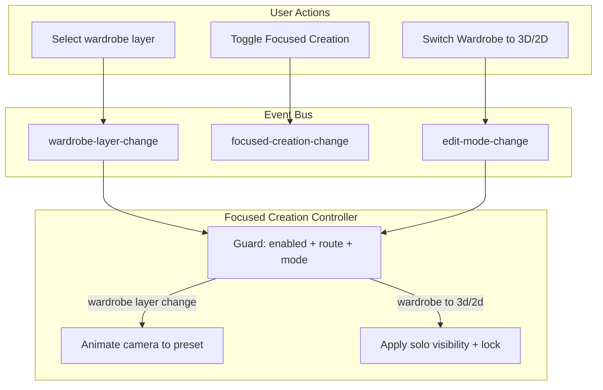

# Focused Creation Mode — Implementation Plan

## Summary

Focused Creation is a toggleable feature that guides the user by:

- **Initial wardrobe entry:** When first entering Creator.Wardrobe, the camera uses the full outfit preview preset (same as Preview when viewing the full skin) instead of the current creator default.
- **Wardrobe mode:** When the user selects a layer (hat, head, jacket, etc.), the camera animates to that part's preset view.
- **Mode transition (wardrobe to 3D/2D):** The camera stays put; the selected layer is soloed (visible, unlocked) and others are hidden/locked.

Default: **ON**. Toggle OFF for experienced users who want full manual control.

---

## Architecture




---

## 1. Events

**File:** [src/events/appEvents.ts](src/events/appEvents.ts)

- Add `app:creator:wardrobe-layer-change` — payload `{ layer: WardrobeLayerKey }`
- Add `app:creator:focused-creation-change` — payload `{ enabled: boolean }`
- Add to `APP_EVENTS` and `CREATOR_EVENTS`
- Add `AppCreatorWardrobeLayerDetail` and `AppCreatorFocusedCreationDetail` types

---

## 2. State

**File:** [src/state/creatorState.ts](src/state/creatorState.ts)

- Add `focusedCreationEnabled: boolean` to `CreatorState` interface (default `true`)
- Initialize in `createCreatorState()`

**File:** [src/creator.ts](src/creator.ts)

- Add `getFocusedCreationEnabled(): boolean` and `setFocusedCreationEnabled(enabled: boolean)` to the public API
- `setFocusedCreationEnabled` publishes `focused-creation-change`
- Optional: persist via `localStorage` key `creator:focusedCreation` on toggle (read on init, write on change)

---

## 3. Wardrobe layer event

**File:** [src/creator.ts](src/creator.ts)

In the `WardrobePartsPanelContext` / context passed to wardrobe parts panel, wrap `setSelectedLayer` so that after calling `wardrobeApi.setWardrobeSelectedLayer(layer)`, it publishes `CREATOR_EVENTS.WARDROBE_LAYER_CHANGE` with `{ layer }`.

Current wiring (around line 312):

```ts
setSelectedLayer: (layer) => wardrobeApi.setWardrobeSelectedLayer(layer),
```

Change to:

```ts
setSelectedLayer: (layer) => {
  wardrobeApi.setWardrobeSelectedLayer(layer);
  publish(CREATOR_EVENTS.WARDROBE_LAYER_CHANGE, { layer });
},
```

---

## 4. Layer visibility API — solo helper

**File:** [src/creator/layerVisibility.ts](src/creator/layerVisibility.ts)

Add `applyFocusedSoloForLayer(layer: string): void` to `LayerVisibilityApi`:

- Set visibility: `setLayer3DVisibleAll` with `{ [k]: k === layer }` for each `LAYER_KEYS`
- Set lock: `setLayer3DLockedAll` with `{ [k]: k !== layer }` (only selected layer unlocked)
- Clear solo-mode state (`clearLayerSoloModes`) to avoid conflicts with Alt-click solo
- Call `publishEvent(CREATOR_EVENTS.LAYER3D_CHANGE)` after updates

**File:** [src/creator.ts](src/creator.ts)

Expose `applyFocusedSoloForLayer` via the layer visibility API used by panels. The `layerVisibilityApi` is created internally; ensure this method is passed through to the Focused Creation controller (or call it from a dependency).

---

## 5. Focused Creation controller

**New file:** `src/controllers/focusedCreationController.ts`

Pattern: mirror [src/controllers/creatorCameraController.ts](src/controllers/creatorCameraController.ts) — subscribe to events, guard, then act.

**Dependencies:**

- `getFocusedCreationEnabled: () => boolean`
- `getRoute: () => string`
- `getEditMode: () => EditMode`
- `getWardrobeSelectedLayer: () => WardrobeLayerKey`
- `creatorPoseController: CreatorPoseController` (for `animateCameraToCreatorView`)
- `applyFocusedSoloForLayer: (layer: string) => void`
- `getPreviewPreset: (key: PreviewPresetKey) => PreviewPreset`
- `getCharacter: (id: string) => CharacterState | undefined`
- `getPrimaryCharacterId: () => string`

**Subscriptions:**

- `WARDROBE_LAYER_CHANGE`: animate camera to preset for that layer (when enabled, route=creator, editMode=wardrobe)
- `EDIT_MODE_CHANGE`: when `previousMode === 'wardrobe'` and `mode === '3d' | '2d'`, apply solo for selected layer and skip any camera snap (when enabled)

**Camera pose from preset:**

- Map `WardrobeLayerKey` to `PreviewPresetKey` (fullOutfit, hat, head, jacket, body, arms, sleeves, pants, legs — 1:1)
- Get preset via `getPreviewPreset(layer)`
- Build `CameraPose`: `position` from `preset.cameraPosition`, `target` from `preset.cameraTarget` (as `THREE.Vector3`)
- Add `char.container.position` to both position and target so the pose stays correct if the character is not at origin
- Call `creatorPoseController.animateCameraToCreatorView(pose)`

**Return:** `{ dispose: () => void }` to unsubscribe on teardown.

---

## 6. applyRoute — initial wardrobe camera uses full outfit preset

**File:** [src/main.ts](src/main.ts)

When transitioning **within creator** (e.g. wardrobe to 3D), `applyRoute` already returns early and does not run the camera snap (lines 325–332). The snap at lines 349–351 only runs when first entering creator. No change needed for mode switches.

**Initial wardrobe entry:** When first entering creator in wardrobe mode with Focused Creation ON, the camera must use the **full outfit preview preset** — the same values used by the Preview route when viewing the full skin — not the current default creator pose.

- Use `getPreviewPreset('fullOutfit')` from [src/viewer/previewPresets.ts](src/viewer/previewPresets.ts)
- Preset values: `cameraPosition: {x:0, y:1.45, z:4}`, `cameraTarget: {x:0, y:1, z:0}`, `fov: 35` (from [src/config/preview/skins/preview.config.json](src/config/preview/skins/preview.config.json))
- Build `CameraPose` from preset (position + target, add `char.container.position` if character is not at origin)
- Set `ctx.camera.fov = preset.fov ?? 35` and `ctx.camera.updateProjectionMatrix()` for consistency with Preview
- When Focused Creation is OFF: keep current behavior (use `getCreatorCameraPose()`)
- When mode is 3d or 2d on first entry: keep current behavior (use `getCreatorCameraPose()`)

**Implementation:** In the `window.setTimeout` block (lines 349–351) that runs the camera snap, add a conditional: if `desiredMode === 'wardrobe'` and `getFocusedCreationEnabled()`, build pose from `getPreviewPreset('fullOutfit')`, apply FOV, then call `snapCameraToCreatorView(pose)`. Else use existing `getCreatorCameraPose()` and `snapCameraToCreatorView()`.

---

## 7. Toggle UI

**File:** [src/viewer/CameraControls.ts](src/viewer/CameraControls.ts)

Add a Focused Creation toggle to the camera toolbar (e.g. before or after the Recenter button):

- Toggle button or icon (e.g. crosshairs / target when ON, unlock when OFF)
- Label: "Focused" when ON, "Free" when OFF; tooltip: "Guided view: camera follows selection. Turn off for full control."
- On click: call `setFocusedCreationEnabled(!current)` (via a context/callback passed to `buildCameraControls`)

**Dependencies:**

- `buildCameraControls` needs `getFocusedCreationEnabled`, `setFocusedCreationEnabled`. These can be passed as parameters or resolved from a shared creator API/module.

**File:** [src/main.ts](src/main.ts) or creator bootstrap

- Pass the getter/setter into `buildCameraControls` (or have CameraControls import from creator if the API is exported).

---

## 8. Bootstrap and wiring

**File:** [src/main.ts](src/main.ts)

- Create `focusedCreationController` with the required deps (same pattern as `creatorCameraController`)
- Call `focusedCreationController` creation during creator bootstrap (e.g. in `initCreator` or where other controllers are created)
- Call `dispose` when leaving creator or on app teardown if applicable

**File:** [src/controllers/index.ts](src/controllers/index.ts)

- Export `createFocusedCreationController` and its type (if needed elsewhere)

---

## 9. Event documentation

**File:** [docs/concepts/EVENT-SYSTEM.md](docs/concepts/EVENT-SYSTEM.md)

- Add `wardrobe-layer-change` and `focused-creation-change` to the event registry table
- List publishers and subscribers for each

---

## File change summary


| File                                           | Action                                                                  |
| ---------------------------------------------- | ----------------------------------------------------------------------- |
| `src/events/appEvents.ts`                      | Add 2 events + types                                                    |
| `src/state/creatorState.ts`                    | Add `focusedCreationEnabled`                                            |
| `src/creator.ts`                               | Add getter/setter, publish on layer change, expose solo API             |
| `src/creator/layerVisibility.ts`               | Add `applyFocusedSoloForLayer`                                          |
| `src/controllers/focusedCreationController.ts` | New controller                                                          |
| `src/viewer/CameraControls.ts`                 | Add toggle button                                                       |
| `src/main.ts`                                  | Instantiate controller, wire deps, pass getter/setter to CameraControls |
| `src/controllers/index.ts`                     | Export controller                                                       |
| `docs/concepts/EVENT-SYSTEM.md`                | Document new events                                                     |


---

## Edge cases and guards

- **fullOutfit:** When selected, use `getPreviewPreset('fullOutfit')` for camera. When transitioning to 3D/2D with fullOutfit selected, do *not* apply solo (all layers visible/unlocked).
- **Guard:** Only react to `wardrobe-layer-change` when `getEditMode() === 'wardrobe'`.
- **Guard:** Only react to `edit-mode-change` when `previousMode === 'wardrobe'` and `mode === '3d' || mode === '2d'`.
- **Guard:** All reactions gated by `getFocusedCreationEnabled()` and `getRoute() === 'creator'`.

---

## Optional: localStorage persistence

If persisting the toggle:

- Read `localStorage.getItem('creator:focusedCreation')` on app init; parse and apply to state (default true if missing/invalid)
- On `setFocusedCreationEnabled`, write to localStorage
- Ensures returning users keep their preference

