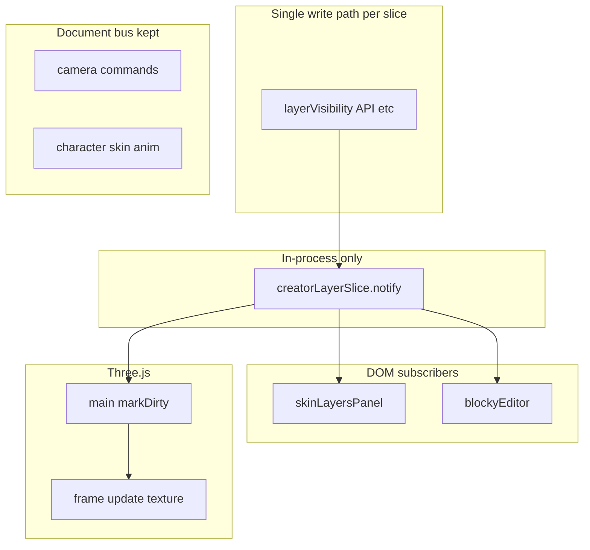

# Observable store + subscribe (single path, narrow event bus)

## Principles (updated)

| Priority | Rule |
|----------|------|
| **Reasoning** | One way to propagate **creator editor state**: **mutate → `notify()` → subscribers**. No “also `publish` just in case.” |
| **Simplicity** | **Document `CustomEvent` bus** is **not** a legacy compatibility layer. After migration, removed events are **gone** from [`appEvents.ts`](src/events/appEvents.ts) / [`EVENT-SYSTEM.md`](docs/concepts/EVENT-SYSTEM.md) (or marked removed with no subscribers). |
| **Narrow bus** | Keep **`publish`/`subscribe` on `document`** only where it is the **clearest** fit—see [Event bus policy](#event-bus-policy-what-stays-on-document). |
| **DOM vs Three.js** | **DOM panels:** `subscribe` on slices. **Three.js:** **pull** in hot paths (`controls`); **one** subscriber that sets **dirty** / applies pose when editor state changes—no per-frame bus. |

This **replaces** the earlier idea of a dual path (in-process + indefinite `publish(LAYER3D_CHANGE)`). Migration is **complete** per event family: either still on the bus by policy, or **fully** on subscribables with **no** duplicate emission.

---

## Event bus policy (what stays on `document`)

**Stay on the document bus** — intentional cross-boundary “commands,” not shared editor state snapshots:

| Events | Rationale |
|--------|-----------|
| **`app:creator:camera-*`** (yaw, pitch, zoom, recenter, move start/end) | **DOM / shortcuts / buttons → Three.js camera controller** is a **command bridge**. Controllers already listen on `document`; keeping one channel for “do this to the orbit rig” is easy to reason about and avoids threading camera deps through every panel. |
| **`app:character:skin-change`**, **`app:character:animation-play`** | **App boundary**: UI, socket, tests, and future tools issue **commands**; [`characterEvents.ts`](src/controllers/characterEvents.ts) is the subscriber. Not the same problem as “panel A and panel B must mirror the same `CreatorState` field.” |

**Move off the document bus** — fan-out where **web UI pieces** must stay in sync with **the same underlying state** (today implemented as many `publish` + `subscribe` pairs):

| Events | Typical subscribers / publishers today | Target |
|--------|----------------------------------------|--------|
| `LAYER3D_CHANGE` | [`layerVisibility.ts`](src/creator/layerVisibility.ts), [`skinLayersPanel.ts`](src/creator/skinLayersPanel.ts), [`main.ts`](src/main.ts), [`blockyEditor.ts`](src/creator/blockyEditor.ts) | **`creatorLayerSlice` `notify()`** only |
| `CURRENT_COLOR_CHANGE`, `SWATCH_*` | swatches, colorPicker, creator | **`creatorColorSlice`** (or one `creatorUi` slice with typed topics—prefer **few files** over many) |
| `EDIT_MODE_CHANGE` | modePanels, pose, wardrobe, etc. | **`creatorModeSlice`** + subscribers (main registers pose/Three side once) |
| `TOOLS_CHANGE` | tool UI sync | same store family |
| `CANVAS_CHANGE` | undo, preview dirty, etc. | **`creatorCanvasSlice`** or shared `notify` from the module that owns pixels |
| `TEXTURE_POSITION_CHANGE` | texture panel, layers highlight | **`creatorHoverSlice`** / pointer slice |
| `SKIN_LOAD_CHANGE` | main, swatches, pose hooks | **slice**; main subscribes like any other listener |
| `LOCK_FEEDBACK` | layers panel wiggle | **One-shot** `notify` with payload on layer slice, or tiny `feedback` callback list—still **not** `document` if everything is in-process |

Implementation detail: **one module** (e.g. `src/state/creatorSubscribers.ts`) can hold **several** `subscribable()` instances (layer, mode, color, canvas, hover) to avoid a forest of files—**as long as** each bucket has a **single** write path and **one** mental model.

---

## Solution summary

1. **`subscribable()`** — [`src/lib/subscribable.ts`](src/lib/subscribable.ts): `subscribe(fn) => unsubscribe`, `notify()`.
2. **Creator slices** — mutate existing [`CreatorState`](src/state/creatorState.ts) (and wardrobe closure) **only** through APIs that call **`notify()`** for that slice. **Do not** `publish` migrated events.
3. **Phase “remove bus usage”** — For each migrated event: find every `publish` and `subscribe`, replace with slice `notify` / `slice.subscribe`, then **delete** the `APP_EVENTS` / `CREATOR_EVENTS` entry and update [`EVENT-SYSTEM.md`](docs/concepts/EVENT-SYSTEM.md).

---

## Phased work

### Phase A — Layer slice + **delete `LAYER3D_CHANGE` from the bus**

- Implement `creatorLayerSlice` + wire [`createLayerVisibilityApi`](src/creator/layerVisibility.ts) to **`notify()` only**.
- Rewire [`skinLayersPanel.ts`](src/creator/skinLayersPanel.ts), [`main.ts`](src/main.ts), [`blockyEditor.ts`](src/creator/blockyEditor.ts) to **`layerSlice.subscribe`**.
- Remove **`publish(..., LAYER3D_CHANGE)`** and all **`subscribe(LAYER3D_CHANGE)`**; remove the constant from [`appEvents.ts`](src/events/appEvents.ts) once unused.

### Phase B — **Bus migration: other creator DOM-fan-out events**

- For each row in [Move off the document bus](#move-off-the-document-bus--fan-out-where-web-ui-pieces-must-stay-in-sync-with-the-same-underlying-state-today-implemented-as-many-publish--subscribe-pairs): implement or extend a slice, move subscribers, **delete** the corresponding `APP_EVENTS` / `CREATOR_EVENTS` entries and `publish`/`subscribe` sites.
- Order by **dependency** (e.g. `EDIT_MODE_CHANGE` before panels that assume mode; `CANVAS_CHANGE` where preview/undo already cluster).
- **Goal:** `CREATOR_EVENTS` (and `APP_EVENTS` creator keys) shrink to **camera + any stragglers** you explicitly keep; editor sync is **only** subscribables.

### Phase C — Wardrobe focus + 2D paint

- Same pattern; **no** `publish` for wardrobe selection or 2D layer selection once panels subscribe to slices.

### Phase D — Home / play (later)

- New buckets using **`subscribable()`**; character/camera bus unchanged unless play mode adds new **command** types (then add **named** bus events, not duplicate state events).

---

## Adaptive recipe (unchanged idea, stricter rule)

1. One **write path** per bucket.
2. After mutation: **`notify()`** for that bucket—**not** `publish` unless the bucket is in [stay on bus](#stay-on-the-document-bus--intentional-cross-boundary-commands-not-shared-editor-state-snapshots).
3. DOM: `subscribe` in panel setup; unsubscribe when panel is torn down.
4. Three.js: pull in controls; **one** dirty subscriber from relevant slice(s).
5. **Removing an event:** grep `publish`/`subscribe` for that string → zero before merging.

---

## Tests

- `node:test` + `tsx`: `subscribable` behavior; slice fires after mutations; **no** `dispatchEvent` spy needed for migrated flows.

## Documentation

- [`docs/concepts/MODELS-AND-SUBSCRIBERS.md`](docs/concepts/MODELS-AND-SUBSCRIBERS.md): **two channels** — (1) **subscribables** = creator editor state, (2) **document bus** = camera commands + character commands (+ future external).
- [`EVENT-SYSTEM.md`](docs/concepts/EVENT-SYSTEM.md): list **only** remaining bus events; removed events documented as “moved to creator slices” with pointer to the new module.
- [`TAXONOMY.md`](docs/concepts/TAXONOMY.md): optional `models` / `state` note for subscribable slices.

## Risks

- **Missed subscriber:** grep-driven migration; add a short checklist per event in the PR.
- **Panel lifecycle:** always pair `subscribe` with teardown when `innerHTML` rebuilds panels.

## Out of scope

- React / R3F / Redux / Zustand.
- Changing camera or character **semantics**—only **transport** clarity (bus vs slice).
- Focused-camera UI beyond **slice + subscribe** hooks.
