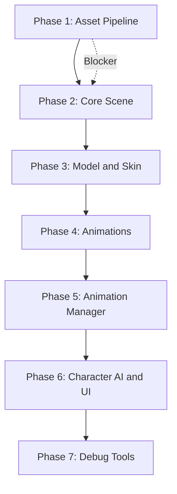

# Three.js to Babylon.js Migration Plan

A lift-and-shift analysis for porting the Minecraft 3D Character Viewer from Three.js to Babylon.js.

---

## 1. Executive Summary

| Aspect | Verdict |
| -------- | --------- |
| **Feasibility** | Feasible but non-trivial |
| **Effort** | Medium–High |
| **Critical blocker** | FBX pipeline — Babylon.js has no built-in FBX loader |
| **Key risk** | Asset conversion (FBX → glTF or .babylon) and animation API mapping |

Migration is achievable but requires an asset conversion pipeline and significant API rewrites in model loading, skin application, and animation control. The logging system and high-level logic (sequences, state machine, trapezoid bounds) are framework-agnostic and can be preserved.

---

## 2. Current Implementation Summary

### 2.1 Renderer

| Aspect | Detail |
| -------- | -------- |
| **File** | [src/main.ts](src/main.ts) L219–245 |
| **API** | `THREE.WebGLRenderer`, antialiasing, PCF soft shadows |
| **Setup** | `shadowMap.enabled`, `shadowMap.type = PCFSoftShadowMap`, pixel ratio capped at 2 |
| **Canvas** | Appended to `#three-canvas-container` |

### 2.2 Camera

| Aspect | Detail |
| -------- | -------- |
| **File** | [src/main.ts](src/main.ts) L225–240 |
| **API** | `THREE.PerspectiveCamera`, `OrbitControls` |
| **Config** | FOV 45°, near 0.1, far 100; position (0, 1.5, Z); target (0, 1, 0) |
| **Params** | `?fov=`, `?cameraZ=` supported |

### 2.3 Trapezoid Bounds (Bounding Region)

| Aspect | Detail |
| -------- | -------- |
| **File** | [src/trapezoidBounds.ts](src/trapezoidBounds.ts) |
| **Logic** | Not a visual AABB — frustum-derived trapezoid in XZ for walk limits |
| **Functions** | `getTrapezoidBounds()`, `clampToTrapezoid()` |
| **Note** | Uses `THREE.Vector3` and camera FOV/aspect; math is framework-agnostic |

### 2.4 Model

| Aspect | Detail |
| -------- | -------- |
| **File** | [src/main.ts](src/main.ts) L450–531 |
| **Loader** | `FBXLoader` |
| **Scale** | 0.01 (FBX exported at centimeter scale) |
| **Hierarchy** | `container` → `model` → `BonesCharacter` (armature root) → skeleton bones |
| **Critical** | Turn clips animate `BonesCharacter.quaternion`; `model.rotation.y` is set separately |

### 2.5 Skin Rendering

| Aspect | Detail |
| -------- | -------- |
| **File** | [src/main.ts](src/main.ts) L377–431, 507–552 |
| **Source** | 64×64 PNG, `MINECRAFT_SKIN_UVS` per body part |
| **Mapping** | `_getMinecraftPartFromMeshName()` maps mesh names to skin regions |
| **Texture** | NearestFilter, ClampToEdgeWrapping, flipY per preset |
| **Materials** | Per-mesh: `map`, `alphaTest`, `transparent`, `DoubleSide` for overlay |
| **Overlay** | `renderOrder = 1` for hat/jacket/sleeves/pants; optional scale 1.03 |
| **Preprocess** | [src/skinPreprocess.ts](src/skinPreprocess.ts) — transparency handling |

### 2.6 Animations

| Aspect | Detail |
| -------- | -------- |
| **Files** | [src/main.ts](src/main.ts), [src/animationManager.ts](src/animationManager.ts) |
| **API** | `THREE.AnimationMixer`, `THREE.AnimationAction` |
| **Flow** | `mixer.update(delta)` in animate loop; `fadeToAction()` cross-fades |
| **Usage** | `LoopRepeat`, `LoopOnce`, `clampWhenFinished`, `reset()`, `time` |

### 2.7 Mixamo Animations (In-Place)

All FBX clips are in-place (no root motion). Downloaded from Mixamo with "Without Skin". Turn clips animate `BonesCharacter.quaternion`; walk clips are start-walking → walking → stop-walking with frame-aligned transitions.

### 2.8 Animation Sequences

| Aspect | Detail |
| -------- | -------- |
| **File** | [src/animationManager.ts](src/animationManager.ts) |
| **API** | `playSequence([steps])` — steps: `animation`, `walkTo`, `pause` |
| **Walk flow** | Turn → start-walking → walking (lerp position) → stop-walking |
| **Turn strategies** | `lerp`, `snap`, `reset` (URL `?turn=`) |
| **Frame sync** | 30 fps; `START_WALKING_FRAMES`, `STOP_WALKING_FRAMES`, `WALKING_START_FRAME` |

### 2.9 State Engine

| Aspect | Detail |
| -------- | -------- |
| **File** | [src/characterAI.ts](src/characterAI.ts) |
| **States** | idle → wandering (after 10s) \| noticing (user activity) → approaching → interacting |
| **Features** | Micro-emotes, procedural head look-at, body turn toward camera |
| **Integration** | Calls `animationManager` for walk, sequences, stop; `update()` each frame |

### 2.10 Animation Loops (Turn, Walk, Emote)

- **Turn:** `playTurnToFace`, left-turn/right-turn clips, turn lerp states
- **Begin to walk:** start-walking clip, transition to walking
- **Walk:** position lerp, `model.rotation.y` updated per frame
- **Walk to stop:** stop-walking clip, transition to idle
- **Emote:** `playAnimationForDuration`, `WANDER_EMOTES`, `IDLE_MICRO_EMOTES`

---

## 3. Three.js vs Babylon.js Benefits

### Stay with Three.js

| Benefit | Detail |
| --------- | -------- |
| **FBX in-place** | Direct FBX loading; no conversion pipeline |
| **Mature Mixamo path** | Mixamo → FBX → Three.js is well documented |
| **No asset changes** | Existing FBX and skins remain as-is |
| **Familiar API** | `Object3D`, `Group`, `Mesh`, `Material`, `Texture` are widely known |
| **Smaller core** | Three.js core is lean; loaders are add-ons |
| **Ecosystem** | OrbitControls, FBXLoader, many examples |
| **AnimationMixer** | Matches current model (actions, crossfade, events) |
| **Invested knowledge** | Turn/walk behavior is already debugged and tuned |

### Move to Babylon.js

| Benefit | Detail |
| --------- | -------- |
| **Inspector** | Built-in scene inspector (`@babylonjs/inspector`) |
| **Tooling** | Babylon.js Editor available |
| **Features** | Physics, particles, GUI, sound built in |
| **WebGPU** | Native WebGPU support |
| **Enterprise** | Used in production by larger teams |
| **Cost** | FBX pipeline change, animation API rewrite |

---

## 4. Problematic Parts (Detailed)

| Severity | Area | Issue | Impact |
| ---------- | ------ | ------- | -------- |
| **Critical** | FBX | Babylon.js has no built-in FBX loader | Must convert all FBX to glTF or .babylon via Blender (or similar) |
| **High** | Animation API | Different model: `Skeleton`, `AnimationGroup` vs `AnimationMixer` | Crossfade, loop modes, events must be reimplemented |
| **Medium** | BonesCharacter | Converted rigs may change bone names | `findBonesCharacter`, `getBonesCharacterYawDeg`, `resetBonesCharacter` need remapping |
| **Medium** | Skin mapping | `_getMinecraftPartFromMeshName` relies on mesh names | May need mapping table for new mesh names |
| **Low** | Raycasting | 3D painting uses `THREE.Raycaster` | Babylon: `scene.pick()` with different API |
| **Low** | OrbitControls | No direct equivalent | Babylon: `ArcRotateCamera` with different API |
| **Low** | Trapezoid math | Uses `Vector3` | Replace with Babylon `Vector3` or keep math, swap types |

---

## 5. Logging Integration

The logging system is **framework-agnostic** and requires no changes.

| Aspect | Detail |
| -------- | -------- |
| **File** | [src/logger.ts](src/logger.ts) |
| **Dependencies** | No Three.js imports; uses `console`, `fetch`, `performance`, `localStorage`, URL params |
| **Instrumentation** | Same calls: `logger.info('animation', 'Walk start', {...})` etc. |
| **Server relay** | Unchanged |
| **Systems** | `animation`, `stateMachine`, `messaging`, `position`, `renderer`, `input`, `general` |

See [docs/LOGGING-IMPLEMENTATION.md](docs/LOGGING-IMPLEMENTATION.md) for integration details.

---

## 6. Debug Tools vs Babylon.js

### Current Custom Debug Tools

| Tool | Purpose | Three.js-specific? |
| ------ | --------- | -------------------- |
| Isolated test page | Turn/walk without characterAI | Uses `getCharacter`, `animationManager`, camera |
| Pause / step frame | Freeze loop, advance one frame | `mixer.update()`, `animationManager.tick()` |
| Debug overlay | model.rotation.y, active action, turnLerp, etc. | `char.model`, `char.currentAction`, `getDebugState()` |
| Turn strategy | lerp / snap / reset | Pure logic |
| Walk to waypoint | Manual walk targets | `animationManager.walkTo()` |

### Babylon.js Inspector

- Scene graph, properties, materials, textures, skeletons, performance
- `ShowInspector(scene)` — separate from custom overlay
- Does **not** expose turn/walk/sequence state; use custom overlay for that

### Compatibility

| Current tool | Babylon equivalent | Works same? |
| -------------- | -------------------- | ------------- |
| Isolated test page | Same concept | Yes — rewire to Babylon scene/character |
| Pause / step | Same concept | Yes — Babylon has `scene.paused` |
| Debug overlay | Custom | Yes — keep overlay, change data sources |
| Turn strategy | Logic | Yes — unchanged |
| Walk to waypoint | Same | Yes — rewire `walkTo` calls |

**Recommendation:** Add `@babylonjs/inspector` for general scene debugging; keep custom overlay for turn/walk/sequence state. See [docs/DEBUG-TOOLS-IMPLEMENTATION-SPEC.md](docs/DEBUG-TOOLS-IMPLEMENTATION-SPEC.md).

---

## 7. Migration Phases



### Phase 1: Asset Pipeline (Blocking)

1. Define Mixamo FBX → glTF workflow (see [Section 11: Batch Conversion Options](#11-batch-conversion-options))
2. Use FBX2glTF or Blender Python to batch-convert model + 38 animations
3. Validate skeleton and clips in a minimal Babylon scene

### Phase 2: Core Scene

1. Replace `WebGLRenderer` with Babylon `Engine` + `Scene`
2. Replace `PerspectiveCamera` + `OrbitControls` with `ArcRotateCamera`
3. Add lights and ground plane

### Phase 3: Model and Skin

1. Load model via Babylon loaders
2. Apply skin texture (StandardMaterial or PBRMaterial)
3. Port mesh-name mapping and UV logic
4. Implement overlay rendering (renderingGroupId, scale workaround)

### Phase 4: Animations

1. Implement crossfade/blending equivalent of `fadeToAction`
2. Map turn, walk, and emote clips to Babylon animation groups
3. Wire into render loop (e.g. `scene.onBeforeRenderObservable`)

### Phase 5: Animation Manager

1. Port `trapezoidBounds.ts` (math unchanged; swap Vector3)
2. Port `animationManager` (walkTo, playTurnToFace, sequences)
3. Port `getDebugState()`, turn strategies

### Phase 6: Character AI and UI

1. Port `characterAI` (state machine, head look-at, body turn)
2. Port 3D painting (raycast → UV) using `scene.pick`
3. Reattach creator, controls, sequences, socket logic

### Phase 7: Debug Tools

1. Add `@babylonjs/inspector` for scene inspection
2. Update test controls for Babylon camera/character
3. Update debug overlay to read from new scene graph

---

## 8. Recommendation

| Scenario | Recommendation |
| ---------- | ---------------- |
| **Prioritize FBX workflow, low risk, minimal effort** | Stay with Three.js |
| **Prioritize Inspector, WebGPU, or advanced features** | Migrate to Babylon.js if asset conversion work is acceptable |

---

## 9. Out of Scope

- Physics
- WebGPU-specific implementation
- Creator UI layout changes
- Babylon-only features (e.g. post-processing)
- Multi-character expansion

---

## 10. Dependencies

| Dependency | Purpose |
| ------------ | --------- |
| FBX2glTF (recommended) | Batch FBX → glTF without Blender; see Section 11 |
| Blender (optional) | FBX → glTF if Blender-specific processing needed |
| `@babylonjs/core` | Core engine and loaders |
| `@babylonjs/loaders` | glTF loader |
| `@babylonjs/inspector` | Debug inspector |
| Conversion scripts | `scripts/convert-fbx-to-gltf.js` or `.sh` |

---

## 11. Batch Conversion Options

Batch conversion of FBX to glTF is feasible. The project has **38 animations** and **1 base model** (see [public/animations/index.json](public/animations/index.json)). Two approaches:

### 11.1 FBX2glTF (Recommended — No Blender)

[FBX2glTF](https://github.com/facebookincubator/FBX2glTF) is a command-line tool that converts FBX to glTF 2.0. No Blender required.

| Aspect | Detail |
| -------- | -------- |
| **Binaries** | Prebuilt for Windows, macOS, Linux |
| **Single file** | `FBX2glTF --binary -i input.fbx -o output` |
| **Output** | `.glb` (binary) or `.gltf` (JSON) |
| **Options** | `--binary`, `--draco`, `--embed`, `--pbr-metallic-roughness` |

**Batch script (Bash):**
```bash
for f in public/animations/*.fbx public/models/*.fbx; do
  [ -f "$f" ] || continue
  out="${f%.fbx}.glb"
  FBX2glTF --binary -i "$f" -o "$out"
done
```

**npm package:** `fbx2gltf` provides a Node.js wrapper for programmatic batch conversion. Integrate with a script similar to [scripts/generate-animations-manifest.js](scripts/generate-animations-manifest.js) to iterate `.fbx` files and convert.

### 11.2 Blender Python (Headless)

If Blender-specific processing is needed (e.g. custom rig adjustments), use Blender in background mode:

```bash
blender --background -P convert_fbx_to_gltf.py
```

**Sample script (`convert_fbx_to_gltf.py`):**

```python
import bpy
import os

anim_dir = "public/animations"
model_dir = "public/models"
out_anim = "public/animations_gltf"
out_model = "public/models_gltf"
os.makedirs(out_anim, exist_ok=True)
os.makedirs(out_model, exist_ok=True)

for d, out in [(anim_dir, out_anim), (model_dir, out_model)]:
    for f in os.listdir(d or "."):
        if not f.lower().endswith(".fbx"): continue
        path = os.path.join(d, f)
        bpy.ops.wm.read_homefile()
        bpy.ops.import_scene.fbx(filepath=os.path.abspath(path))
        out_path = os.path.join(out, f.replace(".fbx", ".glb"))
        bpy.ops.export_scene.gltf(export_format="GLB", filepath=os.path.abspath(out_path))
```

### 11.3 Recommendation

| Approach | When to use |
| ---------- | ------------- |
| **FBX2glTF** | Default — no Blender dependency, fast, CI-friendly |
| **Blender Python** | When Blender-specific edits or rig fixes are required |

Add a `scripts/convert-fbx-to-gltf.js` (or `.sh`) that uses FBX2glTF to batch-convert `public/animations/*.fbx` and `public/models/*.fbx` to `public/animations/*.glb` and `public/models/*.glb`, and update Phase 1 to run it before validation.

---

## Related Docs

- [docs/LOGGING-IMPLEMENTATION.md](docs/LOGGING-IMPLEMENTATION.md) — Logger usage
- [docs/LOGGING-ARCHITECTURE.md](docs/LOGGING-ARCHITECTURE.md) — Logger spec
- [docs/DEBUG-TOOLS-IMPLEMENTATION-SPEC.md](docs/DEBUG-TOOLS-IMPLEMENTATION-SPEC.md) — Debug tools
- [docs/ANIMATION-AND-MOVEMENT-GUIDE.md](docs/ANIMATION-AND-MOVEMENT-GUIDE.md) — Turn, walk, facing
- [docs/TROUBLESHOOTING.md](docs/TROUBLESHOOTING.md) — Debug modes
